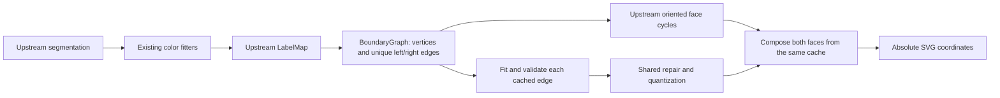

# Stage 1.2B — locked shared-edge composition

## Status

Implemented on `feat/stage-1-2b-locked-shared-edges`, based on Stage 1.2 commit
`53cafd5cd977dbb06874c79c825f87d1c8eb2f1a`. Main remains unchanged. Select
**Shared edge · locked graph (eksperimental)** in the contour profile menu.

**Geometric shared-edge gates pass on the regression corpus. Universal visually
seamless SVG rendering does NOT pass.** Abutting vector fills can still produce
antialias hairlines in a renderer even when their boundaries are identical. The
report distinguishes that defect from actual geometric cracks. No stroke, underpaint,
background flattening, embedded raster, preview patch or forced color merge is used.
The new route is explicit; Auto retains Stage 1.2 behavior pending further review.

## Confirmed root causes and architecture audit

Reviewed `engine/src/lib.rs`, upstream `config.rs`, `pipeline.rs`, `compose.rs`,
`mosaic/{graph,face,fit,compose}.rs`, `fitter.rs`, `ir/{region,vector}.rs`, `simplify.rs`,
`optimize.rs`, `svg.rs`, adapter routing, and existing browser quality gates. Some
requested directories are single Rust modules in this upstream revision.

1. `Config::default` uses ColorCluster + `Hierarchical::Stacked`. `compose_stacked`
   calls `fit_region` independently per layer; the project `RegionFitter` also selects
   fitting per component. Painter overlap is part of that old representation, not
   proof of a numerical overlap bug.
2. `Hierarchical::Cutout` already maps to `Compositing::Mosaic`. Upstream
   `LabelMap::from_segmentation` flattens the actual upstream layer masks;
   `BoundaryGraph::extract` creates unique grid chains with left/right ownership and
   junction nodes. `face::assemble` makes oriented face cycles, including holes,
   islands and diagonal pinch contacts. `compose_mosaic` fits each chain once, applies
   curve passes once, and emits exact reversed geometry for its neighbor. These are
   real implemented capabilities, not inferred from the name “Cutout”.
3. Stage 1.2 Auto does not always choose this route. In particular, sharp flat art
   typically uses the stacked adaptive fitter; blended opaque input may use
   Watershed/Mosaic. Explicit old `shared` uses Mosaic, spline, simplification .25px
   and the upstream color-distance merge threshold.
4. Stage 1.2 `coverage::refine` executes **after** paths have been composed and
   optimizer coordinates quantized. Shared-edge identity is no longer represented
   in VectorDoc, so independent anchor changes can separate the two copies. The
   production tests demonstrate cracks on curved/organic/ring/rounded fixtures.
5. Geometry refined after quantization is written with rounded relative deltas.
   Those deltas can accumulate differently when the same boundary is reversed.
   For example, with two successive deltas .014 at precision 2, relative output
   reaches .02, whereas absolute rounding of .028 reaches .03. This integration
   hazard applies to unquantized post-refinement geometry; it does not establish
   a bug in the upstream writer's already-quantized input contract. The new writer
   uses shared coordinates rounded once before composition, absolute commands,
   six decimal places, and no subsequent per-face optimizer/refiner. No SVGO or
   roundcoords pass follows it.
   Separately, old Mosaic's JPEG primitive-match score below 1 is caused by collinear
   subdivision differences after CleanupPass, not demonstrated geometric drift.
   Inspection found, for example, [53,32]→[51,32] versus two matching intervals split
   at [52,32]. Upstream shared geometry was already correct there.
6. Upstream Mosaic fitting guarantees reuse but not a checked global planar
   embedding. Its spline `FIT_ERROR = 10.0` and closed-ring smoothing can exceed a
   conservative local corridor. Curve simplification is already per edge upstream;
   it must not be blamed for independent fitting that it does not perform.
7. A second, separate cause survives correct geometry: SVG source-over compositing
   of independently antialiased abutting fills. At complementary coverage .5/.5,
   output alpha is `.5 + .5*(1-.5) = .75`, not 1. Real Chromium alpha deficits below
   document opaque coverage remain in the new screenshots. Geometry cannot alone
   guarantee a renderer's coverage-compositing semantics.

## Topology-first implementation



`engine/src/planar.rs` is a constrained composition layer over upstream, not a new
tracing frontend. It does not infer labels from RGB or reimplement boundary tracing.
Only identical adjacent paints are merged (`merge_similar(0)`). Palette fitting
still uses the existing preset budgets (8/24/64); that preexisting limitation remains.

The existing upstream structures store a segment once, including `left`, `right`,
`start`, `end`, polyline and first/last directions. Nodes carry incident directed
segment references. Faces carry oriented segment cycles. New checks verify expected
left/right incidence, one use per non-OUTSIDE side, and exact cycle connectivity.
OUTSIDE covers the frame/keyed transparency; touching diagonal labels retain the
upstream's documented pinch/8-connectivity convention rather than inventing a merge.

The initial fit is the upstream `SplineSegmentFitter`, length threshold 2px. Rejected
fits are retried as bounded open pieces of the **same edge**, each using that same
fitter with pinned endpoints; the final chain is cached once for both faces. This
is adaptive geometric fitting, not multiple segmentations or an online preset search.
Recursion is capped at eight levels and stops splitting at eight lattice points.
Polygon/pixel representations remain conservative fallbacks. There is no independent
post-composition coverage refinement or simplification on this route.

Coordinates are quantized once to 1e-6px on the shared cache and then validated.
Checks include finite coordinates, frame containment, closed rings, pinned junctions,
continuous cubic chains, ring orientation and sampled distance in **both** directions
between the fitted edge and its original crack chain (maximum 1px on large chains; .75px when the chain bounding-box extent is <=16px). This guards
shortcuts across thin features. Adaptive cubic flattening uses .002px flatness for
intersection checking. A spatial grid checks non-adjacent intersections/contacts,
including self intersections; only declared junction contacts and ring closure are
allowed. Offending edges revert in the shared cache, followed by rechecking. If
repair or the validation budget is exhausted, the entire graph reverts to the
original upstream integer pixel representation. It never silently exports a detected
invalid fitted embedding. Pixel fallback preserves topology but can look jagged.

These are floating-point, tolerance-based validation checks, **not an exact algebraic
proof that every possible cubic contact is excluded**. Sub-tolerance degeneracies
remain a limitation. The source preflight caps total grid cracks, including the
frame, at 65,536 before graph construction; flattened checks are bounded to 32,769
points/edge, 150,000 line pieces and 2,000,000 candidate comparisons. Too-complex
input returns an actionable error or uses the documented raw-graph fallback.

The only upstream source patch exposes the existing face assembler and extracts
`compose_fitted` from the original composer for reuse. Existing composition behavior
is preserved; all 31 upstream unit tests pass. Provenance is updated in
[UPSTREAM_LOCKFILE.md](UPSTREAM_LOCKFILE.md); upstream remains
`e71343fbcbf469b8a72a255030408a39939162eb`, VTracer 1.0.0-alpha.4, retained MIT grant,
visioncortex 0.9.3, flo_curves 0.8.0. No new dependency is introduced.

## Metric definitions and benchmark protocol

Original CC0 source SVGs and supersampled PNG/JPEG/WebP fixtures live in
`tests/fixtures/shared-edge/`. Ten sources × Stage 1.2 Auto / old Mosaic / locked
planar = 30 actual browser conversions and downloaded SVGs. Raster-vs-vector metrics
use independent sharp/libvips rendering. All comparisons use the same source, size
and preset. Original compressed raster is used for codec color errors, so compression
artifacts are not incorrectly charged as deviation from a clean PNG.

- **Boundary coincidence:** parse the exported SVG, normalize absolute commands,
  canonicalize drawing primitives including reversed cubic control points at 1e-6px.
  Every interior primitive in these fully covered fixtures must have exactly one
  reversed match in another face. Canvas frame primitives are excluded. This is
  segment equality, not a screenshot or proximity test. This metric assumes full
  opaque partitions; it is not misapplied to transparency or legitimate exterior holes.
- **Geometric gaps/overlap:** independent scanline nonzero winding at four subpixel
  sites/pixel. Each shared cubic is flattened once to .0001px and reused reversed;
  points within 1e-6 of a crossing are counted separately as boundary samples.
  An opaque fixture must have exactly one containing face. These finite samples
  are not a proof that arbitrarily small defects cannot exist; coincidence and
  native incidence/intersection checks provide separate evidence.
- **Renderer hairlines:** actual Chromium SVG Image → canvas pixels at 100%, 400%
  and 1000%. Count alpha <250, excluding a one-source-pixel outer frame, and record
  maximum alpha deficit. They are not relabeled as geometric gaps or hidden under white.
- **Drift:** native sampled bidirectional edge-vs-label-crack maximum, plus color
  reconstruction error. It measures departure from segmentation, not certainty about
  the true antialiased design edge. Existing silhouette contour metrics cannot identify
  all internal edges in an opaque full-canvas partition; no such claim is made.
- **Features:** organic eye/eye/nose IoU in known CC0 source ROIs, dark-color distance
  <70, enforced >=.90 for the new output; existing cat/alpha/line-art/photo gates run.
- **Validity:** graph incidence, closed cycles, ring winding and checked crossing
  counts, plus strict editable SVG validation. Path count is descriptive only.

Golden metric tests inject a known 1px gap and overlap and require 64 affected samples
for a 16px fixture. A deliberately changed cubic control point must fail coincidence.
Initial Canvas `isPointInPath` tests produced two false overlap classifications for
exactly reversed rounded curves, even outside a tiny stroke tolerance. The metric was
replaced by the independent canonical scanline implementation rather than increasing
an overlap acceptance allowance. Renderer pixels remain measured separately.

## Measured topology and color results

Four samples/source pixel; all new incidence errors and checked crossings after repair are zero. Old overlap on lossy Auto includes intentional painter layers. It is not all categorized as a bug.

| Fixture | Geometric gap old → new | Overlap old → new | Exact primitive matches Auto / old Mosaic / locked | RGBA MAE old → new | Locked drift px | Full pixel fallback |
|---|---:|---:|---|---:|---:|---|
| curve.png | 11 → 0 | 14 → 0 | 0.105 / 1.000 / 1.000 | 0.757 → 0.790 | 0.945 | no |
| junction.png | 0 → 0 | 0 → 0 | 0.667 / 1.000 / 1.000 | 0.582 → 0.361 | 0.000 | no |
| organic.png | 29 → 0 | 28 → 0 | 0.400 / 1.000 / 1.000 | 1.634 → 1.631 | 0.993 | no |
| rings.png | 58 → 0 | 14 → 0 | 0.182 / 1.000 / 1.000 | 1.730 → 2.043 | 0.903 | no |
| rounded.png | 19 → 0 | 7 → 0 | 0.313 / 1.000 / 1.000 | 1.292 → 1.590 | 0.970 | no |
| diagonal.png | 0 → 0 | 7 → 0 | 0.000 / 1.000 / 1.000 | 0.670 → 0.856 | 0.760 | no |
| thin.png | 0 → 0 | 0 → 0 | 0.879 / 1.000 / 1.000 | 1.169 → 0.718 | 0.949 | no |
| pinch.png | 0 → 0 | 0 → 0 | 1.000 / 1.000 / 1.000 | 0.309 → 0.569 | 0.000 | no |
| curve.jpg | 0 → 0 | 33748 → 0 | 0.000 / 0.941 / 1.000 | 1.407 → 1.378 | 0.000 | YES |
| curve.webp | 0 → 0 | 32977 → 0 | 0.000 / 1.000 / 1.000 | 1.171 → 1.264 | 0.981 | no |

The new corpus has **zero unmatched interior drawing primitives**, not merely similar contours. Old scores can underestimate geometric coincidence when a straight interval is split differently: old Mosaic JPEG .941 is such a case, not proof of a gap. The `crossingsBefore` field counts affected edges, not exact intersection points; budget fallbacks have a separate flag. Some repair fallbacks preserve lattice fragments within an otherwise smooth edge.

| Fixture | Vertices / edges / faces | Shared edges / contours | Repair events | Paths / explicit endpoints / controls old → new | SVG bytes old → new | Trace ms old → new |
|---|---|---|---:|---|---|---|
| curve.png | 2/3/2 | 1/2 | 0 | 4/48/80 → 2/56/108 | 1323 → 2988 | 32.8 → 35.7 |
| junction.png | 4/6/3 | 3/3 | 0 | 4/21/14 → 3/16/14 | 449 → 473 | 18.2 → 20.5 |
| organic.png | 0/5/5 | 4/9 | 3 | 9/143/236 → 5/289/560 | 3711 → 11617 | 13.9 → 49.3 |
| rings.png | 0/4/4 | 3/7 | 1 | 14/141/208 → 4/155/296 | 3626 → 8301 | 14.1 → 63.4 |
| rounded.png | 0/2/2 | 1/3 | 0 | 8/93/152 → 2/105/204 | 2455 → 5969 | 12.3 → 66.1 |
| diagonal.png | 2/3/2 | 1/2 | 0 | 2/72/140 → 2/72/140 | 2120 → 3052 | 32.3 → 20.6 |
| thin.png | 0/2/2 | 1/3 | 0 | 9/105/144 → 2/23/40 | 2334 → 751 | 11.4 → 13.5 |
| pinch.png | 5/8/4 | 4/4 | 0 | 8/48/48 → 4/20/16 | 828 → 558 | 11.3 → 12.3 |
| curve.jpg | 40/61/22 | 54/23 | 29 | 22/167/290 → 22/1865/0 | 4137 → 12132 | 23.9 → 41.4 |
| curve.webp | 19/29/11 | 26/11 | 9 | 10/84/148 → 11/300/508 | 2126 → 10794 | 17.8 → 23.7 |

Counts are literal SVG coordinates, not unique editable nodes. Repair events can revisit an edge. Trace timing includes diagnostics/segmentation/graph/opacity/serialization, excludes image decode and worker initialization, and is a single desktop observation. It is not a latency guarantee.

## Renderer coverage at three zooms

| Fixture | Alpha-deficit pixels at 100% old → new | 400% old → new | 1000% old → new | Maximum new deficit at 1000% (0–255) |
|---|---|---|---|---:|
| curve.png | 139 → 140 | 519 → 556 | 1388 → 1380 | 65 |
| junction.png | 0 → 0 | 220 → 0 | 585 → 0 | 0 |
| organic.png | 369 → 289 | 1747 → 1222 | 4533 → 3085 | 65 |
| rings.png | 494 → 440 | 2070 → 1890 | 5572 → 4805 | 67 |
| rounded.png | 337 → 332 | 1811 → 1292 | 4840 → 3234 | 65 |
| diagonal.png | 154 → 138 | 559 → 601 | 1229 → 1488 | 64 |
| thin.png | 283 → 3 | 1606 → 12 | 4044 → 30 | 64 |
| pinch.png | 0 → 0 | 0 → 0 | 0 → 0 | 0 |
| curve.jpg | 0 → 0 | 0 → 0 | 0 → 0 | 0 |
| curve.webp | 0 → 190 | 0 → 792 | 0 → 1981 | 71 |

These remaining nonzero deficits are **not PASS for universal visual gaplessness**. The old curves can expose fully transparent cracks (deficit 255). New matched boundaries remove that geometric defect while retaining renderer-dependent AA hairlines. JPEG pixel fallback eliminates AA at grid-aligned integer zooms but is visibly less smooth. WebP can introduce hairlines where old painter overlap hid them.

Organic feature IoU, eye / eye / nose: **0.93590 / 0.93590 / 0.86486 → 0.96203 / 0.96203 / 1.00000**. All three new gates >=.90 pass. Small eyes can still look faceted at high zoom; feature area IoU alone is not smoothness certification.

## Scaled/alpha browser evidence

| Fixture | Silhouette IoU | Alpha MAE | Decode / startup ms | Segmentation ms | Downstream ms | Alpha subset ms | SVG export subset ms | Total trace ms | WASM linear MiB | SVG bytes |
|---|---:|---:|---|---:|---:|---:|---:|---:|---:|---:|
| quality/cat-128-partial.png | 0.98976 | 1.397 | 23.0 / 13.9 | 5.6 | 151.0 | 29.5 | 1.9 | 179.5 | 1.50 | 9857 |
| quality/cat-512-opaque.png | 0.99716 | 0.299 | 20.1 / 0.0 | 32.4 | 271.8 | 0.7 | 5.8 | 327.8 | 7.44 | 43380 |
| quality/cat-1024-partial.png | 0.99838 | 0.222 | 29.3 / 0.0 | 91.7 | 1393.4 | 967.9 | 3.4 | 1548.2 | 22.75 | 63304 |

The explicit partial-alpha 128px >=.980 target passes on the new route as well as retained Auto. Alpha and export timings are **subsets** of downstream, not additional totals. Downstream includes color fitting/graph construction/validation/repair as well as RGB fitting, so it is not labeled as pure spline CPU time. The first scaled trace has a cold worker; subsequent traces reuse it. Larger alpha contours still dominate 1024px runtime.


## Visual comparisons

Reproduce with `node scripts/shared-edge-screenshots.mjs` after browser tests. It emits
30 full-width screenshots: original raster | previous Stage 1.2 Auto SVG | locked graph
SVG, at 100%, 400% and 1000% for every fixture. The checkerboard is a common viewer
background, never paint added to an export. Examples (generated and ignored by Git):

- `../benchmark-results/shared-edge/curve.png-100.png`, `-400.png`, `-1000.png`
- `../benchmark-results/shared-edge/organic.png-100.png`, `-400.png`, `-1000.png`
- `../benchmark-results/shared-edge/rings.png-100.png`, `-400.png`, `-1000.png`
- `../benchmark-results/shared-edge/curve.jpg-100.png`, `-400.png`, `-1000.png`

GitHub CI archives these PNGs, the downloaded SVGs and raw metrics in
`stage-01-evidence`. Raw generated scores and screenshots are intentionally not
committed. The tables here summarize actual observations, as requested.

## Failed experiments, regressions and limitations

- Merely switching to old Cutout is insufficient: it does not repair existing Auto
  routing, post-composition refinement or unchecked fitted intersections.
- Unconstrained independent coverage refinement after graph composition is rejected
  for the locked route. A future AA-aware graph refinement must operate on the
  shared cache with constrained vertices and revalidation.
- Immediate polygon/pixel fallback after a failed bidirectional drift check made
  too many otherwise smooth edges stair-stepped. Bounded open-piece upstream spline
  fitting retains more smooth geometry. A uniform 1px experiment then failed the
  unchanged >=.90 feature gate (one feature IoU .88095). The final scale-aware
  guard retains .75px for chains <=16px and permits 1px for larger contours; all
  feature, coincidence, gap/overlap and alpha acceptance thresholds remain intact.
  The tighter .75px run and screenshot are retained under the ignored
  benchmark-results/shared-edge/tight-drift/ directory for comparison.
- JPEG regions can still require full pixel-graph fallback. This is topology-safe,
  not a smooth-curve success. Compression-created small regions remain; they are not
  forcibly merged away. Distinct adjacent paint colors can retain small islands.
- Some color errors and silhouettes are worse than Auto even though boundaries match.
  An exact graph partitions the labels it receives; it cannot recover lost details
  or correct a poor segmentation on its own. No universal Vector Magic parity claim.
- Source-over antialias hairlines remain at high zoom. Therefore **full visual-gapless
  acceptance is FAIL / incomplete**, and this mode is not promoted to Auto. Strokes,
  underpainting, crisp-edge tricks, preview CSS and raster embedding were not added.
- Partial alpha retains the existing quantized vector-mask approach, not continuous
  alpha or general translucent-photo certification. Mask contours are separate opacity
  level sets, not adjacent color faces. True transparent holes must remain transparent.
- Physical Android, peak total process memory and real vector-editor compatibility
  are NOT VERIFIED. WASM memory is not total JS/browser RSS. Desktop observations
  and device emulation do not certify mobile performance.

## Files changed and reproduction

- Rust: `engine/src/planar.rs`, `engine/src/lib.rs` (routing, real topology evidence).
- Small upstream API patch: `vendor/vtracer/src/mosaic.rs`, `mosaic/compose.rs`.
- Client: adapter/types/diagnostics/input and UI profile/diagnostics. Worker lifecycle,
  object URL ownership and original alpha/Photo/Auto routes remain unchanged.
- Evidence: shared-edge fixture generator, metric definitions/types, screenshot tool,
  unit tests, browser topology/alpha/runtime gates and CC0 fixtures.
- Both CI definitions, README, upstream provenance and this report.

```bash
npm ci
node scripts/shared-edge-fixtures.mjs
cargo test --manifest-path engine/Cargo.toml --locked
cargo test --manifest-path engine/Cargo.toml --locked -p vtracer --lib
npm run build:wasm
npm run lint
npm run typecheck
npm run test
npm run build
npm run test:e2e
node scripts/shared-edge-screenshots.mjs
```

This instance sets `NEXORA_TEST_PORT=4174` and
`NEXORA_CHROMIUM_PATH=/usr/bin/chromium`; CI installs Playwright Chromium. Real
cancellation terminates the worker, including graph fitting; no new backend, upload,
secret, subscription or runtime candidate sweep is introduced. The warm worker
continues to be reused.

## Validation, GitHub and review

- Local PASS: 10 project Rust tests, 31 upstream Rust tests, 32 TypeScript tests,
  13 real Chromium browser tests, WASM production build, static build, lint and typecheck.
- Quality PASS: exact shared geometry and sampled geometric partition gates on the
  ten-source corpus; feature and partial-alpha gates retained.
- Quality FAIL / incomplete: universal visually seamless/smooth output at high zoom.
- GitHub: implementation commit `1ef5afd40a1a8864747ffd85934848edecb68bde` pushed.
  Initial [CI run 40117710537](https://github.com/akidwush/vector-magic-bydika/actions/runs/40117710537)
  failed. Local success is not claimed as remote success. Authenticated logs/PR API
  returned Forbidden; validation log summaries are added to diagnose the failed run.
  Draft PR creation failed with `Post https://api.github.com/graphql: Forbidden`.
  No PR exists and main is not merged. This branch stacks on the pending Stage 1.2
  coverage branch; both need review before main. The
  [PR creation link](https://github.com/akidwush/vector-magic-bydika/compare/feat/stage-1-2-subpixel-coverage...feat/stage-1-2b-locked-shared-edges?expand=1)
  is a comparison/creation page, not an existing PR.
  GitLab execution and physical Android remain NOT VERIFIED.

Implementation includes self-review of edge ownership, oriented reverse serialization,
quantization, feature bounds, topology repair and resource limits. Independent review
is still required before merge. Main is intentionally unchanged; no force push.
