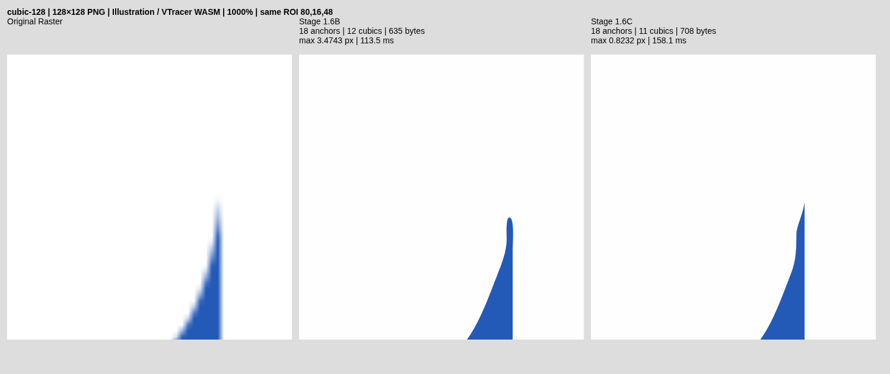
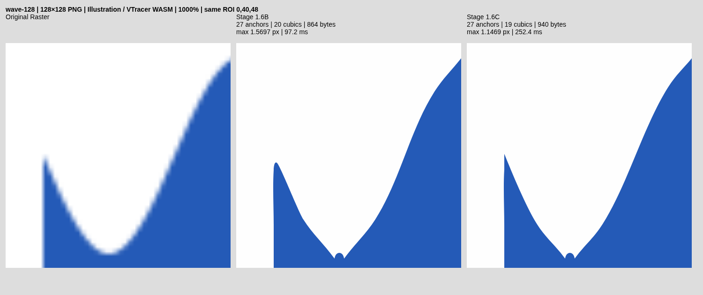

# Stage 1.6C — low-resolution source geometry recovery

**Primary Cubic 128/512 recovery: PASS. Broader geometric quality: PARTIAL. Experimental only.**

Cubic's missing acute tip is corrected in the actual exported SVG at both lower
resolutions. Wave 128's corner and maximum error improve, but its p95 barely
changes and eight pre-existing false G0 turns remain. Some held-out narrow shapes
remain visibly defective. This is not a claim of complete vectorization quality,
1/16–1/64px reconstruction, or Vector Magic equivalence.

## Git baseline and delivery

- Base: `feat/stage-1-6b-recovery`, verified `564b643d53ecc5897f6c3b8a0174ccd807c47dcd`.
- Implementation: [`f67cdb36b61083bc21297e8c46d44ac6f7595ca6`](https://github.com/akidwush/vector-magic-bydika/commit/f67cdb36b61083bc21297e8c46d44ac6f7595ca6).
- Follow-up branch: `feat/stage-1-6c-low-resolution-geometry`; no merge to main.
- Three historical comparators remain: Stage 1.5 `6084faffbd18313c80b7d4bc8bec349dd88b63c8`,
  Stage 1.6 `db06a032f7180f349b275ef3801854c048bb674d`, and verified Stage 1.6B above.
- GitHub implementation workflow: **PASS**, completed 2026-10-26 in 8m54s; [exact-commit run 40277732397](https://github.com/akidwush/vector-magic-bydika/actions/runs/40277732397). All 33 reported workflow steps completed successfully.

All measurements below use original PNG bytes and final exported SVGs. The
reference SVGs are used only by offline measurement, never passed to the engine.
Local evidence was generated on 2026-10-26 with Rust 1.99.1, wasm-bindgen 0.2.126,
Node 24.19 and installed Chromium on this cloud Linux machine.

## Confirmed initialization failures

The three primary failures were **not** caused by too few source samples, alpha,
gamma ambiguity, initial raw-mask rejection, or serialization rejecting an
otherwise valid correction. They stopped before candidate fitting at the
existing `before < 0.008` aggregate source-loss guard:

| Fixture | Initial mean loss | Samples / trusted | Raw chain points | Pre-reducer cubics | Stage 1.6B outcome |
|---|---:|---:|---:|---:|---|
| Cubic 128 | 0.003957732 | 1528 / 1528 | 385 | 14 | no trusted initialization |
| Cubic 512 | 0.004782971 | 5667 / 5667 | 1547 | 34 | no trusted initialization |
| Wave 128 | 0.003462079 | 1997 / 1997 | 483 | 23 | no trusted initialization |

A mostly accurate long contour makes global average loss small while its acute
cap is several pixels short. Thresholded segmentation and the initial spline
round the narrow, low-coverage tip. The final path has a smooth cap instead of a
true G0 corner. Increasing solver iterations cannot help an initialization that
never reaches that solver.

Three secondary issues were reproduced. An exactly grid-aligned arm has no
mixed pixels, so an AA-only sampler incorrectly treats an observable straight
side as missing evidence. A short Wave arm has only about four pixels of useful
support after opposite-arm exclusion; measuring its projected length rejected
3.999998px despite 4px of physical support. Finally, a deferred raw spline and
its composed path sometimes differ only by existing upstream quantization and
cleanup. Strict raw `SubPath` equality then loses unique ownership.

None of the old global source-loss, unmixing, raw-mask safety, reducer deviation
or promotion thresholds was loosened. The low-mean case now defers a baseline
context to the established final-knot recovery stage. Existing Stage 1.6B
contexts take priority over deferred contexts within the same four-component
budget.

## Reused architecture and source evidence

VTracer remains the tracer: 1.0.0-alpha.4, pinned upstream
`e71343fbcbf469b8a72a255030408a39939162eb`; visioncortex 0.9.3 and flo_curves 0.8.0
are unchanged. Licenses and attribution are unchanged. This adds no tracer,
planar graph, segmentation algorithm, coverage replacement or dependency.

The order remains:

```text
VTracer → source fitting → quantization → conservative node reduction
        → output-consistent recovery on final knots → line serialization → SVG
```

The extension uses existing `Sample`, `FittedGeom`, calibrated two-color `Matte`,
validated signed-offset inversion, cached signed Green-integral areas, banded
linear solver, per-span rollback and topology checks. Ownership is exact, or
uniquely exact after the same upstream quantization/cleanup policy on both paths;
proximity matching and ambiguous duplicate owners are rejected. Eleven held-out
contexts were recognized by canonical identity, but none thereby became an
accepted geometric change.

Recovery still runs only for supported opaque two-color closed owned stacked
components with 5–128 final cubics, within the existing document/command limits.
The shared-edge compositor and its reversed-edge cache are not sent through an
independent per-face pass. Partial/intrinsic alpha, open shared junction chains,
uncertain color models and frame-touching components retain their existing path.
No pixels are reassigned or new anchors inserted by this recovery.

### Multi-scale tangent estimation

A candidate is a rounded hairpin: adjacent chord turning angle >2 radians,
existing endpoint tangent turn <0.65, incident lengths >0.5px with the shorter
<8px. Existing true sharp corners are not reclassified as smooth caps.

Arms are sampled at arclength windows of 12, 16, 20 and 28px, stopping at existing
G0 junctions. Opposite-arm distance exclusion remains 2.25px. Each fitted arm
requires at least five unique source-supported positions over 4px of physical
support. An adaptive shorter window is derived from actual available support
when only one nominal scale is coherent. A large window is not extended through
a junction merely to manufacture a second scale.

Trusted single-edge pixels use the existing signed-offset helper. For an exact
axis-aligned integer-grid arm, an inside coverage >0.999 / outside <0.001 pixel
pair can instead certify the common pixel-square boundary under the straight-arm
hypothesis. Such pairs are rejected near the opposite arm. This is not an
assumption that every opaque pixel supplies a subpixel edge measurement.

Fit transverse displacement as a quadratic in normalized longitudinal distance
using three robust weighted least-squares iterations. Weights are
`1 / (1 + (residual / 0.12)^2)`; arm RMS must remain <=0.18px. The existing
banded solver handles the 3×3 normal equations. This supports curved arms without
replacing them globally with straight tangent extrapolations.

### Apex hypotheses and uncertainty

The original validated geometry is always the rollback hypothesis. At most
three source-supported alternatives are scored per cap, with at most three
caps per captured component.

Quadratic arm intersections use normalized coefficients and a stable root
formula. The tangent intersection conditioning proxy is
`(1 + abs(dot(u,v))) / (1 - abs(dot(u,v)))`; reject above 1500. A quantization-floor
and extrapolation-leverage estimate must remain <=1.25px. At least two support
scales must agree within 1.25px before an intersection is used.

Cubic 512 demonstrates why a point intersection is not sufficient: 20px and
28px windows predict y=161.176410 and 159.342141 (condition ~275.5 and 440.2),
about 1.83px apart. These disagreeing roots are rejected. A second bounded
hypothesis class requires two coherent arm tangent models, a strongly linear
arm, and trusted positive source coverage above the rounded cap. Wedge pixels
provide a support interval and full 2D loss, never independent half-plane targets.
This admits coverage refinement without pretending that the uncertain tangent
intersection is ground truth.

The apex stays within 3px of the final baseline knot. A strongly supported line
constrains transverse movement. The same existing knot becomes a genuine G0
corner; outer endpoint tangent rays remain fixed and incident handles are
adjusted. Five bounded search scales (0.4, 0.2, 0.1, 0.04, 0.015px) refine two apex
coordinates, four handle lengths and eligible incident tangent directions.
These are computational search steps, not a claimed geometric precision.

### Joint wedge scoring and acceptance

The existing cached signed-area evaluator scores the complete two-arm region
in a 13×13 source patch, flattening changing cubics at 0.001px tolerance. Unchanged
edges are cached. No half-plane inversion is applied in that apex patch.
Acceptance requires >=15% local coverage-MSE improvement, lower local paint RGB
error, and a likelihood sensitive to quarter-pixel alternatives above the
quantization floor. These heuristic uncertainty checks are not calibrated
confidence intervals or proof that the original apex is uniquely identifiable.

Cheap monotone chord projections and opposite convex-half-plane constraints
reject folded handles and arm crossings before expensive scoring. Full
self-intersection, existing source-drift and other-path crossing/containment
checks still run before commitment. Existing partitioned span refinement follows
a promising initialization; per-span rollback remains active. The rounded,
serialized component must improve overall source loss without increasing paint
RGB error. Final coordinate rounding and exact line serialization occur before
the independent export gate. There is no later simplification to erase the apex.

## Absolute exported geometry

Units are input pixels. The existing endpoint-inclusive symmetric sampled
boundary metric uses adaptively flattened curves (0.002px) and original reference
endpoints; it is not an exact continuous Hausdorff bound. All six core cases use
the same sampler, viewport and source scale.

| Fixture | Mean B → C | p95 B → C | Maximum B → C | Outcome |
|---|---|---|---|---|
| cubic-128 | 0.122940 → 0.063891 | 0.354277 → 0.270706 | 3.474265 → 0.823200 | improved |
| cubic-512 | 0.104745 → 0.055474 | 0.396321 → 0.258020 | 3.474265 → 0.823200 | improved |
| cubic-1024 | 0.047432 → 0.047432 | 0.200903 → 0.200903 | 0.766976 → 0.766976 | identical SVG |
| wave-128 | 0.128942 → 0.093623 | 0.426717 → 0.425460 | 1.569711 → 1.146853 | improved |
| wave-512 | 0.074254 → 0.074254 | 0.237143 → 0.237143 | 0.578088 → 0.578088 | identical SVG |
| wave-1024 | 0.059089 → 0.059089 | 0.241311 → 0.241311 | 0.660000 → 0.660000 | identical SVG |

Cubic maximum falls 76.31% at both lower resolutions; its p95 falls 23.59% and
34.90%. Wave 128 mean improves 27.39% and maximum 26.94%, but p95 improves only
0.29%. The 5% Wave-p95 research target is **NOT ACHIEVED**. Protected Cubic 1024,
Wave 512 and Wave 1024 are byte-identical to Stage 1.6B, including endpoint errors.
The unchanged older three-build gate retains its earlier browser/reference
sampler (Cubic 1024 maximum 0.702885px); the endpoint-inclusive metric above
reports 0.766976px. These estimators are not interchangeable. The new gate
protects the endpoint-inclusive values and requires identical protected SVGs.

### Independent endpoint and corner measurements

| Fixture | Critical final anchor error B → C | Endpoint-to-boundary B → C | Corner precision / recall B → C | False G0 B → C |
|---|---|---|---|---|
| cubic-128 | 3.575262 → 0.823200 | 3.474265 → 0.823200 | 1.000 / 0.667 → 1.000 / 1.000 | 0 → 0 |
| cubic-512 | 3.575262 → 0.823200 | 3.474265 → 0.823200 | 1.000 / 0.667 → 1.000 / 1.000 | 0 → 0 |
| wave-128 | 1.697793 → 0.344600 | 1.569711 → 0.000000 | 0.200 / 0.667 → 0.273 / 1.000 | 8 → 8 |

The final Cubic apex is `(116,40.8232)` at 128 and `(464,160.8232)` at 512,
compared with reference `(116,40)` / `(464,160)`. Wave's final apex is
`(8,63.6554)` versus `(8,64)`: it **overshoots by 0.3446px**. Point-to-any-boundary
error is zero there because the vertical side extends past the reference point;
that does not imply a perfect corner. Nearest final-anchor distance and actual
G0-corner matching are measured separately. A unit test protects this distinction.
Corner matching retains the existing 2px criterion. Eight false Wave G0 turns
remain unchanged; precision is therefore still poor even though recall becomes 1.

### Source reconstruction and structure

RGBA MAE is premultiplied, in 0–255 channel units. libvips and Chromium independently
rasterize the final SVG. Lower errors in both do not prove unique inverse geometry.

| Fixture | libvips RGBA MAE B → C | libvips IoU B → C | Chromium RGBA MAE B → C |
|---|---|---|---|
| cubic-128 | 0.725769 → 0.646286 | 0.991147 → 0.993450 | 0.754486 → 0.661270 |
| cubic-512 | 0.568850 → 0.545236 | 0.998083 → 0.998876 | 0.572975 → 0.549436 |
| cubic-1024 | 0.528289 → 0.528289 | 0.999596 → 0.999596 | 0.530567 → 0.530567 |
| wave-128 | 0.754807 → 0.661957 | 0.990146 → 0.991660 | 0.759903 → 0.682404 |
| wave-512 | 0.559772 → 0.559772 | 0.998757 → 0.998757 | 0.564516 → 0.564516 |
| wave-1024 | 0.531787 → 0.531787 | 0.999504 → 0.999504 | 0.533414 → 0.533414 |

| Fixture | Apex patch coverage MSE B → C | Whole-component source loss B → C |
|---|---|---|
| cubic-128 | 0.00250432 → 0.00056191 | 0.00441486 → 0.00236292 |
| cubic-512 | 0.00359349 → 0.00103674 | 0.00564206 → 0.00218698 |
| wave-128 | 0.00220705 → 0.00047313 | 0.00380881 → 0.00207976 |

| Fixture | Anchors B → C | Cubics B → C | Paths B → C | SVG bytes B → C |
|---|---|---|---|---|
| cubic-128 | 18 → 18 | 12 → 11 | 2 → 2 | 635 → 708 |
| cubic-512 | 38 → 38 | 31 → 30 | 2 → 2 | 1132 → 1430 |
| cubic-1024 | 72 → 72 | 65 → 65 | 2 → 2 | 2735 → 2735 |
| wave-128 | 27 → 27 | 20 → 19 | 2 → 2 | 864 → 940 |
| wave-512 | 27 → 27 | 20 → 20 | 2 → 2 | 1103 → 1103 |
| wave-1024 | 57 → 57 | 50 → 50 | 2 → 2 | 2309 → 2309 |

All core paths stay closed with zero sampled proper crossings. No anchors are
added, and one cubic becomes an exact line in each newly recovered core shape.
Files become larger because coordinates gain meaningful fractional precision;
this stage does not claim byte-size reduction.

## Cross-resolution and held-out evidence

There are 45 paired browser comparisons: six Cubic/Wave cases plus 39 held-outs.
Nine new original CC0 references cover rotated/subpixel-shifted blades, 8°/28°
triangles, a nearly parallel 2° wedge, a rounded tip, a thin ellipse and a clipped
blade. Each source is independently rasterized from its vector at 128/512/1024;
no other resolution is an inference input. Selected references also use independent
4×4 box sRGB/linear-light AA and deterministic ±1-byte source noise. These variants
check retention; they do not all demonstrate recovery.

Four SVGs change: Cubic 128/512, Wave 128 and a held-out rotated blade at 512.
The rotated blade mean/p95/max improve from 0.175874/0.418786/1.219400 to
0.121555/0.353207/0.523179px, and corner recall improves 2/3 → 1. The other 41
experimental exports are unchanged. All 45 refinement-off Auto control SVG hashes
are identical between Stage 1.6B and this candidate.

Every held-out outcome is recorded below. `crossings` is the existing sampled
proper-crossing count, including pre-existing defects. Unchanged baseline means
retention, **not** a quality PASS. A Stage 1.5 global source-fit rejection is not
relabelled as failure of the new low-mean cap initializer.

| Held-out fixture | Maximum B → C (px) | Crossings retained | Initialization / outcome |
|---|---|---|---|
| blade-narrow-native-srgb-128 | 4.119 → 4.119 | 0 | existing global fit: source-gain/final-validation rejection |
| blade-narrow-native-srgb-512 | 1.605 → 1.605 | 12 | existing global fit: source-gain/final-validation rejection |
| blade-narrow-native-srgb-1024 | 11.930 → 11.930 | 0 | existing global fit: source-gain/final-validation rejection |
| blade-narrow-box4-srgb-128 | 6.118 → 6.118 | 0 | existing global fit: source-gain/final-validation rejection |
| blade-narrow-box4-srgb-512 | 1.460 → 1.460 | 0 | existing global fit: source-gain/final-validation rejection |
| blade-narrow-box4-srgb-1024 | 10.931 → 10.931 | 0 | existing global fit: source-gain/final-validation rejection |
| blade-narrow-box4-linear-128 | 8.117 → 8.117 | 0 | existing global fit: source-gain/final-validation rejection |
| blade-narrow-box4-linear-512 | 14.479 → 14.479 | 0 | existing global fit: source-gain/final-validation rejection |
| blade-narrow-box4-linear-1024 | 12.929 → 12.929 | 0 | existing global fit: source-gain/final-validation rejection |
| blade-rotated-native-srgb-128 | 2.295 → 2.295 | 0 | owned final path; no eligible rounded-cap knot |
| blade-rotated-native-srgb-512 | 1.219 → 0.523 | 0 | source-supported cap accepted |
| blade-rotated-native-srgb-1024 | 1.900 → 1.900 | 1 | global fit passed; exported protection/ownership retained baseline |
| blade-rotated-box4-linear-noise-128 | 2.295 → 2.295 | 0 | owned final path; no eligible rounded-cap knot |
| blade-rotated-box4-linear-noise-512 | 4.810 → 4.810 | 0 | existing global fit: protected-corner check rejected |
| blade-rotated-box4-linear-noise-1024 | 1.340 → 1.340 | 0 | owned final path; no eligible rounded-cap knot |
| blade-oblique-native-srgb-128 | 3.477 → 3.477 | 0 | existing global fit: protected-corner check rejected |
| blade-oblique-native-srgb-512 | 0.461 → 0.461 | 0 | existing Stage 1.6B result retained |
| blade-oblique-native-srgb-1024 | 1.866 → 1.866 | 1 | global fit passed; exported protection/ownership retained baseline |
| triangle-eight-native-srgb-128 | 5.154 → 5.154 | 0 | owned final path; no eligible rounded-cap knot |
| triangle-eight-native-srgb-512 | 2.255 → 2.255 | 0 | owned final path; no eligible rounded-cap knot |
| triangle-eight-native-srgb-1024 | 2.303 → 2.303 | 0 | owned final path; no eligible rounded-cap knot |
| triangle-twentyeight-native-srgb-128 | 1.290 → 1.290 | 0 | owned final path; no eligible rounded-cap knot |
| triangle-twentyeight-native-srgb-512 | 2.273 → 2.273 | 0 | owned final path; no eligible rounded-cap knot |
| triangle-twentyeight-native-srgb-1024 | 1.797 → 1.797 | 0 | owned final path; no eligible rounded-cap knot |
| parallel-uncertain-native-srgb-128 | 14.752 → 14.752 | 2 | existing global fit: source-gain/final-validation rejection; zero trusted samples |
| parallel-uncertain-native-srgb-512 | 20.385 → 20.385 | 21 | cap found; neither arm has sufficient trusted single-edge support |
| parallel-uncertain-native-srgb-1024 | 13.261 → 13.261 | 22 | owned final path; no eligible rounded-cap knot |
| rounded-blade-native-srgb-128 | 1.235 → 1.235 | 0 | owned final path; no eligible rounded-cap knot |
| rounded-blade-native-srgb-512 | 4.741 → 4.741 | 0 | existing global fit: source-gain/final-validation rejection |
| rounded-blade-native-srgb-1024 | 2.497 → 2.497 | 0 | existing global fit: source-gain/final-validation rejection |
| rounded-blade-box4-linear-128 | 0.916 → 0.916 | 0 | owned final path; no eligible rounded-cap knot |
| rounded-blade-box4-linear-512 | 4.659 → 4.659 | 0 | existing global fit: source-gain/final-validation rejection |
| rounded-blade-box4-linear-1024 | 7.444 → 7.444 | 0 | existing global fit: source-gain/final-validation rejection |
| thin-ellipse-native-srgb-128 | 0.660 → 0.660 | 0 | owned final path; no eligible rounded-cap knot |
| thin-ellipse-native-srgb-512 | 1.998 → 1.998 | 0 | owned final path; no eligible rounded-cap knot |
| thin-ellipse-native-srgb-1024 | 0.536 → 0.536 | 0 | existing Stage 1.6B result retained |
| clipped-blade-native-srgb-128 | 26.923 → 26.923 | 0 | frame-touch preflight; no source initialization |
| clipped-blade-native-srgb-512 | 108.173 → 108.173 | 0 | frame-touch preflight; no source initialization |
| clipped-blade-native-srgb-1024 | 215.849 → 215.849 | 0 | frame-touch preflight; no source initialization |

Notable unresolved failures: the 8° triangle at 128 has maximum 5.154px and no
eligible rounded-cap knot; an already sharp but misplaced vertex requires a
different initialization class. Nearly parallel wedges retain large errors and
pre-existing crossings. At 512 the potential cap has no sufficient single-edge
arm support outside the opposite-arm exclusion. These are rejected, not repaired.
Clipped references include geometry outside the observed canvas; current
frame-touch preflight skips initialization and full-reference distances remain
large. Samples were not dropped to improve the metric. These tests do not establish
that every rejected image is information-theoretically unrecoverable.

## CPU, memory and rejected experiments

Browser timing uses an isolated module context per fixture, three back-to-back
paired runs before reference/libvips scoring, alternating the middle run's engine
order. Both cold/first and warm runs are retained. Median columns include all three
runs; per-fixture WASM loading is recorded separately from trace time.

| Fixture | WASM load B / C | First trace B / C | Three-run median B / C | C cap init | C span recovery | C WASM MiB |
|---|---|---|---|---|---|---|
| cubic-128 | 16.9 / 17.1 | 113.5 / 158.1 | 30.4 / 63.2 | 19.2 | 39.0 | 1.75 |
| cubic-512 | 11.3 / 9.4 | 230.1 / 330.4 | 159.5 / 245.6 | 26.5 | 43.5 | 9.00 |
| cubic-1024 | 8.9 / 8.0 | 904.8 / 918.1 | 744.4 / 778.0 | 0.0 | 86.8 | 34.88 |
| wave-128 | 9.7 / 10.5 | 97.2 / 252.4 | 37.9 / 176.5 | 17.0 | 116.2 | 1.75 |
| wave-512 | 12.6 / 11.3 | 354.8 / 358.3 | 285.3 / 289.8 | 0.0 | 54.0 | 10.62 |
| wave-1024 | 8.0 / 6.8 | 864.5 / 898.6 | 694.1 / 682.3 | 0.0 | 86.8 | 38.94 |

Columns are B / C milliseconds; cap and span times are candidate first-run
subtimers, not additive measurements of the complete pipeline. Span timings
include the established partitioned recovery. A high-resolution cap-initialization
time of zero confirms that its old recovery route was retained. WASM memory is
linear high-water allocation after the fixture, warm runs and Auto control, not
peak live heap, browser RSS, or an Android measurement. Paired allocations were
identical on all six core cases. One held-out rounded linear-light 128px input
allocated 196608 additional bytes (0.1875MiB), with identical final geometry;
other held-out allocations were equal in this run.

The first candidate Cubic 128/512 cap patch MSEs and whole-component losses are
reported above. Local initialization takes 17.0–26.5ms on the changed cases in this run; total
additional cost is larger because previously skipped partitioned spans now run.
Wave 128 median trace rises about 139ms. WASM compilation/loading and noisy first
runs can dominate individual small-input timings. Android hardware, browser RSS,
GUI editing and Illustrator are **unverified**.

Rejected methods and observed failures are retained:

- Simply increasing iterations or relaxing `before <0.008` would bypass the
  demonstrated guard, not solve reliable final-knot initialization; not enabled.
- Naive single-line inversion at a wedge and independent acute-arm offsets remain
  excluded. A uniformly large tangent window crosses curvature/junctions. Wave's
  28px fit RMS ~0.301px and Cubic 128's large-window RMS ~0.191px are rejected.
- Raw quadratic-root agreement alone cannot initialize Cubic 512. The conflicting
  roots above were retained as rejected diagnostics; full joint coverage is used.
- Requiring mixed pixels on an exact axis arm and projected rather than physical
  short support caused false missing-evidence decisions. The replacement conditions
  are source-certified and tested, without reducing the 2.25px wedge exclusion.
- Repeating whole-contour `self_clear` for each handle proposal cost roughly
  45–122ms in early prototypes. Cached coverage plus cheap local convex/monotone
  guards removed that repeated flattening; full validation still checks winners.
- Three intermediate full research runs failed a single-run +500ms timing check.
  Preserved local roots include `564b643-20261026T050831-199180`,
  `isolated-proof1` and `564b643-20261026T054143-206991`. Outliers occurred in
  unchanged legacy fitting, with 0–12ms new recovery and identical geometry;
  the specific scheduler/GC cause was not established. Two other isolated runs
  (`paired-proof1`, `canonical-proof1`) passed even the single-run checks.
- The new runtime gate now uses **both** median paired added time and difference
  of three-run medians against the same 500ms budget, plus the 250ms cap budget.
  Raw runs/outliers remain in JSON. This is measurement aggregation, not proof
  that every individual conversion meets 500ms additional latency. The existing
  Stage 1.6B runtime/geometry gate is byte-for-byte unchanged. The exact implementation run had
  no +500ms raw outliers. Earlier runs still retain their outliers and failures.

Execution is bounded by the existing four-component, 128-cubic, sample and
resource caps; each cap has at most three hypotheses and a finite search.
Initialization and arm diagnostics are each capped at 1536 f64 values and reset
per trace. Worker isolation, cancellation, reuse and cleanup are unchanged.

## Verification and CI

- Rust/WASM release build: PASS. Native engine tests: **59 default + 59 with source_geometry**; upstream VTracer library: **31**.
- TypeScript unit tests: **39 PASS**; lint, typecheck and Vite build PASS.
- Normal Chromium Playwright suite: **23 PASS**. Feature-specific actual app tests:
  **4 PASS**, including final low-resolution downloads and old 35 export comparisons.
- Existing Stage 1.5 retention and Stage 1.6B geometry/runtime gates: PASS, unchanged thresholds.
- New low-resolution browser gate: **45 comparisons PASS within its stated scope**;
  Wave 128 p95 and unchanged held-out quality failures explicitly remain.
- Existing shared-edge tests retain exact reversed coordinates, zero new crossings
  and closed faces. This recovery does not process those per-face paths.
- Partial-alpha Cat 128 IoU **0.983604**, above the unchanged 0.980 requirement;
  true holes, intentional colors, photo/gradient, compression and thin-feature checks pass.
- Real local **Inkscape 1.4** CLI import/plain-SVG/PNG roundtrip: three new low-resolution
  exports plus the existing four reference exports pass. Anchors/closed paths retained.
  Inkscape GUI and Illustrator were not tested. CI records Inkscape unavailable if absent.
- Cancellation/replacement, worker lifecycle/reuse and unsupported-route tests pass.
- Normal WASM/dist restoration checked: feature exports absent and dist WASM matches
  the restored source WASM. Changed Rust modules and `git diff --check` pass.

The low-resolution gate is a focused improvement/nonregression gate. It rejects
new crossings, source RGBA/IoU/mean/p95/max regressions, new false corners, extra
anchors and protected-export changes. Existing invalid unchanged shapes and the
unachieved Wave p95 target are recorded separately, not silently called fixed.
`source-geometry-quality-gate.mjs`, `source-refinement-quality-gate.mjs` and the
conservative reducer remain unchanged from verified Stage 1.6B. Stage 1.6's
numerical coverage proof still reports PARTIAL for end-to-end 1/16–1/64px targets.

## Actual exports and visual evidence

The committed visual subset is copied without editing from the exact implementation
run. Each comparison is Original Raster | Stage 1.6B | Stage 1.6C, with identical
viewport, scale and ROI, including the old worst endpoint at 400/1000%.

Cubic 128: [100%](evidence/stage16c/cubic-128-100.png),
[400%](evidence/stage16c/cubic-128-400.png), [1000%](evidence/stage16c/cubic-128-1000.png).



Cubic 512: [100%](evidence/stage16c/cubic-512-100.png),
[400%](evidence/stage16c/cubic-512-400.png), [1000%](evidence/stage16c/cubic-512-1000.png).

Wave 128: [100%](evidence/stage16c/wave-128-100.png),
[400%](evidence/stage16c/wave-128-400.png), [1000%](evidence/stage16c/wave-128-1000.png).



Actual editable exports: [Cubic 128 baseline](evidence/stage16c/cubic-128-stage16b.svg)
/ [candidate](evidence/stage16c/cubic-128-candidate.svg),
[Cubic 512 baseline](evidence/stage16c/cubic-512-stage16b.svg)
/ [candidate](evidence/stage16c/cubic-512-candidate.svg),
[Wave 128 baseline](evidence/stage16c/wave-128-stage16b.svg)
/ [candidate](evidence/stage16c/wave-128-candidate.svg).
These contain real paths, no raster, camouflage stroke, filter or preview hack.

Complete generated evidence is ignored by git and uploaded as `stage-01-evidence`
by the workflow, including final SVGs and failed-run details when CI fails.
Local exact-commit run:

```text
benchmark-results/stage16c/f67cdb3-20261026T060608-215706/
  run.json                         # exact source commit / clean state
  quality-gate.json                 # existing Stage 1.6B gate
  comparison.json, exports/         # Stage 1.5 / 1.6 / candidate comparison
  low-resolution/comparison.json    # all 45 actual browser exports, metrics, diagnostics
  low-resolution/quality-gate.json  # scope, failures, remaining issues, runtime outliers
  low-resolution/exports/           # B / C feature and Auto controls
  low-resolution/*-{100,400,1000}.png
  low-resolution/inkscape/          # real local import / PNG roundtrips
  browser/                         # actual app Web Worker download exports
  regression/                      # existing 35 feature comparisons
  subpixel/proof.json               # numerical proof, remaining precision failures
```

Historical artifacts are never used as writable destinations. The runner creates
a fresh namespace, builds isolated historical worktrees, preserves failure exit
codes, and restores normal WASM **and dist** on exit. No private binaries,
credentials or generated scores are committed.

## Files and reproduction

Core changes: new `engine/src/recovery/acute.rs`; deferred context/diagnostic
integration in `inverse.rs`, `recovery.rs` and `lib.rs`; only `pub(crate)` visibility
for the existing `source_fit::quantized` helper. `reduce.rs`, coverage math, alpha,
segmentation, planar graph and upstream sources are unchanged.

Supporting changes: adapter/types diagnostics; endpoint/structure metrics and
unit tests; original acute fixtures/generator; browser low-resolution test;
paired benchmark, explicit quality gate and optional Inkscape roundtrip;
existing source-target runner/probe and export evidence namespaces; workflow
branch coverage; README and this report with original screenshots/exports.

```sh
./scripts/build-wasm.sh
cargo test --manifest-path engine/Cargo.toml --locked
cargo test --manifest-path engine/Cargo.toml --locked --features source_geometry
npm test
npm run lint
npm run typecheck
npm run build
npm run test:e2e
bash scripts/source-target-research.sh
```

For installed local Chromium set `NEXORA_CHROMIUM_PATH=/usr/bin/chromium`.
To try the experimental path manually, build/bind WASM with `--features source_geometry`,
then enable both the existing source-refinement and node-optimization controls.
Normal build/Auto excludes source geometry. The research runner restores that
normal build after testing; it does not deploy the experiment.

**Promotion recommendation:** retain the experimental branch for review. The
specific Cubic 128/512 gate passes and high-resolution Stage 1.6B geometry is
preserved. Do not globally enable or merge while Wave's false corners, narrow
held-out failures, ambiguity and mobile latency remain unresolved. Next work
should distinguish an already-G0 but misplaced low-resolution tip from a true
corner, and repair source-verified Wave crest/bottom initialization without
relaxing the established corner or topology protections.
