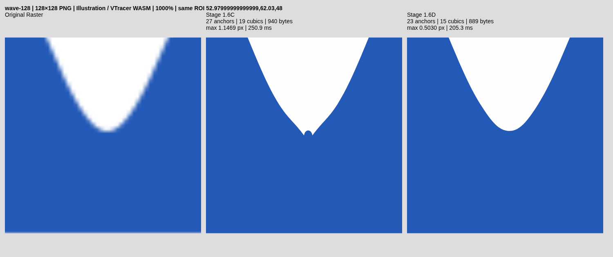

# Stage 1.6D — source-verified continuity recovery

**Wave continuity gate: PASS locally. Broader acute-vertex recovery: PARTIAL. Experimental only; no promotion or merge.** Base: `5f69567c357eb0bb5930925fa7d35d132de2f3a5`,
branch `feat/stage-1-6d-false-corner-recovery`. Implementation: `68b05a1d1e4b883a2c38b6e59ef2398695218428`.
The following diagnosis was recorded before implementing the recovery.

## Pre-implementation diagnosis

The verified source-geometry WASM was rebuilt before changing engine code.
`benchmark-results/stage16d/audit/profiles.json` and `joins.json` retain the actual
exported geometry and upstream corner diagnostics. Wave 128 reproduced mean
0.0936232644, p95 0.4254596403 and maximum 1.1468534986px.

| Final join | Position | Tangent discontinuity | Detector confidence | Confirmed cause |
|---|---|---:|---:|---|
| 0 | (48.98, 41.97) | 2.38665 rad | 0.54805 | first endpoint of inverted crest splice |
| 1 | (51.02, 41.97) | 2.38665 rad | 0.54805 | second endpoint of same splice |
| 4 | (76.98, 86.03) | 2.38665 rad | 0.54805 | first endpoint of inverted valley splice |
| 5 | (79.02, 86.03) | 2.38665 rad | 0.54805 | second endpoint of same splice |
| 8 | (104.98, 41.97) | 2.38665 rad | 0.54805 | first endpoint of second crest splice |
| 9 | (107.02, 41.97) | 2.38607 rad | 0.54805 | second endpoint of same splice |
| 19 | (20.98, 86.03) | 2.38665 rad | 0.54805 | first endpoint of first valley splice |
| 20 | (23.02, 86.03) | 2.38665 rad | 0.54805 | second endpoint of same splice |

The original VTracer/legacy result has six measured corners, not these eight.
The source/adaptive contour stage introduces the paired estimates: raw-chain
PCA intersections extrapolate about one pixel beyond a smooth extremum, and
nonmaximum suppression with index radius three permits both candidates four
chain indices apart. The two independently protected positions then bound a tiny
piece. Its endpoint adjustment and local fitter create a reverse-curvature bridge.
The complete cubic is approximately `c .21,1.64 1.83,1.64 2.04,0` at each crest;
valleys reverse its vertical sign. Thus the local bulge/notch and the two G0 joins
are geometrically linked, not independent corners to smooth one at a time.

All ten intermediate protected candidates survive source fitting. The reducer
preserves their recorded positions and genuine final tangent changes. Recovery
then treats every final turn over 0.61 rad as hard, excludes nearby normal targets
and partitions spans at both ends. These short splices have no free interior knot,
so the span translation system cannot repair them. Exact line serialization only
removes straight cubics; it does not introduce these defects.

Source evidence contradicts the extrapolated positions: rows 41–42 around the
crest are empty, whereas the candidate reaches y=41.97; the transition is in row
43. At the valley, row 85 is fully foreground but the candidate inserts a bridge
near y=86.03. The source remains one two-color region with two SVG paths including
background. There is no extra region, missing hole or adjacency change at these
eight locations. Local geometry can be corrected without modifying segmentation
or topology. Actual valley loss and geometric acceptance remain to be measured.

True final corners are the two lower rectangle vertices and the source-recovered
left acute endpoint. These require separate protection, not the paired-splice
operation. Already-G0 but misplaced held-out tips are a separate hypothesis class.

## Source-supported classification and geometry

VTracer 1.0.0-alpha.4 remains the tracer, pinned upstream
`e71343fbcbf469b8a72a255030408a39939162eb`; visioncortex 0.9.3 and flo_curves 0.8.0
are unchanged. Existing licenses/attribution remain. No new dependency, tracing
engine, segmentation, service, GPU or planar graph was added.

The new `recovery/continuity.rs` works on uniquely owned final reduced knots,
inside the existing experimental recovery. The pipeline remains VTracer → source
fit → quantization → reduction → output-consistent recovery → SVG serialization.
A source-validated continuity proposal precedes partitioned span refinement, so
artificial cuts do not freeze the following solver. Shared faces, open/junction
chains, partial alpha and unsupported ownership never enter per-face smoothing.

Classification is conservative:

- TRUE_HARD_CORNER: a final tangent discontinuity with strong existing multiscale
  protected evidence (confidence >=0.75 at a matching final vertex).
- SMOOTH_JOIN: existing near-aligned final tangents.
- FALSE_CORNER: assigned only after the complete source-supported replacement passes.
- JUNCTION_LOCKED: open boundaries/junction endpoints are not independently fitted.
- UNCERTAIN: retained when any support, color, confidence or validation check fails.

Some geometrically true corners remain UNCERTAIN in this classifier and stay
protected. The independent reference-based corner metric is separate. The
classifier does not claim to know design intent from one turning-angle threshold.

A bounded candidate consists of a short nonlinear bridge (<4px arclength), two
large final G0 changes and supported neighboring arms. Strong protected vertices
are excluded. The weaker 0.548-confidence Wave candidates can be reconsidered
only with independent source evidence. Two neighboring curves plus their bridge
become two cubics sharing a G1 join. Outer endpoint positions and tangent rays
are retained. Removing the bridge is justified by reconstruction, not node count.

The source model exploits an exact graph identity. For a single boundary y=f(x)
inside a vertical pixel strip [lo,hi], foreground below it satisfies
`mean_column(f) = hi - sum(pixel_coverage)`. Foreground above it has the reversed
identity. The implementation also supports the transposed pixel axis. It requires
full/opposite end colors and monotone coverage along each normal strip; thin
features with a second boundary and ambiguous colors are rejected.

Fit an asymmetric quartic graph to **pixel-column integrals**, not samples at
pixel centers. Each basis value is the exact column average of t^k. Windows span
7–24px, require at least eleven supported columns and at most 32 normal pixels.
Whole-window RMS <=0.08px, maximum residual <=0.18px, and central/whole-window
position/tangent disagreement <=0.08 are required. Neither a symmetric parabola
nor an idealized circle is forced. Independent native quadrature tests include
an asymmetric source, a genuine V, transposed geometry, partial alpha and a
second boundary. The genuine V fails the smooth-source certification.

Hermite control handles use source graph position/slope at the new join and the
existing outer tangent rays. Rounded controls must retain monotone pixel-axis
projection and G1 direction; this excludes folds/cusps within either cubic.
The existing signed Green-area cache evaluates both incident arms together.
Acceptance requires >=15% local coverage-MSE reduction and lower local RGB loss,
followed by unchanged source-drift, self-intersection, other-path collision,
containment, winding, closure and whole-component source-loss checks. Rollback
retains the prior contour. No new editable knots are added.

The graph/box-filter model is an assumption, not a guarantee about an unknown
rasterizer. Color/gamma uncertainty or unsupported evidence keeps the baseline.
Ground-truth vectors are supplied only to offline benchmarks, never this optimizer.

## Actual final SVG results

Same endpoint-inclusive geometry sampler as Stage 1.6C: adaptive flattening at
0.002px and symmetric sampled distances, including reference endpoints. These
are sampled errors, not exact continuous Hausdorff bounds. No metric sampling or
old quality threshold was changed.

| Fixture | Mean C → D (px) | p95 C → D | Maximum C → D |
|---|---|---|---|
| wave-128 | 0.093623 → 0.028710 | 0.425460 → 0.085308 | 1.146853 → 0.502973 |
| wave-512 | 0.074254 → 0.074254 | 0.237143 → 0.237143 | 0.578088 → 0.578088 |
| wave-1024 | 0.059089 → 0.059089 | 0.241311 → 0.241311 | 0.660000 → 0.660000 |
| cubic-128 | 0.063891 → 0.063891 | 0.270706 → 0.270706 | 0.823200 → 0.823200 |
| cubic-512 | 0.055474 → 0.055474 | 0.258020 → 0.258020 | 0.823200 → 0.823200 |
| cubic-1024 | 0.047432 → 0.047432 | 0.200903 → 0.200903 | 0.766976 → 0.766976 |
| triangle-eight-native-srgb-1024 | 0.086546 → 0.054593 | 0.242575 → 0.149175 | 2.302899 → 1.292558 |

| Wave 128 metric | Stage 1.6C | Stage 1.6D |
|---|---|---|
| precision | 0.2727272727272727 | 1 |
| recall | 1 | 1 |
| unexpected | 8 | 0 |
| anchors | 27 | 23 |
| curves | 19 | 15 |
| paths | 2 | 2 |
| bytes | 940 | 889 |
| raster RGBA MAE | 0.661956787109375 | 0.58184814453125 |
| chromium RGBA MAE | 0.682403564453125 | 0.631317138671875 |
| libvips silhouette IoU | 0.9916603487490523 | 0.9946838807670401 |

All five protected Cubic/Wave exports are byte-identical to Stage 1.6C. Wave
128 retains its real left apex at (8,63.6554): reference anchor error 0.3446px,
not zero. Its remaining maximum ~0.503px is on the right boundary, not the removed
valley notch. The milestone does not establish universal smoothness or subpixel
accuracy. Counts decrease because four invalid bridge constructions are replaced.

## Valley and independent raster evidence

Local patch is x=14..29, y=76..90. The following uses libvips rasterization of the
**serialized final SVG**, encoded-sRGB two-paint unmixing for coverage, and direct
source RGB MAE in 0–255 units. It is independent of the optimizer's Green integral.

| Metric | C | D |
|---|---|---|
| coverageMSE | 0.003513981459980748 | 0.00017212216274623872 |
| rgbMAE | 2.5375 | 0.9944444444444445 |

The optimizer's separate local patch records are retained in comparison.json;
all four paired repairs improve their own coverage MSE by >15% and RGB loss.
After span recovery, the independently rasterized valley still improves. Whole
component source loss drops 0.002079755 → 0.000819615. Both Chromium and libvips
reconstruction improve, not just node statistics or intermediate geometry.

## Held-outs and already-G0 vertices

All 45 cases were measured as Stage 1.6C → D, in addition to the unchanged old
B/C gates. Forty-three exports are unchanged. The changes are Wave 128 and the
8° triangle at 1024. Existing invalid narrow/clipped held-outs remain invalid;
retention is not a quality PASS. All 45 refinement-off Auto control hashes match.
Existing regression fixtures also cover circles, ellipses, triangles, stars,
organic/rounded shapes, cat facial features, thin lines, JPEG/WebP, partial alpha,
true holes and shared-edge output.

Already-G0 recovery is a separate source hypothesis, not the rounded-cap detector.
It selects supported acute arm geometry around a final G0, reuses multiscale
quadratic arm models, requires two agreeing intersections, condition <=1500,
uncertainty <=1.25px and the original <=3px apex trust region. It keeps the G0 and
outer tangent constraints, then verifies the complete 2D wedge, source RGB and
existing topology/source guards. At most one existing sharp vertex is attempted
per deferred component; ordinary active high-resolution recovery is unchanged.

Triangle 128 has supported intersection proposals near (48.58,18.80), but they
are over 5px from the existing (50.33,23.56) vertex. The 3px trust region rejects
these rather than clamping an unsupported partial correction into a fake apex.
Triangle 512 has proposals around (194.17,74.68), but no proposal passes the
complete local/whole recovery constraints; it remains unchanged. This is a
candidate-validation limitation, not lack of color samples. Its exact rejecting
subguard is not individually instrumented and remains to be localized.
Triangle 1024 accepts (388.4129,149.6282), with reference anchor error 0.1414px;
mean/p95/max and source RGBA improve. Its other corner errors remain, so its
maximum is still 1.292558px. Nearly parallel wedges remain uncertain. No safety
bound, sampling policy or segmentation label was changed to make them pass.

## CPU, memory and rejected experiments

Browser-local timings use three paired runs in isolated per-fixture contexts,
with WASM initialization separate and the middle run reversing engine order.
Raw cold/warm values remain in JSON. These are cloud desktop measurements;
physical Android latency, live-heap peak and browser RSS are unverified.

| Fixture | Three-run median trace ms C → D | Continuity ms, first run | Sharp ms, first run | WASM high-water MiB C → D |
|---|---|---|---|---|
| wave-128 | 163.5 → 122.6 | 33.1 | 0.0 | 1.75 → 1.75 |
| cubic-1024 | 765.0 → 790.7 | 0.5 | 0.0 | 34.88 → 34.88 |
| triangle-eight-native-srgb-1024 | 313.1 → 489.3 | 0.4 | 12.7 | 37.62 → 37.62 |

Memory is the WASM linear allocation after warm/Auto runs, not peak live heap.
Existing component/sample/command/input limits remain. Continuity is capped at
8 attempted pairs / 4 accepted pairs per component; diagnostics are bounded and
reset per trace. Worker lifecycle/cancellation and reuse are unchanged.

A first full run failed the unchanged 50% additional-runtime gate on Cubic 1024:
Stage 1.6 baseline 729.8ms, candidate 1115ms. The new continuity work was only
0.5ms. The failure remains in `5f69567-20261026T082526-226694`; it was not relabeled
PASS. Profiling identified repeated whole-contour coverage in span scoring.
The span solver now caches unchanged signed-area contributions using the existing
Patch evaluator. Same flattening tolerance, source samples, acceptance checks and
accepted protected SVG bytes are retained. The subsequent complete runner exits
0 and old gates pass. Timing noise is not proof that the previous failure was
entirely caused by one mechanism.

Rejected approaches include smoothing one splice endpoint independently,
accepting angle-only corner labels, fitting pixel-center polynomial samples,
using a smooth graph on a genuine V, extending windows through an opposite thin
boundary, and clamping the distant Triangle 128 intersection into the trust
region. The source-only initialization prototype applied after old recovery
reached max 0.3446px on Wave; the integrated pre-span version is retained for
bounded work and full validation, with the reported final maximum 0.502973px.
These are distinct experiments, not interchangeable final results.

## Tests, CI, exports and promotion

Local checks: default/feature Rust 67 each; VTracer library 31; TypeScript unit
39; lint/typecheck/build/WASM PASS. Normal Chromium E2E: 24 PASS. Feature E2E:
5 PASS, including actual worker/download continuity assertions and the existing
35 regression comparisons. The complete research runner exits 0: unchanged
Stage 1.5 retention, Stage 1.6B, Stage 1.6C and new 1.6D gates all pass.
Partial-alpha Cat 128 retains the existing >=0.980 IoU gate; source recovery is
not applied to intrinsic alpha. Shared-edge browser tests retain exact reversed
coordinates and zero new crossings. CLI Inkscape checks pass locally where
available; GUI editing and Illustrator remain unverified.

CI implementation run: [40293322175](https://github.com/akidwush/vector-magic-bydika/actions/runs/40293322175).
**PASS** for exact implementation commit 68b05a1, completed 2026-10-26
in 14m05s; all 33 reported workflow steps succeeded, including the blocking
research gates and actual browser exports. Documentation-only follow-up commits
do not change the validated engine source.

Actual comparisons at [100%](evidence/stage16d/wave-128-100.png),
[400%](evidence/stage16d/wave-128-400.png), [1000%](evidence/stage16d/wave-128-1000.png).

[Baseline SVG](evidence/stage16d/wave-128-stage16c.svg),
[candidate SVG](evidence/stage16d/wave-128-candidate.svg),
[tangent/anchor classification](evidence/stage16d/wave-128-tangents.svg),
[signed curvature](evidence/stage16d/wave-128-curvature.svg).
The SVG exports contain real editable paths, no embedded raster or camouflage.
The graph diagnostic legend includes locked junctions; this owned Wave ring has
none. The planar comparison was independently tested; the simple serialized
endpoint incidence plot found no degree-three junction in that selected export,
so none is falsely annotated as recovered. Raw unclipped curvature samples and
per-candidate accepted/rejected/uncertain records are retained in CI artifacts.

Complete local evidence:
`benchmark-results/stage16d/5f69567-20261026T082937-228259/`.
The local candidate was an uncommitted worktree at baseline 5f69567; implementation
source was subsequently committed as 68b05a1. CI rebuilds that exact source in a
clean checkout and uploads actual SVGs/screenshots as `stage-01-evidence`.
Historical outputs use separate namespaces. The runner restores normal WASM and
dist and preserves failure exit codes. Generated score JSON/binaries are ignored
by git; only original legal fixture visuals/exports are committed here.

Changed sources: new recovery/continuity.rs; recovery.rs integration and span
cache; acute.rs separate existing-G0 hypothesis; feature-only lib.rs diagnostics;
adapter/types; browser test; paired benchmark/evidence/new gate; research runner;
workflow branch coverage; this report and visual subset. Existing coverage math,
node reducer, segmentation, planar ownership and old quality gates are unchanged.

Reproduce with the requested build, both cargo-test configurations, npm test,
lint/typecheck/build, npm run test:e2e, then bash scripts/source-target-research.sh.
For local Chromium set NEXORA_CHROMIUM_PATH=/usr/bin/chromium. Experimental source
geometry still requires the existing Cargo feature and refinement/node controls.

**Promotion:** keep experimental, on the follow-up branch. Primary Wave false
corner/valley recovery passes; broad acute-vertex recovery remains PARTIAL.
Triangle 128/512, other retained narrow failures, right-boundary error and mobile
performance remain open. No global enablement, hosting change or merge to main.
