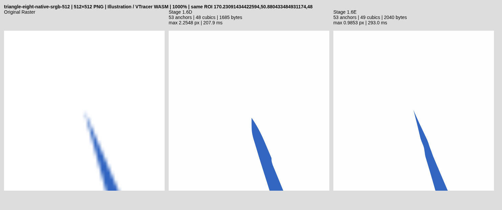

# Stage 1.6E — source-verified sharp apex recovery

Baseline: `b1fa0c572c94b8a432735cd981c88570ba890c2a` (implementation
`68b05a1d1e4b883a2c38b6e59ef2398695218428`). Work branch:
`feat/stage-1-6e-sharp-apex-recovery`. Experimental, no main merge/global enablement.

## Diagnosis recorded before changing acceptance or geometry

The verified feature WASM was rebuilt and actual exports preserved under
`benchmark-results/stage16e/audit/`. Diagnostic-only changes preserved geometry.
All rejection thresholds were retained.

Triangle 128: three consistent intersections require 4.993–5.066px movement.
The existing 3px candidate trust guard rejects all before geometry scoring.
It is not a color, tangent-intersection-conditioning or segmentation rejection.

Triangle 512: all three candidates pass the 3px trust guard, G0 angle,
monotone-control/arm-separation tests, self-intersection and 3.5px source-drift
checks. The best initial coverage loss is 0.020189533 versus 0.021456346
(only 5.9% improvement, below the existing 15% requirement). Actual paint RGB
loss rises from 0.081891584 to 0.083792957. Thus both the local gain requirement
and exported-paint reconstruction reject it. No whole-component rollback has
yet occurred: the candidate is rejected earlier. No safety threshold was changed.

The Stage 1.6D proposal moves the apex and assigns incident handles using chord
length/3 while retaining outer handle lengths. Source-calibrated position alone
does not make those handle lengths a correct two-arm raster reconstruction.
The proposed continuation jointly refines four handle lengths, keeping the
evidence apex fixed and preserving outer endpoint positions/tangent rays.

Diagnostics use bounded 32-value rows; -1 explicitly means not evaluated.
Stages: 2 trust rejection; 3 final G0/control rejection; 4 initial candidate
scoring; 5 joint-handle fallback; 100 component source safety; 104 component
self-crossing; 101 other-path collision; 102 containment; 103 whole source loss;
110 committed component. Indices: 0 stage, 1 knot, 2–3 original position,
4–5 proposed position, 6 conditioning, 7 uncertainty, 8 displacement,
9 G0 turn, 10 local-control guard, 11–12 coverage losses, 13–14 RGB losses,
15 self-clear, 16 source-safe, 17 winding, 18 closure, 19 collision-clear,
20 containment-clear, 21 source acceptance, 25 evaluation ms, 26 initialization
ms, 27 final local safety ms, 28–31 incident calibrated tangent directions.
Final serialization is independently measured from the browser SVG download.

## Outcome and implementation

**PARTIAL:** Triangle 512 achieves material source/reference improvement; Triangle
128 remains unresolved and unchanged. All six protected Wave/Cubic exports and
Triangle 1024 are byte-identical to Stage 1.6D. Feature remains experimental.
Implementation: `e5af7613db73f5b955b240dad71e48693b9ab7cf`.

VTracer 1.0.0-alpha.4 remains the tracer, pinned upstream
`e71343fbcbf469b8a72a255030408a39939162eb`; visioncortex 0.9.3 and flo_curves 0.8.0
are unchanged. Licenses and attribution remain. No new engine, rasterizer,
dependency, segmentation, smoothing pass, graph or cloud service was added.

## Joint source-verified reconstruction

The existing already-G0 initializer still runs first. If it succeeds, its result
is retained exactly, including Triangle 1024. Only its rejected, source-supported
hypotheses enter the new fallback. This does not use the rounded-cap detector.

At most three agreeing multiscale intersections are evaluated. Conditioning
<=1500, estimated uncertainty <=1.25px and the existing <=3px apex displacement
remain required. The calibrated apex and incident tangent directions are fixed
while four incident handle lengths are optimized. Outer endpoints and outer
tangent rays stay fixed. This is a deliberate lower-dimensional strategy: do
not slide a fairly certain apex around to compensate for incorrect handle lengths.

For each hypothesis, bounded coordinate descent uses steps 0.5, 0.2, 0.08 and
0.03px, four lengths and two signs. Length changes remain within 2px of the
initial source proposal, with minimum length 0.1px. Negligible objective gain
terminates early. Monotone control projection, arm separation and a final G0
turn >2.6 radians reject folds/reversed tangents before expensive validation.

The local objective is coverage MSE + 0.1*(exported RGB L1)^2, with a 1e-6
squared handle-displacement regularizer. Arm position/direction evidence is a
hard constraint, not another freely fitted variable. Hypothesis selection also
uses a small uncertainty prior. Node complexity is fixed. No reference geometry
is passed to the optimizer. Existing signed Green-area caching scores both arms
together in the 13×13 wedge patch; there is no half-plane inversion at the apex.

Acceptance still requires >=15% coverage improvement AND lower actual-paint RGB
loss, not merely a smaller scalar objective. Existing local topology, self-clear,
source-drift, global collision/containment/winding/closure and whole-component
source acceptance remain. Final coordinate rounding and SVG serialization are
independently checked. Original geometry remains the rollback candidate.

The 512px winning local patch MSE falls 0.021456346 → 0.017613541; normalized
RGB L1 falls 0.081891584 → 0.077202478. Whole-component source MSE in a final
instrumented replay falls 0.005983518 → 0.001841683 and RGB L1
0.043767512 → 0.030548397. All topology/containment flags pass. The selected
28px-support hypothesis has condition 210.464 and uncertainty 0.07323px;
movement is 2.46035px. Those uncertainties are heuristic, not calibrated
confidence intervals or proof that the original vector is uniquely identified.

## Trust-region investigation and remaining 128px failure

Triangle 128's source estimates are mutually consistent and near the offline
reference, but require ~5.06px displacement. The old 3px proposal bound and
3.5px component-wide symmetric drift contract both prevent full correction.
Resetting the baseline after intermediate steps would evade that total-motion
contract; it was not used. No unsupported 3px clamped partial move was accepted.
A separately certified larger-displacement strategy has NOT been established.
This is a current recovery/validation limitation, not a claim that the raster
contains no evidence. The complete baseline SVG is retained.

The 512 rejection was not due to missing source support, conditioning or a
collision. The original chord/3 handles yielded an insufficient coverage gain
and worse RGB. Keeping the supported apex and fitting the handles resolves that
specific reconstruction error without increasing any trust radius.

## Absolute exported geometry

Same endpoint-inclusive symmetric sampled boundary metric as Stage 1.6D, with
0.002px adaptive curve flattening and the same sampling policy. These are sampled
errors, not an exact continuous Hausdorff bound. References are offline metrics.

| Fixture | Mean D → E (px) | p95 D → E | Max D → E | Identical SVG |
|---|---|---|---|---|
| triangle-eight-native-srgb-128 | 0.227364 → 0.227364 | 0.392321 → 0.392321 | 5.154173 → 5.154173 | True |
| triangle-eight-native-srgb-512 | 0.109566 → 0.064629 | 0.554576 → 0.191055 | 2.254785 → 0.985251 | False |
| triangle-eight-native-srgb-1024 | 0.054593 → 0.054593 | 0.149175 → 0.149175 | 1.292558 → 1.292558 | True |
| wave-128 | 0.028710 → 0.028710 | 0.085308 → 0.085308 | 0.502973 → 0.502973 | True |
| wave-512 | 0.074254 → 0.074254 | 0.237143 → 0.237143 | 0.578088 → 0.578088 | True |
| wave-1024 | 0.059089 → 0.059089 | 0.241311 → 0.241311 | 0.660000 → 0.660000 | True |
| cubic-128 | 0.063891 → 0.063891 | 0.270706 → 0.270706 | 0.823200 → 0.823200 | True |
| cubic-512 | 0.055474 → 0.055474 | 0.258020 → 0.258020 | 0.823200 → 0.823200 | True |
| cubic-1024 | 0.047432 → 0.047432 | 0.200903 → 0.200903 | 0.766976 → 0.766976 | True |

Triangle 512 final apex is (194.1707,74.6836), reference-anchor error 0.205838px
versus baseline 2.254785px. Endpoint-to-any-boundary distance is separately
0.007945px: it is not the anchor error. Other retained corner errors still reach
1.483px at an anchor, explaining the remaining nonzero shape error. Triangle
1024 retains its prior apex error 0.141402px and maximum 1.292558px.
Wave 128 still has zero false G0 corners and precision/recall 1/1.

## Source raster reconstruction, corners and editability

MAE is premultiplied RGBA in 0–255 units. libvips and Chromium independently
rasterize the final SVG. Paints/opacity and region/path counts are unchanged.

| Triangle resolution | libvips MAE | Chromium MAE | libvips IoU | Corner precision/recall | Anchors | Cubics | SVG bytes |
|---|---|---|---|---|---|---|---|
| 128 | 0.898209 → 0.898209 | 0.891251 → 0.891251 | 0.947276 → 0.947276 | 0.667/0.667 → 0.667/0.667 | 14 → 14 | 9 → 9 | 561 → 561 |
| 512 | 0.772780 → 0.762831 | 0.774765 → 0.763748 | 0.991567 → 0.994527 | 0.667/0.667 → 1.000/1.000 | 53 → 53 | 48 → 49 | 1685 → 2040 |
| 1024 | 0.740829 → 0.740829 | 0.741727 → 0.741727 | 0.997554 → 0.997554 | 1.000/1.000 → 1.000/1.000 | 79 → 79 | 75 → 75 | 3202 → 3202 |

No anchors are added. One previously line-serialized segment now needs a cubic;
bytes increase with meaningful fractional coordinates. This is shape recovery,
not file-size optimization. The actual exports are real paths without raster,
stroke concealment, preview hacks or global blur.

## Held-outs and safety

All 45 paired browser cases were tested against Stage 1.6D. Only Triangle 512
changes; the other 44 are byte-identical. All 45 refinement-off Auto hashes match.
The corpus includes rotated/narrow blades, 8°/28° triangles, subpixel shifts,
box/sRGB/linear-light AA, controlled noise, thin ellipses, rounded tips and clipped
frames. All mean/p95/max, corner, source-RGBA/IoU and topology nonregression checks
pass. Nearly parallel/clipped/other defective retained baselines are NOT repairs
or quality passes. No off-frame geometry is invented.

In particular, Triangle 128 remains max 5.154px, recall 2/3. Retention of this
failure is explicit. The new gate asserts it stays unchanged rather than calling
it corrected. Linear-light/noisy held-outs establish retention, not successful
universal recovery. Shared-edge composition remains excluded from this per-face
pass and its exact reversed-edge/browser checks remain intact. Partial-alpha
processing is unchanged, with the existing 0.980 Cat 128 IoU gate retained.

## CPU, memory and work budgets

Three paired browser runs per fixture, alternating the middle-run engine order,
use isolated contexts and record WASM loading separately. Raw cold/warm times,
all stage timings, recovery counters and diagnostics are retained. Below median
includes all three runs; initialization/evaluation/safety are not interchangeable.

| Resolution | WASM init ms D / E | First trace ms D / E | Three-run median ms D / E | Total sharp ms E, first run | WASM high-water MiB D / E |
|---|---|---|---|---|---|
| 128 | 16.5 / 17.4 | 101.0 / 101.1 | 22.4 / 23.1 | 13.1 | 1.688 / 1.688 |
| 512 | 12.4 / 9.5 | 207.9 / 293.0 | 107.8 / 216.4 | 40.3 | 8.375 / 8.375 |
| 1024 | 20.5 / 15.9 | 1036.7 / 698.0 | 552.4 / 564.0 | 32.8 | 37.625 / 37.625 |

In the 512 browser capture, arm initialization is ~3.8ms, individual joint
hypothesis evaluations 6.1–7.5ms (including ~3.8–4.1ms local safety). Activating
previously skipped span recovery adds further work: median total trace increases
~109ms. The source improvement has a CPU cost; it is not claimed to be faster.
An exact-implementation Node replay adds final component safety + whole source
validation timing ~8.22ms and confirms all three triangle SVGs byte-identical to
the browser capture. These are different measurements/environments; the initial
browser capture predates that final timing-only instrumentation. CI rebuilds
and records the complete instrumentation on the exact committed implementation.

Diagnostics are capped at 8192 f64 values and reset per trace. Candidate count,
iterations and handle displacements are bounded. Existing four-component,
128-cubic, sample, input and command caps remain. Unchanged edge-area contributions
are cached. Worker cancellation/reuse/cleanup are unchanged. Linear memory is
high-water allocation after warm/Auto runs, not peak live heap or browser RSS.
Physical Android profiling remains unverified. Existing runtime budgets are not
relaxed: +500ms paired median and 250ms apex budget, plus unchanged legacy gates.

## Rejected hypotheses and limitations

- Initial intersection-only/chord-handle proposals fail the unchanged 15% gain
  and RGB conditions on Triangle 512. A smaller source objective alone is rejected.
- The first passing joint hypothesis used the 16px support model. A bounded
  comparison of all three source-supported alternatives selects the lower-source-
  loss 28px model; ground truth is not used for selection.
- All three Triangle 128 proposals remain rejected by displacement. No staged
  baseline reset, global radius increase or artificially clipped move is used.
- High-resolution already-accepted Stage 1.6D hypotheses bypass the new optimizer,
  retaining exact exported geometry. Correct corners are never globally smoothed.
- Current assumptions are opaque, owned, closed two-color components with reliable
  gamma/arm evidence. This does not recover all acute features or all rasterizers.

## Verification and CI

Rust tests: 69 default and 69 source_geometry; upstream VTracer 31. TypeScript unit
39; lint/typecheck/Vite/WASM build pass. Normal Playwright: 25 PASS; feature
Playwright: 6 PASS, including actual Web Worker Triangle 512 download and old
35 regression comparisons. The complete research runner exits 0, preserving the
old Stage 1.5/B/C/D gates byte-for-byte and adding an explicit 1.6E gate. Final
source vertex/topology commitment is matched against actual serialized SVG anchors.
Inkscape CLI checks pass locally when installed; GUI/Illustrator are unverified.
The normal WASM/dist pair is restored, and experimental exports are absent there.

CI: [exact implementation workflow 40300327798](https://github.com/akidwush/vector-magic-bydika/actions/runs/40300327798).
**PASS**, completed 2026-10-26 in 11m06s for implementation e5af761;
all 33 reported workflow steps succeeded, including all blocking research gates.
The documentation-only follow-up does not change validated engine code. Feature
remains off globally.

## Actual SVG exports and visual evidence

Each figure is Original Raster | Stage 1.6D | Stage 1.6E, identical viewport and
scale. The 1000% ROI includes the worst baseline endpoint. Source pixels are not
embedded in the exported SVGs.

Triangle 128: [100%](evidence/stage16e/triangle-eight-native-srgb-128-100.png), [400%](evidence/stage16e/triangle-eight-native-srgb-128-400.png), [1000%](evidence/stage16e/triangle-eight-native-srgb-128-1000.png); [baseline SVG](evidence/stage16e/triangle-eight-native-srgb-128-stage16d.svg) / [candidate SVG](evidence/stage16e/triangle-eight-native-srgb-128-candidate.svg).

Triangle 512: [100%](evidence/stage16e/triangle-eight-native-srgb-512-100.png), [400%](evidence/stage16e/triangle-eight-native-srgb-512-400.png), [1000%](evidence/stage16e/triangle-eight-native-srgb-512-1000.png); [baseline SVG](evidence/stage16e/triangle-eight-native-srgb-512-stage16d.svg) / [candidate SVG](evidence/stage16e/triangle-eight-native-srgb-512-candidate.svg).

Triangle 1024: [100%](evidence/stage16e/triangle-eight-native-srgb-1024-100.png), [400%](evidence/stage16e/triangle-eight-native-srgb-1024-400.png), [1000%](evidence/stage16e/triangle-eight-native-srgb-1024-1000.png); [baseline SVG](evidence/stage16e/triangle-eight-native-srgb-1024-stage16d.svg) / [candidate SVG](evidence/stage16e/triangle-eight-native-srgb-1024-candidate.svg).

Complete local proof: `benchmark-results/stage16e/b1fa0c5-20261026T092541-237819/`.
The isolated local run was based on b1fa0c5 with worktree changes; exact source
is committed as e5af761. Additional final diagnostic replay is preserved in
`benchmark-results/stage16e/verified-primary/`. CI uses a clean checkout and
uploads all SVG exports, screenshots, raw metrics and rejection diagnostics in
`stage-01-evidence`. Historical artifacts are separate namespaces, never writable
baselines. No generated score JSON or compiled binary is committed.

## Changed files, reproduction and promotion

`recovery/acute.rs`: diagnostic control reasons and source-joint handle fallback;
new `recovery/apex_trace.rs`: bounded rejection audit; `recovery.rs`: separate
component rollback events/timing; `lib.rs`: feature-only diagnostic binding.
The continuity algorithm, reducer, inverse/coverage math, segmentation, planar
ownership and all old gates remain unchanged. Supporting changes add the actual
browser apex test, generic benchmark comparison/diagnostics, dedicated gate,
isolated research build, workflow branch coverage and this report/evidence.

Reproduce with ./scripts/build-wasm.sh; both cargo-test configurations; npm test,
lint, typecheck, build and test:e2e; then bash scripts/source-target-research.sh.
Use NEXORA_CHROMIUM_PATH=/usr/bin/chromium for installed local Chromium. The runner
restores normal WASM/dist on success or failure and preserves meaningful exit
codes. Experimental source_geometry and existing refinement/node controls are
required to exercise this path; no Auto/hosting change is made.

**Promotion decision:** retain the experimental feature branch. Triangle 512
recovery is proven; 128px large-displacement recovery remains PARTIAL and its
unchanged failure is not hidden. Larger source-certified trust regions, other
misplaced corners and real Android measurements remain future work. No merge to
main or global enablement is performed.
