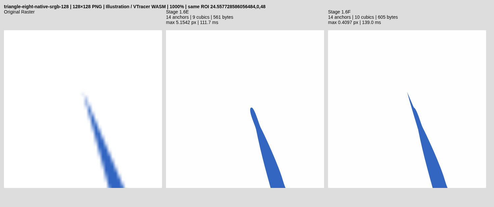

# Stage 1.6F — source-certified large apex recovery

Baseline: `0b67da0cce87476adc59acc7396eb8cfd542452a`.
Branch: `feat/stage-1-6f-large-apex-recovery`.
Engine implementation: `1b454e9de0e131bae8cc2bb026db0eeb901d0bd5`;
evidence-isolation follow-up: `d46031f6d7e3f1b5e2fe56830723d429547aebc4`.
Normal Auto, main, segmentation and shared-edge composition are unchanged.
The extra Cargo feature `large_apex` implies `source_geometry`; both remain off
in normal builds. This is a finite, experimental evidence contract, not a proof
that arbitrary raster inputs have uniquely recoverable vector geometry.

## Outcome

Triangle 128 is corrected in the actual browser-downloaded SVG. Its true apex
and corner recall improve, with lower source RGB loss and no additional anchors.
All other 44 cases, including the eight protected Triangle/Wave/Cubic outputs,
remain byte-identical to Stage 1.6E. All 45 refinement-off Auto hashes match.
Geometric/source/topology assertions pass, and two complete CI runs pass.
Overall local validation is **PARTIAL**: two historical cold-run runtime gates
failed before the extension was active, and the dedicated Stage 1.6F gate also
exits 1 on protected Triangle 512 median runtime (+747.4ms, limit +500ms). Those failures are preserved; no claim
of all local gates passing is made. Production promotion remains blocked pending broader
uncertainty calibration, more rasterizers/real artwork and device profiling.
No universal subpixel precision or Vector Magic equivalence is claimed.

## Audit and diagnostic-only reproduction

`acute::refine_sharp` rejects apex hypotheses beyond 3px from the original final
reduced knot. `source_safe` checks complete two-sided boundary correspondence
against the same original contour, with a 3.5px limit and the existing conservative
0.254px sampling/flattening margin. Neither uses an incremental baseline. Existing
`clamp_position` also retains its 3px envelope. None of these bounds was raised.

Unique shape/subpath identity is established by `recovery::locate`, using exact
or unambiguously canonical quantized ownership, not nearest-shape selection.
`Matte::from` obtains stable opaque foreground/background colors and selects the
calibrated gamma model through the existing encoded-RGB residual comparison.
Uncertain gamma or partial/intrinsic alpha is rejected. Source fitting, corners,
coverage, node reduction and planar ownership are reused unchanged.

The source arm fitter uses robust weighted quadratic transverse position versus
longitudinal distance. Single-boundary targets exclude the opposite arm within
2.25px. Intersection conditioning comes from the tangent normal matrix; the
uncertainty estimate combines a 0.02px noise floor, arm residual, support count,
extrapolation leverage and inverse slope separation. This is an estimate, not a
statistically calibrated confidence interval; nested support windows overlap.

A diagnostic-only prototype called the existing joint-handle fitter on rejected
128px proposals and discarded all resulting geometry. Exported SVG stayed
unchanged. For the 16px model, coverage MSE on the old 13×13 patch fell from
0.006102620 to 0.003219384 and paint RGB L1 fell from 0.047714342 to 0.037144148.
The 20/28px models also improved both losses. All passed local arm separation and
self-clear checks; every one still failed the unchanged 3.5px drift contract.
Thus a source-supported candidate existed, rather than missing labels or a
segmentation failure. These diagnostic patch scores are not compared numerically
to the differently sized final whole-wedge patch.

## Legacy versus extended contracts

Ordinary `source_geometry` executes the same initializer, handle optimizer,
continuity recovery, span fitting and 3px/3.5px acceptance policy. Every legacy
quality-gate file remains byte-for-byte unchanged. The common finite-coordinate,
frame, closure and winding checks were factored into `geometry_safe`; ordinary
`source_safe` still requires those checks AND the original 3.5px bound.

Only a deferred, uniquely owned opaque ring with no accepted ordinary correction
can enter the additional `large_apex` path. It cannot refine shared edges or run
independently on neighboring planar faces. Both legacy acceptance and extended
certification are recorded separately: the accepted Triangle 128 explicitly has
legacy_safe=0, extended_safe=1. It is never reported as passing the old contract.

The new preflight requires three supported 16/20/28px models, each with >=7
samples per arm, >=6px support span, RMS <0.025px, condition <400 and estimated
uncertainty <0.35px. Apex spread must stay <0.25px and corresponding tangent dot
products >0.999. The old intersection builder's numerical/root caps remain;
there is no universal new 6px or 8px acceptance radius. Nearly parallel pairs,
short/noisy arms, uncertain gamma and clipped patches fail closed.

The lowest estimated uncertainty selects one source hypothesis; no
reference coordinates, expected triangle shape, fixture name or other-resolution
image enters the Rust optimizer. At most three evidence models and one joint
handle solve are considered.

For hypothesis displacement d and uncertainty u, the separate correspondence
limit is d + 2u + 0.254px, additionally bounded by 0.4 times the smaller measured
arm-support span. This is a candidate-specific envelope, tied to source evidence,
not a changed legacy tolerance. Full original-to-final two-sided correspondence
still uses the existing bounded drift validator. No staged movement or baseline
reset occurs.

## Joint two-arm reconstruction and complete validation

The existing Stage 1.6E handle optimizer was extracted without changing its
search or acceptance semantics. It keeps the evidence apex, outer endpoint
positions and outer tangent rays fixed while optimizing four handle lengths.
Steps are 0.5, 0.2, 0.08 and 0.03px, with at most 32 coordinate trials, >=0.1px
handle lengths, <=2px handle-length changes and negligible-gain termination.
Its objective remains coverage MSE + 0.1 RGB_L1² plus 1e-6 handle regularization.
It uses existing 0.001px Green-integral coverage and unchanged-edge signed areas.

The complete old/new incident-control bounding rectangle plus a 2px margin is
scored, capped at 2048 source pixels; every pixel must have trusted two-color
support and lie strictly inside the frame. Whole-wedge coverage must improve
>=20% and exported-paint RGB must decrease. A separate 7×7 apex neighborhood
requires >=3 source-positive missing-coverage pixels, >=25% coverage improvement
and nonincreasing peak residual. The whole wedge independently requires the same >=25% witness improvement,
nonincreasing peak residual and no contradictory known-background paint or new
erosion of known-full foreground pixels. Thus a
small global mean loss alone cannot certify an apex.

Monotone controls and opposite arm half-planes rule out folded incident cubics.
Final G0 turn must exceed 2.6 radians. Only the two incident cubics can differ;
every other cubic and both outer positions must be identical to the original.
The certificate privately binds the exact original and exact rounded candidate.
Any later geometry change invalidates it; there is no subsequent span fitting
on this path. All final self-crossing, other-path collision, containment, winding,
closure and whole-component source coverage/RGB guards still run before commit.
The exporter retains editable paths; browser validation reparses the downloaded
SVG, verifies the certified anchor, closed topology, source reconstruction and
absolute endpoint-inclusive reference geometry.

## Accepted source evidence and total displacement

Original apex: (50.3300, 23.5600). Source hypothesis:
(48.58515977, 18.80365313); serialized at four-decimal knot precision.
Total apex movement is **5.06629085px**, never reset during solving.
Condition 201.463026; estimated uncertainty 0.065683px; model spread
0.081064px. Best model supports 21/19 pixels on the
arms, longitudinal intervals [6.140393, 22.854987] and
[7.988827, 24.899095] relative to the original apex; RMS
0.003771/0.006059px. Inferred longitudinal intersection is
-4.317276px. The quantization/extrapolation floor is retained.

Separate correspondence envelope: **5.45165645px**. Endpoint-inclusive,
<=0.5px-spaced two-sided changed-arm diagnostic distance is
**5.06623299px**. Identical remaining geometry has zero correspondence distance;
matching only the changed arms is a conservative upper bound on full-boundary
distance. The actual full-contour safety check additionally retains its sampling
margin, spatial grid and work caps. Legacy drift explicitly fails.

Whole-wedge MSE: 0.008142639 → 0.005208867; RGB L1:
0.063976935 → 0.053341222. Apex patch MSE:
0.005567009 → 0.000066618, with 3 positive missing-tip pixels
and final peak residual 0.048327226. Full-component MSE:
0.007074901 → 0.006582852; RGB L1:
0.062144297 → 0.060675850. These normalized internal RGB losses are
separate from independent renderer MAE below.

## Actual SVG geometry and reconstruction

The unchanged endpoint-inclusive boundary sampler is used at all resolutions.
Ground-truth CC0 SVGs are only offline measurements. Each source raster is
independently generated at its own resolution; 1024px is never an inference input
for 128px. Chromium and libvips rasterize the actual downloaded SVG independently.

| Triangle size | Mean E → F px | p95 E → F px | Maximum E → F px | Apex anchor error E → F px | Corner precision/recall E → F |
|---|---|---|---|---|---|
| 128 | 0.227364 → 0.150871 | 0.392321 → 0.381214 | 5.154173 → 0.409670 | 5.154173 → 0.087990 | 0.667/0.667 → 1.000/1.000 |
| 512 | 0.064629 → 0.064629 | 0.191055 → 0.191055 | 0.985251 → 0.985251 | 0.205838 → 0.205838 | 1.000/1.000 → 1.000/1.000 |
| 1024 | 0.054593 → 0.054593 | 0.149175 → 0.149175 | 1.292558 → 1.292558 | 0.141402 → 0.141402 | 1.000/1.000 → 1.000/1.000 |

| Size | libvips MAE E → F | Chromium MAE E → F | libvips IoU E → F | Anchors E → F | Cubics E → F | SVG bytes E → F |
|---|---|---|---|---|---|---|
| 128 | 0.898209 → 0.892319 | 0.891251 → 0.883865 | 0.947276 → 0.957821 | 14 → 14 | 9 → 10 | 561 → 605 |
| 512 | 0.762831 → 0.762831 | 0.763748 → 0.763748 | 0.994527 → 0.994527 | 53 → 53 | 49 → 49 | 2040 → 2040 |
| 1024 | 0.740829 → 0.740829 | 0.741727 → 0.741727 | 0.997554 → 0.997554 | 79 → 79 | 75 → 75 | 3202 → 3202 |

Triangle 128 maximum improves substantially, while p95 improves only modestly;
remaining body/other-corner defects are not concealed. Anchor count is unchanged.
One previously line-serialized piece now needs a cubic and fractional coordinates,
so bytes increase. Paints, two-color segmentation, object count and editability
are retained. No raster, stroke, overlapping cover-up, global blur or cloud service
is introduced.

## Protected Stage 1.6E outputs

Every entry below is byte-identical; Wave 128 retains zero false G0 corners.

| Fixture | Mean px | p95 px | Endpoint-inclusive maximum px |
|---|---|---|---|
| triangle-eight-native-srgb-512 | 0.064629 | 0.191055 | 0.985251 |
| triangle-eight-native-srgb-1024 | 0.054593 | 0.149175 | 1.292558 |
| wave-128 | 0.028710 | 0.085308 | 0.502973 |
| wave-512 | 0.074254 | 0.237143 | 0.578088 |
| wave-1024 | 0.059089 | 0.241311 | 0.660000 |
| cubic-128 | 0.063891 | 0.270706 | 0.823200 |
| cubic-512 | 0.055474 | 0.258020 | 0.823200 |
| cubic-1024 | 0.047432 | 0.200903 | 0.766976 |

## Complete held-out outcomes

All 39 existing held-outs plus six core Wave/Cubic cases are retained in the
isolated browser comparison. The following are actual endpoint-inclusive maxima,
not quality labels. Retention of inaccurate, nearly parallel, rounded, noisy or
clipped geometry is not counted as a repair. Unchanged invalid baseline paths
are not relabeled valid; the modified primary has zero proper crossings.

| Held-out | Maximum E → F px | Result |
|---|---|---|
| blade-narrow-native-srgb-128 | 4.119156 → 4.119156 | retained, not repaired |
| blade-narrow-native-srgb-512 | 1.605000 → 1.605000 | retained, not repaired |
| blade-narrow-native-srgb-1024 | 11.929661 → 11.929661 | retained, not repaired |
| blade-narrow-box4-srgb-128 | 6.117798 → 6.117798 | retained, not repaired |
| blade-narrow-box4-srgb-512 | 1.460000 → 1.460000 | retained, not repaired |
| blade-narrow-box4-srgb-1024 | 10.930544 → 10.930544 | retained, not repaired |
| blade-narrow-box4-linear-128 | 8.117108 → 8.117108 | retained, not repaired |
| blade-narrow-box4-linear-512 | 14.478923 → 14.478923 | retained, not repaired |
| blade-narrow-box4-linear-1024 | 12.928913 → 12.928913 | retained, not repaired |
| blade-rotated-native-srgb-128 | 2.295082 → 2.295082 | retained, not repaired |
| blade-rotated-native-srgb-512 | 0.523179 → 0.523179 | retained, not repaired |
| blade-rotated-native-srgb-1024 | 1.899573 → 1.899573 | retained, not repaired |
| blade-rotated-box4-linear-noise-128 | 2.295082 → 2.295082 | retained, not repaired |
| blade-rotated-box4-linear-noise-512 | 4.810463 → 4.810463 | retained, not repaired |
| blade-rotated-box4-linear-noise-1024 | 1.340084 → 1.340084 | retained, not repaired |
| blade-oblique-native-srgb-128 | 3.476937 → 3.476937 | retained, not repaired |
| blade-oblique-native-srgb-512 | 0.461063 → 0.461063 | retained, not repaired |
| blade-oblique-native-srgb-1024 | 1.866454 → 1.866454 | retained, not repaired |
| triangle-eight-native-srgb-128 | 5.154173 → 0.409670 | source-certified correction |
| triangle-eight-native-srgb-512 | 0.985251 → 0.985251 | retained, not repaired |
| triangle-eight-native-srgb-1024 | 1.292558 → 1.292558 | retained, not repaired |
| triangle-twentyeight-native-srgb-128 | 1.289704 → 1.289704 | retained, not repaired |
| triangle-twentyeight-native-srgb-512 | 2.273184 → 2.273184 | retained, not repaired |
| triangle-twentyeight-native-srgb-1024 | 1.796512 → 1.796512 | retained, not repaired |
| parallel-uncertain-native-srgb-128 | 14.751639 → 14.751639 | retained, not repaired |
| parallel-uncertain-native-srgb-512 | 20.384957 → 20.384957 | retained, not repaired |
| parallel-uncertain-native-srgb-1024 | 13.261195 → 13.261195 | retained, not repaired |
| rounded-blade-native-srgb-128 | 1.234556 → 1.234556 | retained, not repaired |
| rounded-blade-native-srgb-512 | 4.741311 → 4.741311 | retained, not repaired |
| rounded-blade-native-srgb-1024 | 2.496980 → 2.496980 | retained, not repaired |
| rounded-blade-box4-linear-128 | 0.915891 → 0.915891 | retained, not repaired |
| rounded-blade-box4-linear-512 | 4.659051 → 4.659051 | retained, not repaired |
| rounded-blade-box4-linear-1024 | 7.444041 → 7.444041 | retained, not repaired |
| thin-ellipse-native-srgb-128 | 0.659676 → 0.659676 | retained, not repaired |
| thin-ellipse-native-srgb-512 | 1.997563 → 1.997563 | retained, not repaired |
| thin-ellipse-native-srgb-1024 | 0.535504 → 0.535504 | retained, not repaired |
| clipped-blade-native-srgb-128 | 26.923432 → 26.923432 | retained, not repaired |
| clipped-blade-native-srgb-512 | 108.173434 → 108.173434 | retained, not repaired |
| clipped-blade-native-srgb-1024 | 215.849285 → 215.849285 | retained, not repaired |

Raw traces retain unsupported arms, absent/ill-conditioned intersections, model
spread, insufficient support, uncertain colors and all local/final rejection
stages. No exact fixture names or reference geometry appear in eligibility code.
Synthetic tests reject inadequate model count, unstable apex agreement, sparse
arms, high condition, high uncertainty and contradictory known-background pixels.

## Performance, memory and cancellation

Three actual browser traces are interleaved per build; the table uses their
median and reports WASM loading separately. These are desktop Chromium timings,
not Android results. Linear memory is observed high-water allocation after the
benchmark's traces, not peak live heap, RSS or physical device RAM.

| Size | Init E / F ms | First trace E / F ms | Three-run median E / F ms | WASM high-water E / F MiB |
|---|---|---|---|---|
| 128 | 17.6 / 15.6 | 111.7 / 139.0 | 33.0 / 59.7 | 1.688 / 1.688 |
| 512 | 9.7 / 8.2 | 363.2 / 1845.0 | 526.7 / 1274.1 | 8.375 / 8.375 |
| 1024 | 11.7 / 7.0 | 656.9 / 656.4 | 629.1 / 556.1 | 37.625 / 37.625 |

For accepted 128: evidence extraction 4.200ms, handle optimization
3.500ms, local geometry/correspondence checks 4.800ms,
complete certification 19.400ms, final component/source validation
8.000ms. Whole-component timing also includes its shared safety guards;
these figures must not be added as independent stages. Raw main-stage timings,
all rejected hypotheses and cold/warm samples are preserved in comparison JSON.

The first diagnostic distance implementation repeatedly flattened/matched the
whole ring. Restricting distance diagnostics to the two changed arms retains a
conservative two-sided bound; the full-contour safety validator is unchanged.
All three Triangle exports were asserted byte-identical before/after this cost
reduction. The initial and final Node probes are separate observations, not a
controlled speedup claim. Remaining full-region validation is deliberately kept.

The solver is not universal: preflight runs only after ordinary recovery failed,
only one source hypothesis enters bounded coordinate descent, and unchanged
signed-edge areas are cached. Existing four-context/128-cubic, source-sample,
input, flattening and command/work caps remain. New trace diagnostics cap at
3072 f64 values and reset per trace. A candidate is never advanced through repeated
small steps. Existing Worker isolation, termination-based cancellation, reuse
and memory cleanup are retained and browser-tested. Physical Android, RSS/live
heap and proprietary editor GUI behavior remain unverified.

## Rejected and interrupted experiments

- The original 3px/3.5px path rejects every 128px ~5px proposal. Diagnostic-only
  coverage gains never changed production acceptance.
- Low fit RMS alone is rejected: the extension also requires coherent scales,
  positive apex pixels, no contradictory source pixels, independent paint loss,
  complete boundary correspondence and all existing topology guards.
- Distant intersections are neither clamped to 3px nor advanced in baseline-reset
  steps. The prior result is always the rollback geometry.
- An initial local full run was interrupted to isolate extended-contract browser
  outputs from legacy evidence paths. It is not counted as PASS.
- A subsequent run exited 1 at the unchanged historical Wave runtime gate:
  856.4ms versus 544.6ms (limit 1.5×). Large-apex was not active yet. Accuracy,
  topology and source losses passed. The prior Stage 1.6E run measured 742.0ms
  versus 539.4ms; the paired pilot's Wave 1024 medians were 1122.9ms E and 1120.4ms
  F, with byte-identical output. These observations show timing variability and
  no measured added large-apex cost on Wave, but do not erase the failed gate.
  Its namespace and log are retained. No threshold or exit status was changed.
- One full rerun failed the same unchanged runtime rule on Cubic instead:
  1412.1ms versus 745.3ms; Wave passed at 731.4ms versus 550.8ms. This failed
  namespace is `benchmark-results/stage16f/d46031f-20261026T102932-255571`.
  The cause of local cold-run variation is unresolved. No further full retries
  were performed. Independent final Stage 1.6F testing was then completed in its
  own namespace, preserving both failures, while both complete GitHub CI runs
  passed the unchanged gates.
- The dedicated final 45-case run retained all geometry/source/topology assertions,
  but correctly failed its +500ms median CPU gate on Triangle 512: E times
  363.2/526.7/1100.3ms (median 526.7), F 1845.0/1274.1/295.9ms (median 1274.1).
  This shape does not enter the new large-apex solver and is byte-identical, but
  timing alone cannot establish the cause. No local all-gates PASS is claimed.
  The recorded failure is not waived or retried. Performance remains a blocker
  for broader promotion, despite both complete CI executions passing.

## Verification and CI

Native: 69 default, 69 source_geometry, 72 large_apex tests pass; upstream 31.
TypeScript: 39 unit tests, lint and typecheck pass. Rust/WASM and Vite build pass.
Normal actual-browser suite: 26 PASS. Research runner additionally executes six
ordinary-feature tests and all 26 browser tests with large_apex, including the
actual Worker Triangle 128 SVG download, shared boundaries, alpha, quality,
editability and cancellation/lifecycle. A separate local Inkscape 1.4 CLI
roundtrip of the actual final Triangle 128 passes, preserving 14 anchors, two
closed paths and libvips-equivalent reconstruction (MAE 0.892318726, IoU
0.957820738). GUI and Illustrator remain unverified. All five blocking research gate layers pass in both complete CI runs.
The dedicated local Stage 1.6F gate exits 1 solely on Triangle 512 added median
CPU; its geometric, source, corner, topology, certification and serialization
assertions pass. Both historical full-run failures also remain recorded. None
of these local failures is replaced or relabeled by the passing CI results. Partial-alpha retains the existing 0.980
128px Cat IoU threshold; no gate was lowered. Inkscape CLI validation runs when
installed; Illustrator and GUI editing are not claimed tested.

CI implementation run [40306387969](https://github.com/akidwush/vector-magic-bydika/actions/runs/40306387969)
PASS, 11m19s, for exact engine implementation 1b454e9. The evidence-isolation
follow-up workflow [40306860379](https://github.com/akidwush/vector-magic-bydika/actions/runs/40306860379)
PASS, 11m20s, for exact commit d46031f. All 33 reported workflow steps
succeeded, including all blocking research gates. It uses the same engine and separate ordinary/extended browser
namespaces. CI uploads actual SVG exports, screenshots, raw scores, diagnostics
and failed-gate evidence in stage-01-evidence. Documentation-only follow-up does
not alter validated engine code; its own workflow status is reported separately.

Completed dedicated local Stage 1.6F evidence (runtime gate FAIL, exit 1): `benchmark-results/stage16f/d46031f-local-large-20261026T103603`. Historical artifacts are
never used as writable baselines. The runner builds six isolated historical
versions, retains every old gate unchanged, preserves failure exit codes and
restores normal WASM and dist on success or failure. The failed runtime run is
`benchmark-results/stage16f/d46031f-20261026T102205-253996`; diagnostic-only audit,
first pilot and exact-code probes remain under `benchmark-results/stage16f/`.

## Actual exports and screenshots

Every comparison uses Original Raster | Stage 1.6E | Stage 1.6F at the same
viewport/ROI and 100%, 400% or 1000%. Screenshots rasterize real exported paths;
no screenshot content is embedded in the SVG. The 128px 1000% ROI includes the
previous worst endpoint.

Triangle 128: [100%](evidence/stage16f/triangle-eight-native-srgb-128-100.png), [400%](evidence/stage16f/triangle-eight-native-srgb-128-400.png), [1000%](evidence/stage16f/triangle-eight-native-srgb-128-1000.png); [Stage 1.6E SVG](evidence/stage16f/triangle-eight-native-srgb-128-stage16e.svg) / [Stage 1.6F SVG](evidence/stage16f/triangle-eight-native-srgb-128-candidate.svg).

Triangle 512: [100%](evidence/stage16f/triangle-eight-native-srgb-512-100.png), [400%](evidence/stage16f/triangle-eight-native-srgb-512-400.png), [1000%](evidence/stage16f/triangle-eight-native-srgb-512-1000.png); [Stage 1.6E SVG](evidence/stage16f/triangle-eight-native-srgb-512-stage16e.svg) / [Stage 1.6F SVG](evidence/stage16f/triangle-eight-native-srgb-512-candidate.svg).

Triangle 1024: [100%](evidence/stage16f/triangle-eight-native-srgb-1024-100.png), [400%](evidence/stage16f/triangle-eight-native-srgb-1024-400.png), [1000%](evidence/stage16f/triangle-eight-native-srgb-1024-1000.png); [Stage 1.6E SVG](evidence/stage16f/triangle-eight-native-srgb-1024-stage16e.svg) / [Stage 1.6F SVG](evidence/stage16f/triangle-eight-native-srgb-1024-candidate.svg).

## Components, changed files and reproduction

VTracer 1.0.0-alpha.4 stays pinned at upstream
`e71343fbcbf469b8a72a255030408a39939162eb`; visioncortex 0.9.3 and flo_curves 0.8.0
remain. Licenses and attribution are preserved. No dependencies, new rasterizer,
tracer, segmentation, alpha handling, hosting or shared-edge algorithm are added.

Changes: engine/Cargo.toml adds the separate opt-in contract;
recovery/acute/large.rs contains certificate, local source witnesses, bounded
proposal and diagnostics; recovery/acute.rs shares the existing handle fitter;
recovery.rs retains ordinary validation and integrates the certified exception
with all final guards; recovery/apex_trace.rs explicitly records legacy failure;
lib.rs adds feature-only diagnostic export. Benchmark, dedicated gate, actual
browser test, isolated research runner, CI branch coverage, README and this
report/evidence complete delivery. inverse.rs, source_fit.rs, corners.rs,
planar.rs, reduce.rs and recovery/continuity.rs are unchanged.

Reproduce the specified normal build, both ordinary Cargo suites, npm unit/lint/
typecheck/build/E2E, then `bash scripts/source-target-research.sh`. The runner
adds large_apex native tests, isolated feature WASM, all browser tests, the 45-case
Stage 1.6E/F comparison and the new independent gate. No automatic retry or success
masking is built in. Local Chromium uses NEXORA_CHROMIUM_PATH=/usr/bin/chromium.

## Limitations and promotion decision

Geometric recovery and both CI runs PASS; overall local validation PARTIAL.
Triangle 128 achieves material absolute apex/boundary
recovery and improved source reconstruction, with all protected exports retained.
This does not certify arbitrary larger moves, nearly parallel or rounded tips,
unknown intrinsic transparency, every gamma/rasterizer or the retained defective
held-outs. The uncertainty formula remains heuristic and multiscale models share
samples. Absolute body error and imperfect solid-paint reconstruction persist.
Cold single-run runtime gates exhibit recorded variability; broader repeatable
performance and real Android profiling are required before promotion.

Keep `large_apex` and source geometry experimental. Do not enable in Auto or
merge into main. Additional held-out geometry, independent rasterizers and
calibrated adversarial uncertainty tests are recommended before broadening this
narrow source-supported contract.
