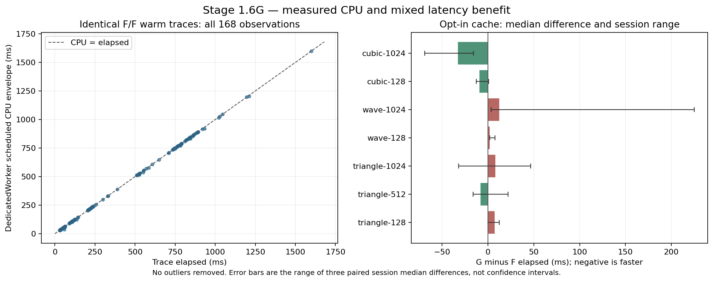

# Stage 1.6G — deterministic runtime profiling and reliability

**PARTIAL.** Work attribution, A/A controls, lifecycle instrumentation and an
opt-in cache prototype are implemented. The historical +747.4ms Triangle 512
median episode was not reproduced or causally explained. No claim of complete
runtime stabilization or universal speedup is made. Main is unchanged; ordinary
source_geometry/large_apex do not enable the cache prototype.

## Revisions and immutable evidence

Base: `c7f47512598cec01ad0adc9516af94e3ff58c963` on
feat/stage-1-6f-large-apex-recovery; its validated engine was
`1b454e9de0e131bae8cc2bb026db0eeb901d0bd5`.
Stage 1.6E comparator: `0b67da0cce87476adc59acc7396eb8cfd542452a`.
Work branch: feat/stage-1-6g-runtime-stabilization.
Implementation: `1487d80`; app-telemetry test correction: `4d2fab3`;
shallow-checkout preparation correction: `c6cda334973b05c2da96629de69b03a8b63d17e7`;
negative-context accounting correction: `353ceb3`.
No merge or global promotion is authorized or performed for this stage.

Historical Stage 1.6F artifacts and old gate files were not overwritten. The
local Stage 1.6G experiments have separate immutable directories, exact WASM
SHA256 values and environment manifests. Development profiling binaries precede
the final commits; their module hashes and source/protocol snapshots identify
those experiments. CI rebuilds from the exact committed source. Raw scores and
compiled modules are artifacts, not committed benchmark JSON or dependencies.

## Original failure and reproduction design

Historical Triangle 512: E median 526.7ms, F median 1274.1ms (+747.4ms), same SVG;
allowed increment remains 500ms. Historical cold Wave 856.4/544.6ms and Cubic
1412.1/745.3ms also failed the unchanged 50% rule. They are retained in the Stage
1.6F namespaces/report. Neither worker exclusion nor zero large-apex time alone
was previously sufficient to establish the cause.

Fresh pinned worktrees build E with source_geometry and F with large_apex. The
new probe uses real module Workers and the original PNG at each resolution,
not another-resolution image or a reference SVG. Seven fixtures have E/E, F/F
and E/F controls: three independent page/Worker contexts per pair, one first
trace, four warm traces and one Worker-reset trace per slot. Orders alternate
deterministically. The reproduction records 756 observations; a separate opt-in
cache experiment records 504 F/F and F/G observations, and matched diagnostic
cache-off/on profiling records 64 more. All outliers and failed experiments stay.

Cold means a fresh Worker/module instance. The browser process, OS file cache
and V8 compiled-code cache are not reset between contexts. These are independent
Worker lifetimes, not three physically cold machines. Four warm values from the
same Worker are not four independent sessions. No confidence interval is inferred
from treating all warm values as independent. Reset is explicitly measured.

Raw PNG decoding/fetch/canvas time, module import, WASM instantiation, Worker
startup round trip, trace call, getter time, browser message round trip, host
protocol round trip, thread CPU/runqueue counters and memory are retained. Node
hashing, SVG writes, metrics and screenshots occur outside the trace clock.
There is no parallel build/test workload during the controlled timing sweeps.

Environment: v24.19.0, Chromium 154.0.8037.57, linux
6.18.55, INTEL(R) XEON(R) PLATINUM 8573C, 5 visible logical CPUs,
cgroup quota `400000 100000` (four CPU-seconds per second). Default
browser flags; no CPU affinity or fixed hardware frequency is asserted. This
is a shared managed cloud machine, not a calibrated Android device.

## Timer audit and overlap

| Quantity | Includes | Excludes / caveat |
|---|---|---|
| UI decodeMs | File decoding and input preparation | Worker startup/trace |
| App startupMs | Cached createEngine promise / module import and WASM init | Worker script fetch and main-thread construction |
| App traceMs | JS input diagnostics, precision scan, WASM call and returned metrics | Prior decode and startup |
| App workerTotalMs | Startup plus adapter trace | Main-thread scheduling / transfer to receiver |
| Probe wasmMs | wasm-bindgen RGBA allocation/copy, Rust processing, SVG return decoding | Module import/init and diagnostics getters |
| rust_trace | Rust trace_quality entry through result, including configuration | Binding input copy before Rust and JS SVG decoding after return |
| stage[5] preparation | Source prepare before pipeline start | Not part of stage[0] |
| stage[0] segmentation | Pipeline start to segment completion | Later region fitting |
| stage[6] fitting | Compose, fitting/source fitting, repair and owner location | Later reduction/recovery |
| stage[2] refinement | Coverage, quantization, reducer, recovery and line serialization | Writer string export |
| stage[4] export | Writer.write | Subsequent alpha path construction |
| stage[3] alpha | Alpha.apply after writer | Not opacity-only CPU time in all modes |
| stage[1] old postprocess | Entire tail after segmentation | OVERLAPS fitting/refinement/export/alpha; never add to them |
| Large recovery | Whole large::refine | Nests preflight, joint fitting and local validation |
| Final validation | Drift, self/other-path crossing, containment and source score | Inside recovery and refinement |
| Browser round trip | Input copy/transfer, Worker execution/getters, return and main scheduling | Decode/startup measured separately |
| Host round trip | Playwright transport plus browser round trip | Not pure browser CPU |

All new Scope timers are inclusive and nest. The profile exposes fixed counters
and nested times, not disjoint stages to sum together. Triangle 512 ordinary
joint_handles belongs to its Stage 1.6E initializer; it is not a large-apex solve.
The separate large_joint_solves counter distinguishes them. Application E2E reads
the actual flattened DOM telemetry: warm, startupMs, workerTotalMs and traceMs.
Automation click-to-result is a separate wall measurement including polling.

## A/A and A/B distributions

Each warm slot below contains 12 retained observations across three Worker
lifetimes. Values are median / nearest-rank p95 / maximum milliseconds. With
12 values, nearest-rank p95 equals the maximum. Raw first/reset samples are
reported separately and never silently pooled into warm medians.

| Fixture | Pair | Slot 0 warm ms | Slot 1 warm ms | Additional median ms |
|---|---|---|---|---|
| triangle-128 | E/E | 21.15 / 40.90 / 40.90 | 19.80 / 27.80 / 27.80 | -1.35 |
| triangle-128 | F/F | 34.10 / 38.90 / 38.90 | 34.10 / 44.00 / 44.00 | 0.00 |
| triangle-128 | E/F | 19.05 / 30.20 / 30.20 | 35.65 / 42.20 / 42.20 | 16.60 |
| triangle-512 | E/E | 216.65 / 227.00 / 227.00 | 200.55 / 211.50 / 211.50 | -16.10 |
| triangle-512 | F/F | 215.65 / 232.00 / 232.00 | 222.65 / 241.80 / 241.80 | 7.00 |
| triangle-512 | E/F | 223.75 / 266.40 / 266.40 | 225.05 / 422.70 / 422.70 | 1.30 |
| triangle-1024 | E/E | 546.05 / 670.80 / 670.80 | 580.75 / 720.10 / 720.10 | 34.70 |
| triangle-1024 | F/F | 620.35 / 1086.90 / 1086.90 | 608.05 / 782.40 / 782.40 | -12.30 |
| triangle-1024 | E/F | 550.40 / 995.80 / 995.80 | 554.70 / 572.50 / 572.50 | 4.30 |
| wave-128 | E/E | 115.30 / 124.60 / 124.60 | 114.35 / 137.10 / 137.10 | -0.95 |
| wave-128 | F/F | 107.35 / 137.20 / 137.20 | 112.30 / 122.90 / 122.90 | 4.95 |
| wave-128 | E/F | 121.85 / 141.30 / 141.30 | 113.60 / 134.30 / 134.30 | -8.25 |
| wave-1024 | E/E | 780.05 / 815.90 / 815.90 | 724.70 / 869.10 / 869.10 | -55.35 |
| wave-1024 | F/F | 739.55 / 873.90 / 873.90 | 786.05 / 925.20 / 925.20 | 46.50 |
| wave-1024 | E/F | 742.00 / 839.60 / 839.60 | 729.60 / 1139.50 / 1139.50 | -12.40 |
| cubic-128 | E/E | 61.45 / 143.80 / 143.80 | 56.45 / 63.10 / 63.10 | -5.00 |
| cubic-128 | F/F | 57.85 / 69.00 / 69.00 | 62.05 / 87.30 / 87.30 | 4.20 |
| cubic-128 | E/F | 62.95 / 79.80 / 79.80 | 63.90 / 67.40 / 67.40 | 0.95 |
| cubic-1024 | E/E | 845.85 / 870.80 / 870.80 | 803.95 / 1047.90 / 1047.90 | -41.90 |
| cubic-1024 | F/F | 839.45 / 1020.70 / 1020.70 | 832.90 / 879.80 / 879.80 | -6.55 |
| cubic-1024 | E/F | 848.30 / 905.40 / 905.40 | 841.70 / 935.70 / 935.70 | -6.60 |

A/A is not perfectly equal. Warm median offsets reach ~55ms on the large core
cases; individual A/A warm outliers exceed a second. The specific +747.4ms paired
median episode did not recur in this fixed design. This is a non-reproduction,
not proof that the historical regression was noise or safe to waive.

| Fixture | F first median / max ms | F warm median / max ms | F reset median / max ms | Warm MAD ms |
|---|---|---|---|---|
| triangle-128 | 88.90 / 142.50 | 34.10 / 44.00 | 32.50 / 36.00 | 2.05 |
| triangle-512 | 292.10 / 350.60 | 218.45 / 241.80 | 209.60 / 230.90 | 8.70 |
| triangle-1024 | 666.85 / 946.70 | 615.05 / 1086.90 | 540.90 / 572.30 | 61.75 |
| wave-128 | 175.70 / 258.10 | 110.85 / 137.20 | 115.40 / 129.70 | 5.40 |
| wave-1024 | 904.00 / 1082.50 | 779.10 / 925.20 | 731.50 / 844.90 | 36.60 |
| cubic-128 | 140.70 / 333.30 | 59.90 / 87.30 | 61.00 / 67.90 | 4.50 |
| cubic-1024 | 952.25 / 1221.10 | 834.70 / 1020.70 | 804.05 / 857.30 | 37.50 |

The final statistics helper uses an ordinary even median and MAD, population
variance and nearest-rank p95. The initial reproduction summary used an upper
central deviation for even MAD; that field is not used above. Raw observations
and original summary remain immutable; this report recomputes ordinary MAD.
Unit tests now cover even medians/MAD, p95, empty input and retained outliers.

## Attribution and limits of causal evidence

The old direct-call timing excludes Worker startup, input decoding, application
input diagnostics, artifact rendering and initial module.default instantiation.
Those cannot directly account for its measured +747ms. They can indirectly affect
process state, caches or available CPU; that possibility is not a measured cause.
The old postprocess timer's overlap can mislead attribution, but cannot itself
change the outer elapsed measurement.

In the controlled optimization run, an identical F/F Cubic 1024 warm trace took
1599.3ms, with 1599.91ms scheduled DedicatedWorker CPU and only 1.41ms runqueue
wait. Its fitting tail was 1099.8ms and recovery 377.2ms. A Wave F/F warm outlier
1021.1ms had 1016.55ms Worker CPU, 5.76ms runqueue, and 273.5ms segmentation.
A Triangle 512 F/F warm 389.9ms trace had 387.16ms Worker CPU and 3.07ms runqueue.
These observation envelopes include wrappers/getters/return overhead; they are
not exclusively Rust CPU. Background compilation threads are separately retained.

Thus these sampled slow traces were predominantly on-CPU, not hundreds of
milliseconds waiting in the Linux runqueue. This does not explain the earlier
unrecorded episode or isolate JIT, GC, allocator/cache behavior or CPU-frequency
changes. The counter-instrumented runs show deterministic work counts for a
fixed image even when elapsed time varies. JIT/GC/frequency causality remains
UNRESOLVED; no favorable rerun is substituted for a failed gate.

A bounded additional traced F/F experiment used Triangle 512 in fresh browser
processes with default flags and with --no-wasm-tier-up. Each kept 16 observations.
Both warm medians were 217.95ms; first medians were 351.10ms and 304.35ms.
All SVG hashes matched. Top-level MinorGC events totaled 21.01ms and 20.38ms over
the respective full captures (10 collections each); nested GC event durations
are not added together. The requested tracing categories exposed no WASM tier
events, so this does NOT establish tier-up state or exclude JIT as a cause.
The flag experiment did not isolate or fix the historical slowdown; no production
browser flags were changed. Both raw Chrome traces and all observations remain
under trace-default-20261026T122349 and trace-no-tier-20261026T122357.

## Function profiling and expensive work

runtime_profile is feature-only, implies large_apex/runtime_cache and stores 32
counters plus 32 inclusive times in a fixed array. No detailed instrumentation
or diagnostic allocations exist in normal builds. Per-trace reset is at both
public trace entrypoints; typed getters are read outside the probe trace timer.
Counts cover eligible/rejected contexts, source samples, hypothesis construction,
local trials, candidate scores, flattening, Green integration, exact-cache hits/
misses and full validation calls. Scopes cover source/inverse fitting, reduction,
continuity, ordinary corner initialization, joint handles and large recovery.

For Triangle 512 and core curves, large recovery/large joint counters are zero;
ordinary Triangle 512 has three joint-handle fits. Triangle 128 alone enters the
large path. Zero elapsed time is not used as evidence of skipped execution.
All profile work signatures are stable across first/warm/reset observations.

Green integration and repeated local curve flattening are measurable hot paths.
Cubic 1024 also spends substantial time in inverse fitting before recovery;
that path remains a major bottleneck. Profiling is separately built and timed:
FFI calls to performance.now add overhead, so instrumented total time is not
presented as the uninstrumented application's runtime.

## Opt-in exact contribution cache

Patch scoring previously recomputed every changed-slot cubic even when a trial
modified only one handle. runtime_cache retains one exact-control-key signed-area
vector per slot for the lifetime of that immutable source patch. Contributions
are still summed in their original order, with unchanged abs/clamp and loss.
No fitting, acceptance, rollback, corner, topology or drift threshold changes.
Cache metadata is bounded by the existing cubic cap and cached f64 cells by
65536 (512KiB), plus slot metadata. Larger products fall back to the old path.
Tests compare score bits through perturbation, rollback, cardinality changes and
memory-cap fallback. The final validator is never removed or cached away.

runtime_uncached provides a reproducible diagnostic control with the same fitter
and guards, cache disabled. runtime_profile includes the cache; ordinary
source_geometry and large_apex keep their original uncached scoring path. The
prototype is explicitly opt-in because whole-conversion benefits are mixed.

| Fixture | Green calls off → on | Flatten calls off → on | Hits | Median patch score ms off → on |
|---|---|---|---|---|
| triangle-128 | 93 → 63 | 96 → 66 | 30 | 2.20 → 1.45 |
| triangle-512 | 497 → 401 | 511 → 415 | 96 | 26.60 → 23.05 |
| cubic-1024 | 998 → 923 | 1002 → 927 | 75 | 64.75 → 60.45 |
| wave-1024 | 967 → 844 | 971 → 848 | 123 | 70.25 → 70.25 |

| Fixture | F warm median ms | Opt-in G warm median ms | Difference ms | Per-session paired median differences ms |
|---|---|---|---|---|
| triangle-128 | 37.70 | 45.10 | 7.40 | 4.65, 0.05, 12.35 |
| triangle-512 | 238.65 | 230.45 | -8.20 | 21.90, 16.75, -16.20 |
| triangle-1024 | 574.35 | 582.35 | 8.00 | -25.35, 46.55, -32.00 |
| wave-128 | 109.00 | 111.05 | 2.05 | 3.30, 1.90, 7.50 |
| wave-1024 | 786.05 | 798.20 | 12.15 | 28.60, 3.35, 224.85 |
| cubic-128 | 62.35 | 53.20 | -9.15 | -8.80, -12.85, 0.75 |
| cubic-1024 | 860.55 | 827.90 | -32.65 | -68.90, -18.90, -15.70 |

Cubic 1024 improves in all three paired sessions; Wave and several smaller shapes
do not demonstrate a consistent whole-trace benefit. Coverage work reduction is
real; a universal latency gain is rejected. The new cache is not enabled on the
ordinary experimental or production path. No precision or geometry tradeoff is
made to obtain the measured improvement.

The figure uses every F/F warm observation in the uninstrumented optimization
experiment. CPU envelopes include wrapper/getter/message work. Error bars show
three paired session median differences, not confidence intervals. It was
plotted with installed Matplotlib; no plotting dependency was added to the app.

## Geometry, topology and source fidelity

The separate final proof uses clean committed code with large_apex/runtime_cache
and the actual Stage 1.6F module. All 45 browser-download comparisons are byte-
identical, including all nine protected cases. All 45 Auto hashes also match.
The unchanged boundary, corner and RGBA metrics run against the actual exports;
identity is not inferred from an optimizer's intermediate representation.
The partial-alpha 0.980 gate and shared-edge identity tests remain intact.

| Protected fixture | Endpoint-inclusive maximum px | Bytes / anchors | F/G identity |
|---|---|---|---|
| [triangle-eight-native-srgb-128](evidence/stage16g/triangle-eight-native-srgb-128.svg) | 0.409670 | 605 / 14 | exact |
| [triangle-eight-native-srgb-512](evidence/stage16g/triangle-eight-native-srgb-512.svg) | 0.985251 | 2040 / 53 | exact |
| [triangle-eight-native-srgb-1024](evidence/stage16g/triangle-eight-native-srgb-1024.svg) | 1.292558 | 3202 / 79 | exact |
| [wave-128](evidence/stage16g/wave-128.svg) | 0.502973 | 889 / 23 | exact |
| [wave-512](evidence/stage16g/wave-512.svg) | 0.578088 | 1103 / 27 | exact |
| [wave-1024](evidence/stage16g/wave-1024.svg) | 0.660000 | 2309 / 57 | exact |
| [cubic-128](evidence/stage16g/cubic-128.svg) | 0.823200 | 708 / 18 | exact |
| [cubic-512](evidence/stage16g/cubic-512.svg) | 0.823200 | 1430 / 38 | exact |
| [cubic-1024](evidence/stage16g/cubic-1024.svg) | 0.766976 | 2735 / 72 | exact |

Identical retained defective held-outs are not repairs. No new anchor, false G0,
proper crossing, hole, winding, containment or paint change is claimed from timing
alone. VTracer 1.0.0-alpha.4 remains pinned at e71343fbcbf469b8a72a255030408a39939162eb;
visioncortex/flo_curves and their licenses remain unchanged. No tracing engine,
cloud service, heavy optimizer, backend or dependency was added.

## Gate outcomes and failed experiments

Local default Rust 69, source_geometry 69, large_apex 72, upstream VTracer 31,
cache-enabled large_apex 73, runtime_profile 74 and runtime_uncached 74 tests pass.
TypeScript 42 tests, lint, typecheck, production WASM and Vite builds pass.
The original normal E2E invocation had 26 PASS plus the new schema-test failure;
the corrected targeted test passes. The final experimental cache build passes
all 27 browser tests, including actual Worker reuse/Reset, alpha, shared-edge,
source quality, cancellation, download and export checks. Inkscape CLI import/
plain-SVG roundtrip passes for three low-resolution core exports; GUI editing
and Illustrator are unverified.

The complete source-target-research.sh invocation ran once and exited **1**:
Stage 1.6B geometry/runtime gate PASS; Stage 1.6C gate PASS; Stage 1.6D gate FAIL
on thin-ellipse-native-srgb-1024, added paired median exceeding the unchanged
500ms budget. Measured thin-ellipse medians were 858.20ms baseline and 1392.20ms candidate,
a +534.00ms increase. It stopped before E/F/identity phases. No retry was performed and
no later identity result changes this full-run failure. That source_geometry
build does not enable the cache or large-apex solver. Its SVG for this case is
unchanged. Remaining phases are not claimed locally executed by that failed run.

A separately named final proof runs the opt-in cache build's 27 browser tests,
all 45 Stage 1.6F/G paired exports, the exact-identity gate (**PASS**), and Inkscape
checks. This is separate evidence, not a full historical-suite PASS. Both the
500ms and 250ms/percentage gates remain blocking wherever they apply.
Negative rounded-tip 128 and nearly-parallel 512 probes each verify one eligible,
zero accepted and one rejected component. An initial diagnostic counter omitted
this no-hypothesis rejection; it is corrected and 32 negative observations verify
eligible = accepted + rejected without changing geometry or acceptance.

The first app-telemetry test used nonexistent nested timings fields; the app's
DOM telemetry is flat. That new test failed, the other 26 normal browser tests
passed, and the corrected targeted lifecycle test passed. No application behavior
or historical assertion was weakened. Initial profiling reset only covered trace,
not trace_quality; warm counters in that 64-observation development experiment
were cumulative. Its raw records stay; no warm work claim uses them. The corrected
entrypoint reset is verified per trace and by native tests; final profiling uses
only the corrected runs. Shallow CI checkout support explicitly fetches the two
pinned historical commits before creating worktrees.

All old quality-gate files and their 500ms, 250ms and percentage limits remain
byte-for-byte unchanged. Diagnostic distribution analysis is an additional report,
not a replacement acceptance rule. The historical 3px/3.5px contracts and the
separate Stage 1.6F source certificate remain unchanged.

## Memory, Android and readiness

WASM memory observations in every row are linear high-water allocation after the
trace, not live heap, browser RSS or physical device memory. The cache prototype
adds at most 512KiB of signed areas per live Patch plus bounded metadata, while
all previous input/command/context/sample/candidate/iteration caps remain.
Worker termination cancellation, reuse, 30s idle cleanup and obsolete-output
suppression are unchanged and tested. The dedicated application telemetry test
observes cold engine creation, warm reuse and Reset, with byte-identical exports.

| Fixture | F observed high-water MiB | Cache G observed high-water MiB |
|---|---|---|
| triangle-128 | 1.688 | 1.688 |
| triangle-512 | 8.375 | 8.375 |
| triangle-1024 | 37.625 | 37.625 |
| wave-128 | 1.750 | 1.750 |
| wave-1024 | 38.938 | 38.938 |
| cubic-128 | 1.750 | 1.750 |
| cubic-1024 | 34.875 | 34.875 |

These high-water values can exceed the live-cache increment due to allocator
reuse/fragmentation and linear-memory growth; they are not live-heap measurements.

Physical Android: **UNVERIFIED**. No adb/device is available in this cloud session.
[USB/local-only procedure](STAGE_01_6G_ANDROID_PROCEDURE.md) records device/browser,
thermal conditions, cold/warm timings, memory, responsiveness and cancellation.
Desktop emulation and CI are not physical phone evidence.

## Measurement policy proposal — not activated

Keep old gates unchanged. For a separately reviewed future policy, specify cold
instance versus cold process, retain every observation, use multiple independent
Worker lifetimes with alternating order, publish first/warm/reset distributions,
and compare against A/A dispersion before assigning causality. Publish CPU and
runqueue evidence alongside wall time; report availability if proc data cannot
be read. Do not infer statistical independence from four traces in one Worker,
add overlapping timers, silently discard tails, or pass geometry-identical code
whose substantial runtime variation remains unexplained. Any revised acceptance
policy needs a separate review; this stage does not revise it.

## Artifacts, CI and reproduction

[Implementation CI 40318733168](https://github.com/akidwush/vector-magic-bydika/actions/runs/40318733168)
**PASS**, 32m17s, exact c6cda33 source. The independent runtime job and complete
normal/experimental historical regression job both finish successfully. Its
reliability report remains PARTIAL by design: successful diagnostic execution is
not proof of stable runtime or promotion. The local historical 500ms failure
above remains a failed local run.

[Negative-accounting correction CI 40321838454](https://github.com/akidwush/vector-magic-bydika/actions/runs/40321838454)
was IN_PROGRESS at report capture. The 353ceb3 correction only adds a feature-only
rejection counter and negative probes; local 74-test profiling and 32 negative
observations pass. No pending workflow is reported as PASS. Documentation-only
follow-up workflow status is separate from the validated engine workflow.

Raw manifests, observations/jsonl, SVGs, counts, timing arrays, thread CPU and
scheduler data, module SHA256 values and identity/reliability reports are uploaded
by Actions as stage-16g-runtime-raw. Existing stage-01-evidence retains all quality
exports and failure details. Raw benchmark scores are not committed to Git.

Local evidence:
- reproduction-20261026T112701: 756 E/E, F/F, E/F observations and preserved harness;
- profile-fixed-before-20261026T113716: corrected baseline counters;
- cache-profile-20261026T113950: matched off/on diagnostic observations;
- optimization-20261026T114120: 504 uninstrumented F/F and F/G observations;
- local-analysis/reliability.json: independent reanalysis, status PARTIAL;
- `benchmark-results/stage16g/final-proof-20261026T121022`: final experimental browser/45-case proof.

Run the specified default/source_geometry/large_apex native suites, upstream tests,
unit/lint/typecheck, normal WASM/Vite and browser tests. Additional runtime_profile,
runtime_uncached and runtime_cache suites exercise diagnostics and cache invariants.
Run source-target-research.sh once for existing gates and the added 45-case
identity proof; it preserves failure exit codes and restores normal WASM/dist.
runtime-research.sh writes only isolated module directories, runs A/A/A/B and
profile controls, never mutates app builds or retries failed gates, and emits
an explicitly PARTIAL reliability report when historical causality is unresolved.
A successful diagnostics job is not production promotion.

## Modified files and next milestone

Engine: feature flags; fixed runtime_profile module; feature-only trace getters;
inclusive scopes/counters in lib, inverse, source_fit, planar, reduce, recovery,
acute, large and continuity; opt-in Patch contribution cache and exact-score tests.
Tooling: runtime builds/probe/statistics/reliability/research/identity scripts,
new unit/application lifecycle tests, isolated historical runner/benchmark variant,
CI artifact job and branch coverage, README and these reports/evidence. Worker,
adapters, input decoder and geometry acceptance algorithms are unchanged.

Recommendation: retain this branch as PARTIAL research. Do not merge or promote
globally. Next work should correlate sampled WASM stacks, V8 tier/GC events,
allocator behavior and hardware counters under controlled CPU frequency, then
repeat on physical Android. Optimizing dominant inverse fitting requires its own
profile and byte-identity proof. Keep the cache opt-in until repeatable whole-
conversion benefit is established beyond Cubic and no small-feature penalty is
introduced. Correct geometry has not been traded away for speed.
