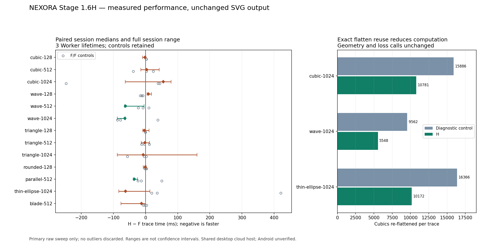

# Stage 1.6H — inverse fitting hot-path optimization

**PARTIAL; research only.** Source-exact reuse and removal of transient integral
buffers reduce measured work. Wave 512 and Wave 1024 improve in all three paired
sessions against both Stage F and the opt-in Stage G cache. Cubic 1024 and small
inputs have mixed whole-trace outcomes. No universal speedup, stabilized historical
runtime, physical Android result or production promotion is claimed. The complete
local historical run and the separately continued H/E runtime gate both FAIL;
those outcomes block promotion despite passing CI and byte-identical geometry.

## Revisions and activation

Verified base: `a9e104a1b5a42736d91abf89db64a4e2d2a77c3f`, fetched and checked
against the remote Stage G branch. Last confirmed diagnostic base: `353ceb3`.
Engine implementation: `7772a310e0e263caa0ead59eb14528b55aea439f`.
Evidence-isolation follow-up: `f160d93`; additional exported-budget check: `052d3fc`.
Work branch: `feat/stage-1-6h-inverse-hotpath`. Main remains `69b06ef8383b729223040a1282cd10809eb172f1`.
No merge, force-push or global activation.

The independent `inverse_hotpath` Cargo feature implies source_geometry. Primary
experiments build `large_apex,inverse_hotpath`; ordinary source_geometry,
large_apex, runtime_cache and Auto keep their previous feature policy. The H build
does not activate the Stage G patch cache. Normal WASM contains no runtime-profile
or inverse-work diagnostic getters. Workers, adapters, types and decoding code
are unchanged.

## Audit and proven costs

VTracer 1.0.0-alpha.4 (pinned e71343fbcbf469b8a72a255030408a39939162eb) remains the tracing foundation; flo_curves 0.8.0 and upstream licenses are unchanged. RegionFitter invokes source_fit::optimize
and then inverse::component; inverse::refine initializes through the existing
corner/flo_curves fitter, ranks local source neighborhoods and tests handles.
The output pipeline stays VTracer → source fit → quantization → node reduction →
output-consistent recovery → SVG serialization. Shared edges remain owned by the
existing compositor; there is no per-face post-composition optimizer.

Each handle proposal previously flattened the entire candidate and recomputed row
geometry for every source pixel. The clamp integral created a two-element Vec,
occasionally growing it for clamp breakpoints. Initial diagnostics count 564,699
such Vec constructions on Cubic 1024 and 758,486 on Wave 1024 per trace. These
are instrumented construction events, not a global allocator measurement.

Measured initializations use 189 loss calls on Cubic 1024, 137 on Wave 1024,
and one on each primary Triangle case. Fitting a new spline itself is a few
milliseconds here; it is not the dominant inverse-fit cost. Source preparation
also costs milliseconds, but dense and sparse neighborhoods differ. Reusing
colors/gamma between these distinct layouts without revalidation would be invalid.
No such reuse is introduced.

## Optimization and exact dependencies

1. Use four stack cells for the at-most-two clamp breakpoints. Preserve the same
   sorting, expression order, breakpoint filtering and sequential sum.
2. Prepare x(lo), x(hi), clipped dy and winding sign once per directed row edge.
   Previously these immutable expressions were repeated per source sample.
   Subtract sample x afterward, at the same arithmetic boundary. Preserve row
   edge order and each sample's area-addition order, followed by the old abs/clamp.
3. Within the known repeated single-handle search, keep one flattened chain per
   cubic slot. Activate only for 8–128 cubics; the caller already requires eight
   local samples and performs repeated proposals. Small/ineligible searches use
   the old flatten path. There is no filename, resolution-reference or semantic
   fixture shortcut.

Keys contain all eight exact control-coordinate bit patterns and tolerance bits;
signed zero, control order and orientation are retained. A slot mutation or
tolerance change misses; knot-count changes clear the entries. Rollback can reuse
only an exact previous key. Each LocalLoss borrows one immutable source layout
inside one owned component search, then drops; it cannot persist across a new
image, component, conversion, cancellation or Worker reset. Flatten values depend
only on geometry and tolerance, not source color. No gamma, ownership decision,
scalar loss, candidate acceptance or final topology result is cached.

Cached point cells are capped at 32,768 (512 KiB), plus at most 128 slot records.
Boxed slices retain exact-length point storage. Cap exhaustion clears/disables
reuse and falls back to the original computation. Existing 8,192-output-point,
18-level subdivision, sample, candidate and component limits remain. Reassembled
chains preserve the original permitted final 8,193rd point and subsequent failure
behavior. Temporary flattened/coverage buffers remain separately bounded.

This is not a second area cache: LocalLoss ends before recovery::Patch is built.
The optional Stage G patch cache remains a separate opt-in recovery experiment.
No approximate keys, fast-math, coordinate rounding changes, reassociated per-cubic
area sums, altered regularization, new early candidate rejection or removed final
validation. Green calls and logical loss/sample counts remain unchanged; H reduces
work inside them and repeated flattening, not the number of evaluated hypotheses.

## Numerical equivalence

Native differential tests compare exact f64 bits against the legacy expression
across clamp boundaries, signed zero, large outside-pixel coordinates, both winding
orientations and 100 deterministic irregular polygons. Further tests compare loss
bits through handle trials, rollback, changed tolerances, topology cardinality,
new source samples and fallback. Open/degenerate/over-limit inputs keep old behavior.
Native x86 and actual Chromium WASM exports are verified; no claim about physical
Android hardware follows from these tests.

The first 64 Stage G diagnostic fields keep their ABI. Inverse-work counters and
inclusive times use an appended fixed-size array in the same profiler, reset at
both trace entrypoints. Production macros compile away with no argument work.
Per-integral clocks are intentionally avoided. Scope times nest; they are never
added as independent CPU costs. The unused clamp_constant field is not evidence
of zero constant integrals and is not used for any claim below.

## Work counts and source fitting profile

Matched U/V builds use current code with runtime_uncached, without/with
inverse_hotpath. This disables the Stage G patch cache in both. Counts are stable
across first/warm/reset traces. U is a diagnostic semantic control, not the exact
historical uninstrumented F binary. Instrumentation affects elapsed time; whole
latency claims use separate uninstrumented modules.

| Fixture | Loss calls | Cubics flattened U → H | Flatten cache hits | Clamp Vec constructions U → H | Cached points peak |
|---|---:|---:|---:|---:|---:|
| cubic-1024 | 189 = 189 | 15886 → 10781 | 5105 | 564699 → 0 | 831 |
| wave-1024 | 137 = 137 | 9562 → 5548 | 4014 | 758486 → 0 | 938 |
| triangle-128 | 1 = 1 | 186 → 186 | 0 | 31954 → 0 | 0 |
| triangle-512 | 1 = 1 | 1327 → 1327 | 0 | 168335 → 0 | 0 |
| rounded-128 | 1 = 1 | 11 → 11 | 0 | 6816 → 0 | 0 |
| parallel-512 | 130 = 130 | 2099 → 1074 | 1025 | 54351 → 0 | 176 |
| thin-ellipse-1024 | 169 = 169 | 16366 → 10172 | 6194 | 757869 → 0 | 999 |

Cubic 1024 processes 1,146,075 sample/area entries and 635,704 clamp terms;
Wave 1024 processes 1,179,230 and 841,934. These counts are identical in U/H.
Row kernels are prepared 48,845 and 70,530 times respectively instead of being
recomputed per clamp term. Cache peaks in this profile reach 999 points (15,984
bytes of point cells), well below the feature cap. No global heap allocation count,
live heap bytes or browser RSS was measured. Vec events and cached point counts
must not be represented as those quantities.

| Fixture | Inverse fit U → H ms | Loss U → H ms | Candidate fitter U → H ms | Sample preparation U → H ms |
|---|---:|---:|---:|---:|
| cubic-1024 | 292.50 → 259.10 | 120.05 → 90.90 | 5.45 → 5.35 | 11.85 → 13.25 |
| wave-1024 | 154.90 → 123.80 | 83.45 → 48.85 | 6.20 → 6.10 | 14.30 → 13.70 |
| triangle-128 | 0.30 → 0.45 | 0.30 → 0.45 | 0.00 → 0.00 | 1.95 → 2.25 |
| triangle-512 | 0.70 → 0.50 | 0.70 → 0.50 | 0.00 → 0.00 | 7.10 → 7.40 |
| rounded-128 | 0.60 → 0.30 | 0.55 → 0.30 | 0.00 → 0.00 | 3.90 → 4.60 |
| parallel-512 | 65.25 → 64.50 | 20.60 → 15.35 | 0.20 → 0.30 | 10.50 → 9.05 |
| thin-ellipse-1024 | 167.90 → 116.70 | 95.75 → 51.40 | 4.00 → 4.40 | 16.45 → 15.85 |

Loss includes flatten and coverage work; inverse fit includes loss, upstream
initialization and safety checks. The remaining inverse-fit cost is not assigned
to an unmeasured function by subtraction. Full raw Scope arrays retain geometry
correspondence, planar flatten, recovery, continuity, certification, joint fitting
and final validation. Triangle 512 records zero large recovery/large-joint entries;
its ordinary joint fits are not mislabeled as large-apex work.

## Independent benchmark design

Reuse the Stage G real-module-Worker harness. Immutable fresh worktrees build:
F = c7f47512598cec01ad0adc9516af94e3ff58c963 with large_apex;
E label = pinned Stage G a9e104a with large_apex,runtime_cache;
G label = Stage H 7772a31 with large_apex,inverse_hotpath.
Thus raw F/G means F/H and raw E/G means G-cache/H. Names and exact module SHA256s
are retained in environment.json; no historical module/result is overwritten.

13 fixtures × three independent page/Worker lifetimes × F/F, F/H, G-cache/H ×
two slots × first + four warm + reset = **1,404 observations**. Matched detailed
profiling contributes 112 separate observations. Three sessions are independent
Worker contexts on one machine, not three independent machines. Fresh Worker does
not reset OS/browser compiled-code caches or imply a thermally cold CPU.

Every outlier stays. Pair and first/warm order alternate deterministically. There
is no simultaneous local build/test workload during timing sweeps. Decode,
module import/instantiation/startup, binding/trace time, getter time, browser/host
round trips, per-thread CPU/runqueue snapshots and linear memory are separated.
Artifact writes, geometry scoring and screenshots occur outside the trace clock.
JS adapter diagnostics and full application automation are tested separately;
the direct Worker probe is not described as click-to-download latency.

Environment: Node v24.19.0; Chromium 154.0.8037.57; Rust 1.99.1;
wasm-bindgen 0.2.126; Linux 6.18.55; Xeon Platinum 8573C;
five visible logical CPUs; cgroup cpu.max 400000/100000. Default browser flags,
shared managed environment, no fixed CPU frequency/affinity claim.

## Whole-trace warm distributions

Each slot has 12 warm values across three sessions. Values below are median /
nearest-rank p95 / maximum ms. With n=12, p95 equals maximum. Population variance,
MAD and all individual observations remain in the raw analysis. No tail is removed.

| Fixture | F ms | H ms | F/F median delta | F/H session median deltas ms |
|---|---|---|---:|---|
| cubic-128 | 61.15 / 171.80 / 171.80 | 59.25 / 91.80 / 91.80 | 3.65 | -9.30, -1.60, 0.65 |
| cubic-512 | 242.15 / 625.30 / 625.30 | 241.00 / 299.30 / 299.30 | 5.35 | -14.85, 3.55, 42.50 |
| cubic-1024 | 907.90 / 1113.70 / 1113.70 | 888.40 / 1496.90 / 1496.90 | -10.90 | 79.65, -63.20, 55.40 |
| wave-128 | 118.05 / 132.80 / 132.80 | 127.80 / 214.80 / 214.80 | -9.60 | 5.00, 18.35, 8.70 |
| wave-512 | 341.75 / 661.10 / 661.10 | 288.85 / 545.30 / 545.30 | -1.10 | -66.05, -62.55, -4.65 |
| wave-1024 | 765.80 / 1060.60 / 1060.60 | 699.15 / 940.60 / 940.60 | -33.05 | -64.35, -88.15, -62.30 |
| triangle-128 | 40.35 / 56.00 / 56.00 | 34.00 / 65.80 / 65.80 | 1.30 | -3.95, -8.35, 10.75 |
| triangle-512 | 227.10 / 240.90 / 240.90 | 224.80 / 267.10 / 267.10 | 0.80 | -13.20, -2.20, 11.90 |
| triangle-1024 | 592.85 / 862.80 / 862.80 | 600.15 / 1161.60 / 1161.60 | -44.45 | 160.15, -7.30, -87.90 |
| rounded-128 | 25.00 / 38.70 / 38.70 | 24.60 / 33.20 / 33.20 | -1.85 | 2.10, -1.35, -7.30 |
| parallel-512 | 215.20 / 347.90 / 347.90 | 192.55 / 274.30 / 274.30 | 3.85 | -34.80, -38.10, -25.00 |
| thin-ellipse-1024 | 717.10 / 1386.80 / 1386.80 | 709.75 / 806.60 / 806.60 | 42.85 | -62.35, -83.35, 13.45 |
| blade-512 | 299.65 / 759.00 / 759.00 | 288.25 / 376.30 / 376.30 | -0.10 | 0.40, -12.50, -76.80 |

| Fixture | G-cache warm ms | H warm ms | G-cache/H session median deltas ms |
|---|---|---|---|
| cubic-128 | 61.50 / 68.40 / 68.40 | 60.55 / 72.00 / 72.00 | 6.75, 2.90, -8.60 |
| cubic-512 | 242.05 / 285.40 / 285.40 | 236.40 / 270.40 / 270.40 | -11.45, 0.20, -2.05 |
| cubic-1024 | 856.80 / 1245.40 / 1245.40 | 820.50 / 1320.30 / 1320.30 | -196.60, 19.70, -71.15 |
| wave-128 | 116.00 / 130.50 / 130.50 | 110.55 / 130.50 / 130.50 | -6.50, -4.05, -1.10 |
| wave-512 | 324.10 / 358.20 / 358.20 | 283.00 / 332.30 / 332.30 | -45.45, -29.40, -42.85 |
| wave-1024 | 819.25 / 904.70 / 904.70 | 731.70 / 900.30 / 900.30 | -106.45, -44.05, -68.65 |
| triangle-128 | 36.55 / 44.60 / 44.60 | 41.00 / 82.90 / 82.90 | 10.65, -4.15, 11.40 |
| triangle-512 | 230.65 / 325.00 / 325.00 | 226.85 / 568.40 / 568.40 | -10.80, -12.70, 61.25 |
| triangle-1024 | 654.10 / 752.60 / 752.60 | 602.05 / 1046.70 / 1046.70 | -78.00, -57.50, -20.10 |
| rounded-128 | 24.05 / 44.60 / 44.60 | 25.30 / 65.00 / 65.00 | 0.95, -0.75, 9.00 |
| parallel-512 | 201.90 / 224.80 / 224.80 | 198.50 / 256.80 / 256.80 | 3.65, 17.45, -11.60 |
| thin-ellipse-1024 | 718.15 / 1196.50 / 1196.50 | 715.00 / 970.40 / 970.40 | 69.15, -50.20, 15.05 |
| blade-512 | 287.60 / 7881.10 / 7881.10 | 293.55 / 603.50 / 603.50 | 3.45, -9.45, 34.50 |

Wave 512 improves 341.75 → 288.85ms (15.48%) against F; Wave 1024 improves
765.80 → 699.15ms (8.70%). Both improve in all three paired sessions against F and
G-cache. These are observed scoped gains, not a universal speedup guarantee.
Cubic 1024 pooled median improves slightly, but two of its three F/H sessions are
slower; repeatable Cubic whole-trace improvement is **not established**.
Triangle 512 medians 227.10 → 224.80ms do not reproduce or explain the historical
+747.4ms episode. Its per-session differences remain mixed.

Primary Wave 128 is slower in all three F/H sessions (118.05 → 127.80ms pooled),
while its G-cache/H pair is faster. This triggered a separately named follow-up,
not a rerun replacing the primary sweep: 108 more F/F, F/H and H/H observations.
Its warm medians are 114.15/116.10, 130.70/126.75 and 115.60/121.95ms respectively.
F/H session deltas are -19.25/-4.10/-0.35ms; H/H are +13.25/+14.55/-2.50ms.
The original slower result remains. 32 matched small-input profile observations
show neither Wave 128 nor Cubic 128 uses the flatten cache; their loss count is one.
Therefore the primary Wave 128 slowdown is not attributed to flatten-cache hits.
These controls demonstrate inconsistency, not a proven JIT/GC/frequency cause.
Small-input latency stability remains **unresolved**, blocking global promotion.

The initial 80-observation diagnostic prototype had an unwired sample-preparation
timer; its other counts are retained but that zero is not evidence. The final
matched U/V runs time the actual preparation path. A 64-observation pilot is also
retained; favorable pilot numbers are not substituted for the complete sweep.

## Cold instances, reset and CPU attribution

| Fixture | F first / H first median ms | F reset / H reset median ms | F/H warm CPU median ms | F/H warm runqueue median ms |
|---|---:|---:|---:|---:|
| cubic-128 | 170.40 / 188.00 | 142.60 / 126.60 | 61.75 / 58.94 | 0.11 / 0.06 |
| cubic-512 | 351.70 / 331.00 | 331.80 / 348.00 | 242.66 / 236.49 | 0.08 / 0.83 |
| cubic-1024 | 1007.60 / 1053.40 | 1005.20 / 958.80 | 908.39 / 888.97 | 1.76 / 0.33 |
| wave-128 | 211.10 / 267.50 | 221.70 / 173.30 | 118.35 / 125.18 | 0.02 / 0.03 |
| wave-512 | 422.80 / 449.40 | 422.10 / 376.90 | 341.54 / 289.24 | 0.38 / 0.28 |
| wave-1024 | 906.60 / 846.60 | 964.70 / 878.70 | 765.64 / 698.65 | 0.24 / 0.72 |
| triangle-128 | 123.00 / 120.50 | 90.20 / 127.60 | 40.64 / 34.32 | 0.00 / 0.16 |
| triangle-512 | 307.00 / 392.10 | 321.90 / 292.30 | 225.68 / 224.78 | 0.26 / 0.23 |
| triangle-1024 | 794.30 / 863.40 | 819.10 / 802.70 | 593.40 / 599.49 | 0.04 / 0.85 |
| rounded-128 | 102.30 / 131.90 | 97.40 / 79.50 | 25.26 / 24.57 | 0.23 / 0.09 |
| parallel-512 | 355.40 / 277.20 | 298.60 / 289.30 | 215.76 / 193.66 | 0.28 / 0.14 |
| thin-ellipse-1024 | 962.90 / 941.40 | 930.70 / 820.80 | 717.38 / 709.99 | 0.26 / 2.35 |
| blade-512 | 367.00 / 469.80 | 355.00 / 404.70 | 298.34 / 285.42 | 0.14 / 0.44 |

Full first/warm/reset medians, p95, maxima, variance, MAD, startup, CPU, runqueue
and memory distributions are in inverse-hotpath-analysis.json and raw JSONL.
Worker CPU envelopes include wrappers/getters/return handling. They are not
exclusive Rust CPU; background compilation threads are separately retained.
The CPU/wall correspondence supports real computation for observed traces, but
cannot identify the historical unrecorded slowdown, GC, V8 tier state or hardware
frequency. The Stage G causal uncertainty remains unresolved.



The figure retains session-level variation and A/A controls; error bars are the
three session range, not confidence intervals. It uses actual raw measurements.

## Actual exported geometry and reconstruction

All **45 actual downloaded F/H SVGs are byte-identical**, and all 45 Auto hashes
match. Independent Chromium and libvips reconstruction metrics and endpoint-inclusive
reference geometry are computed from the downloaded exports. No metric threshold,
coordinate precision, corner identity, drift limit or node-reduction tolerance is
changed. The inherited comparison key stage16f/candidate denotes F/H; runtime
module hashes identify the actual binaries, not a diagram label.

| Protected export | Mean / p95 / maximum px | Anchors / curves | SVG bytes | libvips RGBA MAE / IoU | Corners P/R |
|---|---|---:|---:|---|---|
| [triangle-eight-native-srgb-128](evidence/stage16h/triangle-eight-native-srgb-128.svg) | 0.150871 / 0.381214 / 0.409670 | 14 / 10 | 605 | 0.892319 / 0.957821 | 1.000 / 1.000 |
| [triangle-eight-native-srgb-512](evidence/stage16h/triangle-eight-native-srgb-512.svg) | 0.064629 / 0.191055 / 0.985251 | 53 / 49 | 2040 | 0.762831 / 0.994527 | 1.000 / 1.000 |
| [triangle-eight-native-srgb-1024](evidence/stage16h/triangle-eight-native-srgb-1024.svg) | 0.054593 / 0.149175 / 1.292558 | 79 / 75 | 3202 | 0.740829 / 0.997554 | 1.000 / 1.000 |
| [wave-128](evidence/stage16h/wave-128.svg) | 0.028710 / 0.085308 / 0.502973 | 23 / 15 | 889 | 0.581848 / 0.994684 | 1.000 / 1.000 |
| [wave-512](evidence/stage16h/wave-512.svg) | 0.074254 / 0.237143 / 0.578088 | 27 / 20 | 1103 | 0.559772 / 0.998757 | 1.000 / 1.000 |
| [wave-1024](evidence/stage16h/wave-1024.svg) | 0.059089 / 0.241311 / 0.660000 | 57 / 50 | 2309 | 0.531787 / 0.999504 | 1.000 / 1.000 |
| [cubic-128](evidence/stage16h/cubic-128.svg) | 0.063891 / 0.270706 / 0.823200 | 18 / 11 | 708 | 0.646286 / 0.993450 | 1.000 / 1.000 |
| [cubic-512](evidence/stage16h/cubic-512.svg) | 0.055474 / 0.258020 / 0.823200 | 38 / 30 | 1430 | 0.545236 / 0.998876 | 1.000 / 1.000 |
| [cubic-1024](evidence/stage16h/cubic-1024.svg) | 0.047432 / 0.200903 / 0.766976 | 72 / 65 | 2735 | 0.528289 / 0.999596 | 1.000 / 1.000 |

All old sharp-corner, zero-false-corner Wave 128, containment, winding, closed-path,
crossing, shared-edge and partial-alpha gates remain. Byte identity is supported
by source/RGBA/corner tests, not inferred from fewer operations. Retained defective
held-out geometry is not called repaired. No extra anchors or curves are added.
Three actual low-resolution exports pass Inkscape CLI import/plain-SVG roundtrip;
GUI anchor editing and Illustrator remain unverified.

## Memory and Worker lifecycle

| Fixture | F observed linear high-water MiB | H observed linear high-water MiB |
|---|---:|---:|
| cubic-128 | 1.750 | 1.750 |
| cubic-512 | 9.000 | 9.000 |
| cubic-1024 | 34.875 | 34.875 |
| wave-128 | 1.750 | 1.750 |
| wave-512 | 10.625 | 10.625 |
| wave-1024 | 38.938 | 38.938 |
| triangle-128 | 1.688 | 1.688 |
| triangle-512 | 8.375 | 8.375 |
| triangle-1024 | 37.625 | 37.625 |
| rounded-128 | 1.688 | 1.688 |
| parallel-512 | 8.375 | 8.375 |
| thin-ellipse-1024 | 29.562 | 29.562 |
| blade-512 | 10.125 | 10.125 |

These are WASM linear allocation high-water values after traces, not live heap
or browser RSS. First/warm/reset observations are separate in the raw records.
The cache is lexical and freed before component search exits; there is no retained
geometry map across jobs. Worker termination releases the complete WASM instance.
The actual app lifecycle tests cover cancellation/replacement, warm reuse, Reset,
obsolete result suppression and object URL cleanup. No worker/decoder/resource
cap behavior is modified.

## Validation, original failures and budgets

Local native tests: default 69; source_geometry 69; large_apex 72;
inverse_hotpath 73; large_apex/inverse_hotpath 76;
large_apex/runtime_cache/inverse_hotpath 77; runtime_profile 74;
runtime_uncached 74; detailed runtime_uncached/inverse_hotpath 78; upstream VTracer 31.
All pass. TypeScript 42, lint, typecheck, normal WASM/Vite and normal 27 browser
cases pass; experimental H 27 browser cases, 45 exported identities and Inkscape
CLI imports pass. Each invocation has its original log and exit status.

```text
normal-wasm 0
normal-vite 0
normal-e2e 0
hotpath-proof 0
historical 1
restored-wasm 0
restored-vite 0
hotpath-budget 0
continued-large 1
```

- `historical/quality-gate.json`: **PASS**; failures: `[]`.
- `historical/low-resolution/quality-gate.json`: **PASS**; failures: `[]`.
- `historical/false-corner/quality-gate.json`: **PASS**; failures: `[]`.
- `historical/sharp-apex/quality-gate.json`: **FAIL**; failures: `[{"key":"clipped-blade-native-srgb-1024","reason":"added median CPU >500ms"}]`.

The added H/F budget gate applies the same +500ms paired-median and 250ms certified
apex limits to the actual 45 H exports. It does not replace any old percentage,
geometry, source or promotion gate. The six existing source/geometry/runtime promotion gate files remain byte-identical
to Stage G. The Stage G identity helper only gains a configurable evidence path;
its 45-case, SVG-byte and Auto assertions are unchanged. The full local runner exits 1 at the Stage 1.6E sharp-apex gate:
clipped-blade-native-srgb-1024 has Stage D times 437.60/1460.90/730.00ms
(median 730.00) versus ordinary source_geometry 2471.20/404.70/1282.40ms
(median 1282.40), a +552.40ms excess over the unchanged 500ms limit. SVG bytes
and geometric errors match. inverse_hotpath is not enabled in that build; the
cause is not established. The failed gate is not retried. The runner does not
reach its later F/cache/H phases; independent H proof and separately continued
large-apex evidence are identified as separate invocations.

Stage G's earlier thin-ellipse +534.00ms failed local D gate also remains FAIL
in its immutable namespace; this run's D PASS does not explain or relabel it.
Historical Stage F/G failed timing artifacts remain immutable; passing
this invocation or CI does not retroactively relabel them.

The separately continued Stage F gate, against actual H exports and pinned Stage E,
exits **1**. It runs only the previously unreached large-apex contract, never retries
the failed sharp-apex gate and does not change the full-run FAIL. All geometry,
source RGB, corner, topology and certified-apex checks pass; six +500ms timing
assertions fail. 44 E/H outputs are identical and Triangle 128 retains Stage F's
already-validated correction. This is not a new H geometry improvement.

| Continued H/E failure | E median ms | H median ms | Added median ms |
|---|---:|---:|---:|
| wave-1024 | 1454.80 | 4142.40 | 2687.60 |
| blade-narrow-box4-srgb-1024 | 748.00 | 1900.90 | 1152.90 |
| blade-rotated-box4-linear-noise-1024 | 667.70 | 1738.00 | 1070.30 |
| blade-oblique-native-srgb-1024 | 668.90 | 1177.50 | 508.60 |
| triangle-eight-native-srgb-1024 | 1693.10 | 3144.50 | 1451.40 |
| rounded-blade-native-srgb-1024 | 794.10 | 4722.40 | 3928.30 |

For Wave 1024 the H trace times are 5529.80/4142.40/4081.80ms versus
E 1454.80/2967.40/966.00ms; logical inverse evaluations are 137 in both.
This direct page/module export harness is distinct from the Worker sweep above.
Its H stage arrays include segmentation 736.20/518.10/83.50ms and refinement
700.30/1467.20/3273.00ms. Delays vary across stages, including untouched
segmentation; overlapping postprocess is not added to these. This does not
establish a causal JIT, scheduler, GC, allocator or hot-path explanation. The
direct export harness has no matched thread-CPU snapshots for this episode,
so the Worker CPU attribution cannot be transplanted to it. These large failures
remain **UNRESOLVED** and invalidate a general performance-promotion claim.

Continued raw exports, times and unchanged gate JSON are under
`continued-large/large-apex` inside the validation namespace. No rerun is used
to turn those failures into PASS.

Fixed-path legacy browser reports are moved aside before a test, new reports are
retained in that invocation's compatibility directory, and old bytes are restored
on success or failure. Historical build worktrees and normal WASM/dist are restored
with failure statuses retained. Failed gates are not rerun to obtain a favorable result.

## CI evidence and accepted/rejected experiments

[Engine CI 40328278476](https://github.com/akidwush/vector-magic-bydika/actions/runs/40328278476)
**PASS**, 17m19s, exact implementation 7772a31. Both the full normal/historical
validation job and runtime/experimental proof job pass. This verifies that commit;
the independent reliability report still says PARTIAL and no physical Android
claim follows. The evidence-isolation and extra budget follow-up has its own CI
status:
[follow-up CI 40332190232](https://github.com/akidwush/vector-magic-bydika/actions/runs/40332190232)
**PASS**, 22m01s, exact 052d3fc. Both jobs pass, including the added H/F exported
budgets. Neither CI PASS replaces the two local runtime FAILs. A documentation
follow-up is not silently reported as a passing engine run.

Accepted for opt-in research: stack clamp knots; ordered per-row constants;
exact local flatten reuse; appended fixed profiler counters; isolated artifacts;
actual H/F exported runtime-budget validation. Rejected for promotion: universal
cache activation or speedup claims, favorable-pilot-only conclusions, any inference
that fewer integration calls alone proves faster conversion, per-cubic area sums
that reassociate floating point, caching across different dense/sparse source
layouts, and removing final validation. No failed geometry candidate was promoted
by relaxing a tolerance.

## Artifacts and reproduction

Raw primary namespace:
`benchmark-results/stage16h/runtime-7772a31-20261026T131021-289343`.
It includes immutable E/F/G/U/V modules, SHA256 environment manifests, 1,404 raw
whole-trace observations, 112 matched profiles, SVG exports, reliability.json and
inverse-hotpath-analysis.json. Additional wave128-additional-controls has 108
observations and small-profile has 32. profile-baseline (80) and pilot (64) are
separate development artifacts. No observations or prior namespace is overwritten.

Actual proof/validation namespace: `benchmark-results/stage16h/validation-7772a31-20261026T132601`.

Actions uploads raw modules/observations/exports in runtime-raw-${github.sha},
with complete historical evidence in stage-01-evidence. Generated score JSON and
compiled WASM are artifacts, not committed source. The nine actual protected SVGs
and the measurement figure above are committed documentation evidence.

Reproduce native/unit/lint/typecheck and normal build/browser checks first. Run
`NEXORA_RUNTIME_STAGE=16h bash scripts/runtime-research.sh` for pinned F/G-cache/H
comparisons, or `bash scripts/inverse-hotpath-proof.sh` for actual H browser exports
and budgets. Run `NEXORA_RESEARCH_STAGE=stage16h NEXORA_INVERSE_HOTPATH=1 bash scripts/source-target-research.sh`
once for unchanged historical gates plus H identity. Each namespace is fresh;
there are no gate retries. Normal source_geometry and large_apex stay separate.

Modified source: engine/Cargo.toml; inverse.rs and inverse/hotpath.rs;
source_fit.rs diagnostic scope; lib.rs and runtime_profile.rs diagnostics.
Tooling: existing runtime probe/build/research/identity and historical runner;
new inverse hotpath research, analysis, proof, budget and evidence-isolation
scripts; CI branch/feature/artifact integration; README and this report/evidence.
VTracer, tracing/segmentation, alpha, coverage refinement, shared-edge compositor,
corner detector, node reduction, worker and adapter source are not rewritten.

## Limits and promotion recommendation

Physical Android **UNVERIFIED**: no adb/device/USB access available. Desktop
Chromium and CI are not phone measurements. Use the existing
[physical-device procedure](STAGE_01_6G_ANDROID_PROCEDURE.md), building H explicitly
and recording the device/browser/thermal state, cold/warm/reset times, responsiveness,
memory observations and cancellation. No cloud/GPU/backend dependency was added.

Keep H experimental and main unchanged. Wave Worker improvements are supported by paired
sessions and exact exports; the separately continued direct-export timing gate
fails on Wave and five other large fixtures. Repeatable Cubic acceleration,
stable small-input latency and reliable full-pipeline timing are not established. Global allocation/RSS and GC/JIT/frequency causality
are unmeasured. The next milestone should profile the remaining safety/correspondence
and full fitting costs without caching validation across proposals, correlate CPU
frequency/V8/allocator state, and repeat on real Android. Do not promote from a
single green CI run or pooled median while these uncertainties remain.
