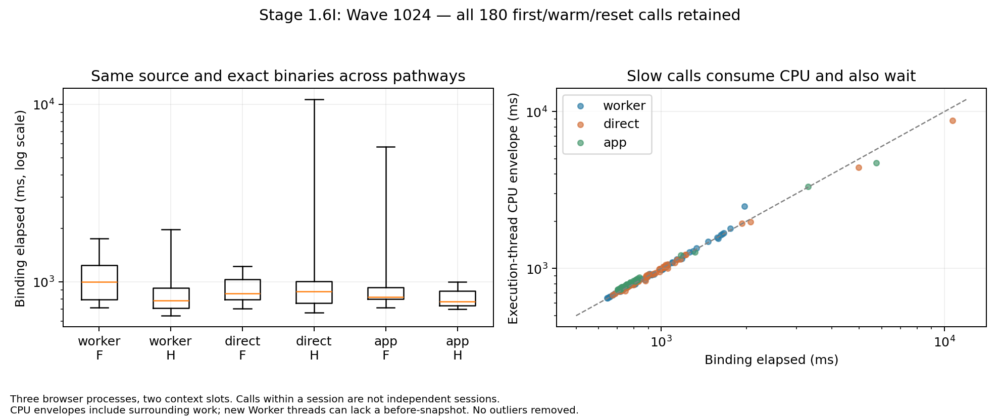

# Stage 1.6I — cross-harness runtime forensics

**Research only; PARTIAL. No merge or global activation.** The engine and its
accepted geometry are unchanged. New measurements do not replace Stage H's
failed local runtime gates. A fast rerun cannot establish that an earlier failure
was fixed.

Current local blockers: one normal browser Download assertion timed out, and the
exact-primary-binary legacy export gate fails on oblique blade 512 (+808.30ms
paired median). Both remain FAIL despite byte-identical geometry and passing CI.

## Source and implementation

- Verified base: `3268ab3fb15c0ce650bc45ab3ff9b0c458f9b2d4`.
- Verified H engine: `7772a310e0e263caa0ead59eb14528b55aea439f`.
- Historical F source: `c7f47512598cec01ad0adc9516af94e3ff58c963`.
- Initial forensic tooling: `4e92c30a53db82c8a5fa4206eeffa871282ba0dd`.
- Corrected attribution and controlled trace/export replay: `cbfe3cf25caa88179f7b1c712d30c8006d6b371f`.
- Final diagnostic implementation: `b8540bd1bc4aa86f8f59097b4128276ee9fac18d`.
- Work branch: `feat/stage-1-6i-runtime-forensics`.
- No edits to `engine/`, `src/`, coordinate precision, node reduction, source
  fitting, accepted recovery, topology validation or old quality gates.

## Actual execution paths

The independent H/F Worker sweep and the failing H/E export comparison used
different comparators and dispatch protocols. Their numeric medians
must not be treated as a matched cross-harness A/B experiment. Importantly,
the retained H Worker module and H export module **already have identical SHA256**
`a568668a139de3b540f12c1c0634610f37b99769f8897fc04f668d6da37e955f`.
A different H binary is therefore ruled out as the explanation for those original
records. The old Worker F comparator is not the old direct E comparator.
This does not explain H's own large absolute change in elapsed time; that remains
a genuine attribution question.

`runtime-benchmark.mjs` imports/instantiates modules in dedicated Workers, decodes
with Canvas outside tracing, sends a transferred RGBA buffer, and times the
synchronous binding call inside the Worker. Each request returns through the
Worker/page protocol before the next request. Cold, warm and reset observations
are retained. Its CPU snapshots cover renderer threads; thread names alone cannot
identify which of two Workers executed a particular invocation.

The failed direct-export gates use `low-resolution-benchmark.mjs`. Each fixture
owns a page and two module instances. Sharp decoding, base64 expansion and module
initialization precede the trace timer. Three alternating rounds of both modules
run synchronously in one `page.evaluate` callback. Both Auto traces follow before
that callback returns. Downloads, reference geometry, libvips measurements and
100/400/1000% screenshots occur after the timed traces. The browser process is
reused between fixtures. `source-target-benchmark.mjs` is another, older pathway;
it does not implement the same three-round protocol.

The actual app decodes the source for each conversion, transfers it through
`TraceClient`, reuses the cached engine promise in `trace.worker.ts`, performs
adapter diagnostics/profile selection, traces, validates the returned SVG, creates
an object URL and commits the result UI. Cancellation terminates the Worker;
30 seconds of idleness also releases it. Reset starts a new Worker. These
production paths are not rewritten by this investigation.

| Measurement                      | Included                                                                           | Excluded / limitation                                                                              |
| -------------------------------- | ---------------------------------------------------------------------------------- | -------------------------------------------------------------------------------------------------- |
| Module import                    | JS import and its dependencies                                                     | WASM initialization is recorded separately                                                         |
| WASM initialization              | Fetch, compilation and instantiation through the existing initializer              | Those three subcosts are not individually identified                                               |
| Binding `coreMs`                 | RGBA wasm-bindgen copy, Rust trace, SVG return decoding                            | Import/init, source decode, getters, telemetry hashing, message return, download                   |
| Diagnostic `rust_trace`          | Existing Rust entry/exit scope                                                     | Binding copies; a wall-clock scope, not CPU time                                                   |
| OS execution-thread CPU/runqueue | Kernel deltas for the PID/TID identified by the trace mark                         | Snapshot envelope also includes surrounding work; newly created threads may lack a before-snapshot |
| Dedicated Worker page result     | Input copy/transfer, binding, telemetry and message return                         | Source decoding and initialization                                                                 |
| Direct page result               | Binding and telemetry completion                                                   | Source decoding, initialization and download                                                       |
| App click-to-result              | Decode, startup when needed, adapter, Worker round trip, validation and result DOM | Preview paint completion and download                                                              |
| Download event                   | Actual Blob/link download through Chromium                                         | Saved-file hashing and artifact scoring                                                            |
| Historical gate labelled “CPU”   | `performance.now()` elapsed binding time                                           | It is not a kernel CPU measurement; its unchanged thresholds remain blocking                       |

The app's existing `data-metrics` does not expose its internal `totalMs`. A
research-only DOM observer measures click-to-result instead of inventing that
field. The app serializer adds a viewBox when necessary and canonicalizes XML.
Raw engine SVG hashes are compared separately from actual app download hashes;
app downloads must match independent DOM serialization of the raw result.

Rust stage[1] overlaps stage[6], stage[2], stage[4] and stage[3]. The profiler's
source fitting, inverse fitting, flattening, coverage and validation scopes also
nest. None of these inclusive timers are added as independent CPU costs.

## Matched experimental contract

`runtime-cross-builds.sh` pins F and H source revisions and creates two additional
H-source diagnostic builds with `runtime_uncached`, without/with `inverse_hotpath`.
The latter is a semantic control, not the historical F binary. Every binary is
hashed before serving, every request records the bytes served, and the exact
same WASM is used in the dedicated Worker, direct page and aliased app Worker.
Normal WASM and `dist/` are untouched by the cross-harness tools.

The five matched inputs are Wave 1024, Triangle 512, Rounded Blade 1024, Thin
Ellipse 1024 and Wave 128. PNG hashes, actual RGBA hashes, dimensions, preset and
binding arguments must agree across pathways. The app genuinely selects its
profile; a different operation or decoding result fails the comparability check.
No source option is silently forced to make results agree.

Production measurements use three independent browser processes, two independent
A/A context slots per binary/pathway, first calls, three warm calls and a reset.
Binary group order alternates; mode order rotates; each session retains its own
median and A/A difference. Warm calls from one context are not independent
sessions. Diagnostic modules separately retain all 48 existing count fields.
Unavailable production-only counters and pure Rust scopes remain null.

Named User Timing marks identify the actual execution PID/TID. The analyzer
matches those marks to `/proc` scheduling counters. It reports top-level GC and
compile interval unions, without adding nested V8 durations. Browser-wide
`v8.compileModule` events can refer to `chrome://` JavaScript and are not proof
of WASM tiering. Cgroup throttling is shared-environment evidence, not a
trace-exclusive CPU attribution.

`runtime-dispatch-isolation.mjs` tests one audited protocol difference: six
identical direct calls in one task versus the same six calls with a task yield
between them. Binaries, source, ordered calls and telemetry remain the same.
CPU is measured for the whole group; individual per-call CPU is not inferred.

## Historical evidence retained

Stage H's original full local historical invocation failed at the earlier
ordinary source_geometry sharp-apex gate: clipped-frame 1024 had a +552.4ms
paired median against its comparator. `inverse_hotpath` was not enabled there.
The separately continued H/E gate failed six runtime cases. Examples remain:
Wave 1024 1454.8 → 4142.4ms; narrow blade 748.0 → 1900.9ms; rotated noisy blade
667.7 → 1738.0ms; Triangle 1024 1693.1 → 3144.5ms; rounded blade
794.1 → 4722.4ms. These results and their raw observations are immutable.

The new matched experiment must not be substituted for those failed invocations.
A non-reproduction will be labelled **NOT REPRODUCED / CAUSE UNRESOLVED**, never
FIXED. All +500ms, 250ms and percentage gates retain their original code.

## Binary manifests

Primary compiled binaries are reused byte-for-byte between all three modes:

| Build | Source / features                    | WASM SHA256                                                        |
| ----- | ------------------------------------ | ------------------------------------------------------------------ |
| F     | c7f4751 / large_apex                 | `0c6a61abcd91ffa4f6c350fcd438f6beb389b0681d43d893b23df9c8a1ed54a3` |
| H     | 7772a31 / large_apex,inverse_hotpath | `e4fe85619c991b62b1b7fd2b71e1b2312b7fb2ddb1d452105c82cdc067d1d13b` |

These newly compiled binaries differ from the retained historical modules.
Source equality is not binary identity. A separate replay preserves and uses the
retained E/H files instead of silently replacing their bytes with a rebuild.
All exact SHA values, Cargo features, served-binary requests and PNG/RGBA hashes
are retained in each experiment's manifests.

## Matched production results

Local production run: **900 observations, invariants PASS, zero missing trace
marks**. The diagnostic run adds **480 observations**, also invariant PASS.
The verdict of a successful diagnostics run remains PARTIAL rather than proving
runtime causality. The first 192-observation pilot is retained separately and is
not pooled with the primary sessions.

Each warm cell below contains 18 observations from three independent browser
processes and two context slots; those 18 calls are not 18 independent sessions.
Numbers are binding wall-time medians, not CPU medians. Every outlier is retained.

| Fixture           | Worker F → H ms | Direct F → H ms | App binding F → H ms |
| ----------------- | --------------: | --------------: | -------------------: |
| wave-1024         | 798.70 → 720.75 | 797.30 → 767.70 |      808.05 → 745.85 |
| triangle-512      | 264.65 → 228.80 | 232.35 → 240.75 |      247.75 → 249.85 |
| rounded-1024      | 935.35 → 599.95 | 651.25 → 606.10 |      658.80 → 599.65 |
| thin-ellipse-1024 | 705.80 → 639.40 | 703.80 → 638.10 |      713.50 → 649.70 |
| wave-128          | 115.10 → 120.20 | 123.25 → 112.10 |      123.75 → 122.05 |

The app binding column excludes the app's additional decoding, diagnostics,
Worker protocol and SVG/UI validation. It is not its click-to-result latency.

| H fixture / pathway        | First median ms | Warm median / p95 / max ms | Reset median ms |
| -------------------------- | --------------: | -------------------------: | --------------: |
| wave-1024 / worker         |          894.50 | 720.75 / 1463.60 / 1463.60 |          969.30 |
| wave-1024 / direct         |          914.40 | 767.70 / 4980.40 / 4980.40 |          960.85 |
| wave-1024 / app            |          889.70 |   745.85 / 826.30 / 826.30 |          916.80 |
| triangle-512 / worker      |          349.85 |   228.80 / 630.50 / 630.50 |          393.95 |
| triangle-512 / direct      |          424.80 |   240.75 / 684.60 / 684.60 |          413.85 |
| triangle-512 / app         |          334.45 |   249.85 / 324.50 / 324.50 |          367.35 |
| rounded-1024 / worker      |          720.80 |   599.95 / 672.00 / 672.00 |          801.20 |
| rounded-1024 / direct      |          743.35 |   606.10 / 692.40 / 692.40 |         1016.95 |
| rounded-1024 / app         |          730.85 |   599.65 / 671.80 / 671.80 |          720.60 |
| thin-ellipse-1024 / worker |          881.45 | 639.40 / 1176.40 / 1176.40 |          814.80 |
| thin-ellipse-1024 / direct |          819.55 |   638.10 / 921.50 / 921.50 |          820.65 |
| thin-ellipse-1024 / app    |          782.10 |   649.70 / 956.80 / 956.80 |          785.45 |
| wave-128 / worker          |          263.35 |   120.20 / 148.40 / 148.40 |          238.00 |
| wave-128 / direct          |          234.95 |   112.10 / 150.90 / 150.90 |          293.25 |
| wave-128 / app             |          211.65 |   122.05 / 325.20 / 325.20 |          216.10 |

“First” means a fresh module/Worker instance, not a proven cold machine-code
cache. Browser processes are independently restarted between sessions, while
compilation/cache state may be shared between contexts inside a session.

| Wave 1024 pathway | Per-session H−F warm median differences ms | H A/A slot-median differences ms |
| ----------------- | ------------------------------------------ | -------------------------------- |
| worker            | -111.90, -807.50, -49.50                   | -64.20, -308.20, -83.40          |
| direct            | +6.90, -66.05, +597.55                     | +107.20, +24.60, +1239.50        |
| app               | -3.55, -57.25, -358.45                     | -4.10, +2.10, +17.60             |

A/A differences can exceed the nominal H/F improvement. This is measured
variability between identical binaries, not permission to call any old failure
noise or to waive a budget.



The figure retains all 180 Wave calls, including first and reset. CPU is an OS
snapshot envelope, not pure Rust; unavailable new-thread deltas are not fabricated.
The logarithmic axes expose the complete tail. Optional rendering:
`python3 scripts/runtime-cross-plot.py ANALYSIS_DIRECTORY OUTPUT_PNG`.

## Captured slow traces

The new experiment captured severe latency episodes on both F and H, including
an H direct Wave trace exceeding ten seconds. These are new traced episodes;
identity of their cause with the historical untraced failure is **unproven**.

| Trace ID                              | Binding wall ms | Scheduled execution-thread CPU ms | Runqueue ms | Observed execution-thread top-level GC ms |
| ------------------------------------- | --------------: | --------------------------------: | ----------: | ----------------------------------------: |
| s2-wave-1024-stage16h-direct-0-4      |        10666.70 |                           8793.76 |     1905.42 |                                      0.00 |
| s2-wave-1024-stage16f-app-0-3         |         5751.90 |                           4698.29 |     1099.86 |                                      0.00 |
| s2-wave-1024-stage16h-direct-1-2      |         4980.40 |                           4397.10 |      701.70 |                                      0.00 |
| s2-wave-1024-stage16f-app-1-3         |         3304.50 |                           3334.77 |       22.30 |                                      0.00 |
| s2-wave-1024-stage16f-app-0-4         |         3246.20 |                       unavailable | unavailable |                                      0.00 |
| s1-thin-ellipse-1024-stage16f-app-1-1 |         2490.90 |                           2623.00 |       12.36 |                                      0.00 |

The 10666.70ms H direct reset observation spent 729.60ms in segmentation,
7282.20ms in the fitting/repair/location interval and 2439.60ms in the refinement
interval. Its writer took 11.70ms. The overlapping fitting tail is **not** added
again. Thus download, libvips scoring and SVG byte count cannot explain this
specific timed episode. The same binary's earlier direct call took 672.60ms,
with the same inverse loss count, loss values, SVG and 40828928-byte WASM linear
high-water allocation.

That slow snapshot also observed 16453.62ms of CPU on other surviving browser
threads, and 4761.18ms of shared-cgroup throttled time. These overlapping,
aggregate quantities are not added to the trace CPU/wall time. The execution
thread itself had 1905.42ms of runqueue delay. Scheduling/contention contributes
to the observed envelope, but it does not by itself explain the substantial
on-CPU increase. Top-level execution-thread GC was zero in these sampled slow
calls; missing WASM tier events do not prove that tiering had no influence.

The first analysis assumed a renderer-main thread name of CrRendererMain. This
Chromium reports some such threads as chromium. Schema 2 instead identifies a
renderer main thread by PID=TID. The original raw observations and first derived
analysis remain intact; the execution-thread match from User Timing marks was
already independent of thread names.

## Work-count and Rust diagnostics

All 48 instrumented counter fields are stable across first/warm/reset calls and
all three pathways for each diagnostic binary/input. This means all existing
instrumented scopes, not every instruction or internal VTracer iteration.
Diagnostic timing includes its own clocks and must not be presented as production
latency. Their SVGs remain byte-identical to production for the matched fixtures.

| Diagnostic H fixture | Recovery source_samples | Inverse loss calls | Flattened cubics | Flatten hits | Ordinary joint fits | Large recovery / large joint calls |
| -------------------- | ----------------------: | -----------------: | ---------------: | -----------: | ------------------: | ---------------------------------: |
| wave-1024            |                    7813 |                137 |             5548 |         4014 |                   0 |                              0 / 0 |
| triangle-512         |                    3313 |                  1 |             1327 |            0 |                   3 |                              0 / 0 |
| rounded-1024         |                       0 |                176 |            10636 |         6670 |                   0 |                              0 / 0 |
| thin-ellipse-1024    |                    6616 |                169 |            10172 |         6194 |                   0 |                              0 / 0 |
| wave-128             |                    1997 |                  1 |              577 |            0 |                   0 |                              0 / 0 |

Triangle 512 performs three ordinary joint-handle fits and no large-apex recovery
or large joint solve. Rounded Blade has no eligible source-recovery component;
its inverse-fitting loss work still executes. Zero is not used to imply absence
of unrelated validators or optimizers.

The diagnostic corpus also exhibits slow calls with unchanged complete
instrumented work signatures. A thin-ellipse reference app call reached 4897.60ms
with 3376.87ms scheduled Worker CPU and 1575.47ms runqueue time. Its inverse-fit
scope was only 256.60ms. A different 3169.10ms call spent 1275.40ms there. A
universal attribution to the H inverse cache or extended apex solver is therefore
unsupported. No speculative cache, solver or safety change is introduced.

## Instrumented Rust elapsed scopes

Diagnostic H uses runtime_uncached,inverse_hotpath. These are eight warm Worker
calls per fixture across two browser processes, separate from production timing.
Scopes overlap, especially recovery/final validation; do not add them as CPU costs.

| Fixture           | Rust total | Segmentation | Source fit | Inverse fit | Reduction | Recovery | Final validation | Writer |
| ----------------- | ---------: | -----------: | ---------: | ----------: | --------: | -------: | ---------------: | -----: |
| wave-1024         |     711.20 |        69.85 |      38.00 |      113.40 |     20.10 |   179.10 |            31.20 |   0.30 |
| triangle-512      |     218.45 |        14.50 |      33.90 |        0.70 |      3.30 |   115.85 |             8.95 |   0.40 |
| rounded-1024      |     567.95 |        63.70 |      35.75 |       84.15 |    118.35 |     1.05 |             0.00 |   0.30 |
| thin-ellipse-1024 |     584.50 |        51.35 |      20.50 |      108.30 |     12.55 |   196.65 |            30.65 |   0.50 |
| wave-128          |     112.75 |         1.15 |      17.80 |        0.50 |      1.30 |    80.25 |            11.75 |   0.15 |

All durations are milliseconds of elapsed scope time. Raw kernel CPU is separate.

## Optional native CPU sampling

A separate 72-call experiment samples the actual direct-page execution of the
retained historical H binary, SHA `a568668a139de3b540f12c1c0634610f37b99769f8897fc04f668d6da37e955f`.
Three browser processes, two context slots, first/warm/reset calls and original
Wave 1024, Triangle 512 and Rounded Blade 1024 PNGs are retained. Source/SVG
invariants PASS. Every marked call has 175–1207 in-window samples. Raw CDP CPU
profiles and Chrome marks are preserved, with no geometry or source-model change.

Rust symbols are observable: the color-cluster BuilderImpl tick, BinaryImage
clustering/pixel operations, `inverse::hotpath::signed_edge_areas`, and recovery
spans appear in the samples. For a 1458.90ms rounded-blade call, the BuilderImpl
tick has 278.42ms of self sample weight, the frontend segment function 119.45ms,
and Cluster::add 77.34ms. A 1459.20ms Wave call shows 54.18ms self weight in the
signed-area kernel. These are sampled **wall-interval weights**, not exclusive
kernel CPU measurements; inclusive stacks are never summed as independent costs.
Inlined functions and profiler overhead limit interpretation.

This experiment did **not** capture a 4–10 second call. Its maximum was 1459.20ms,
with 1478.28ms execution-thread CPU in the wider OS snapshot envelope. It maps
real Rust work but does not causally explain the severe earlier episodes. It is
not retried until an extreme or favorable result appears. No allocator, tiering,
frequency or cache fault is declared from these samples, and no speculative
engine optimization is made.

Controller process CPU and time through completed file download are recorded
from tooling commit `598b042` onward. Earlier primary rows record the download
start event only; completion/controller values are not backfilled. This distinction
is retained in each protocol snapshot.

## Dispatch isolation

**576 individual calls in 96 groups across three independent browser processes;
SVG/source invariants PASS.** “Batched” executes six synchronous calls before
yielding; “yielded” changes only a setTimeout(0) task boundary between calls.
These are a controlled subexperiment, not the full historical two-module gate.

| Fixture            | F batched → yielded warm median ms | H batched → yielded warm median ms |
| ------------------ | ---------------------------------: | ---------------------------------: |
| Wave 1024          |                    778.40 → 779.75 |                    733.45 → 724.25 |
| Rounded Blade 1024 |                    622.90 → 623.20 |                    592.05 → 590.45 |
| Triangle 512       |                    203.25 → 227.10 |                    214.55 → 212.35 |
| Wave 128           |                    118.15 → 108.95 |                    105.90 → 113.70 |

H Wave yielded-minus-batched session differences are +82.45, +29.65 and
−324.30ms. H small-Wave yielding is slower in all three session medians.
There is no repeatable general speedup from inserting yields. This factor does
not explain the historical multi-second contradiction. No production yielding
policy or browser flag is introduced.

## Retained-binary normalized replay

The retained E/H modules, without rebuilding, were replayed in the Worker and
normalized one-call direct pathways. **320 observations, invariants PASS**.
Every source/options/SVG comparison passes for these five shared fixtures.
The historical H SHA is a568668a…955f, also equal to the H module in the new
independent 45-case proof. The E comparator is 0d7e8475…1edd.

| Fixture           | Worker E → H warm median ms | Normalized direct E → H warm median ms |
| ----------------- | --------------------------: | -------------------------------------: |
| wave-1024         |             793.25 → 723.40 |                        771.60 → 721.40 |
| triangle-512      |             230.25 → 250.20 |                        231.80 → 214.80 |
| rounded-1024      |             628.30 → 590.85 |                        637.10 → 717.30 |
| thin-ellipse-1024 |             689.95 → 677.45 |                        686.75 → 742.05 |
| wave-128          |             121.20 → 125.05 |                        110.25 → 145.00 |

The largest H call here was 1421.10ms (rounded, direct, first), with 1431.94ms
in its wider CPU envelope and 62.81ms runqueue. This normalized replay does not
reproduce the old multi-second H medians. It is not the historical two-module
single-callback protocol and is not declared a fix.

## Trace-capture isolation

Six independent browser processes use the explicitly retained on/off/off/on/on/off
treatment order. Each adjacent pair holds fixture/binary/mode ordering constant;
the order changes between pairs. The only intentional treatment is full CDP
Tracing capture. Same original PNG/RGBA, WASM bytes, ordered calls and source
options; no production browser flags change. There are **576 calls** and source/
SVG invariants are **PASS**. Warm cells contain 12 calls from three
processes, not 12 independent sessions.

| Fixture / binary / mode   | Capture on median ms | Capture off median ms | Off−on paired process-median differences ms |
| ------------------------- | -------------------: | --------------------: | ------------------------------------------- |
| wave-1024 / F / worker    |               774.20 |                783.90 | +7.85, -122.10, +103.50                     |
| wave-1024 / F / direct    |               769.85 |                748.00 | -39.45, +40.00, -34.75                      |
| wave-1024 / F / app       |               776.35 |                794.70 | +14.65, -257.30, +24.50                     |
| wave-1024 / H / worker    |               729.05 |                703.55 | -22.15, -2.30, +26.25                       |
| wave-1024 / H / direct    |               722.20 |                727.80 | -3.50, -163.25, +206.80                     |
| wave-1024 / H / app       |               727.20 |                729.95 | +34.30, -279.40, -25.00                     |
| rounded-1024 / F / worker |               637.15 |                628.00 | +4.00, +6.90, -41.25                        |
| rounded-1024 / F / direct |               625.85 |                623.00 | +24.65, -26.20, -56.30                      |
| rounded-1024 / F / app    |               652.10 |                662.40 | -10.45, +24.80, +82.35                      |
| rounded-1024 / H / worker |               579.30 |                593.40 | +220.40, -3.20, -5.85                       |
| rounded-1024 / H / direct |               617.55 |                776.85 | +10.85, +207.65, +77.35                     |
| rounded-1024 / H / app    |               607.10 |                561.35 | -58.70, -72.35, +25.15                      |

Eleven of twelve fixture/binary/mode cells have mixed signs among the three
paired process differences. In the remaining cell, H rounded/direct, turning
capture off is slower in all three pairs. Turning capture off is not a repeatable
general latency improvement in this bounded experiment; it does not explain the
historical untraced failures.

These observations are not pooled with the earlier 900-call run. Off-processes
have no recorded User Timing trace PID/TID; execution-thread CPU attribution is
unavailable there, not zero. Raw OS thread snapshots, controller CPU, cgroup
counters and all wall observations are still retained. Controller CPU is a
separate process measurement, not browser-main CPU. This bounded experiment does
not establish a universal tracing correction or explain an earlier untraced gate.
The original failed gates remain blocking regardless of this diagnostic result.

## Native compilation-log observation

The ordinary CDP trace categories exposed no WASM tier events, and the category
registry returned an empty list. That is a facility limitation, not proof that
tiering is absent. An additional bounded observation uses the **retained H binary**
and `--trace-wasm-compilation-times`, capturing native browser stdout with
Playwright timestamps. No engine or production flag changes.

Default-before, attempted-no-tier-up and default-after each retain 16 actual
Wave 1024 calls across two browser processes, with two A/A slots and reset.
All source/SVG invariants pass. Warm medians are 753.70, 747.40 and 846.35ms.
Each captured native browser log contains **3132 Liftoff and 812 TurboFan compilation records**. Crucially,
adding `--no-wasm-tier-up` leaves the observed TurboFan records present; suppression of the target tier was not established.
Therefore that attempted treatment is **not a validated tier-off control**.
Its timing difference cannot establish or exclude tiering causality.

This provides genuine evidence that both compiler tiers execute, but no causal
link to the severe historical episodes. Native logging perturbs execution and
these calls are never pooled into the production latency tables. All logs,
options, exact hashes and observations remain under `tier-observation`,
`tier-no-tier` and `tier-default-after`; no favorable retry is substituted for
the old gate failures. Verification of an effective tier-isolation mechanism is
still required before drawing that causal conclusion.

## Actual legacy export protocols

The exact primary F/H module files (0c6a61ab…d54a3 / e4fe8561…d13b) are also used
through unmodified `low-resolution-benchmark.mjs`, including its two modules in
one page, three synchronous alternating rounds, actual Blob downloads, libvips
and Chromium reference comparisons. This closes the binary mismatch between the
normalized experiments and the separately run legacy export pathway.

- Exact primary binary identity gate: **PASS**, 45 pairs.
- Existing +500ms/250ms export budget gate: **FAIL**.
- Budget failure details: `[{"key":"blade-oblique-native-srgb-512","reason":"added median CPU >500ms","baseline":453.80000001192093,"candidate":1262.1000000238419}]`.

The failed oblique-512 F/H binding times are F 1171.70 / 453.80 / 447.20ms
and H 1616.20 / 1262.10 / 410.20ms. The H slow warm call has 910.50ms in the
fitting/repair/location interval versus 200.90ms in its next warm call; refinement
is 323.30 versus 192.10ms. No capture/sampling profiler was active in this legacy
invocation. The old harness records work counters on its first call only (160
inverse evaluations in both builds); it does not provide complete warm-call work
signatures. Equal SVGs alone cannot prove identical warm-call instruction work.
This is another unresolved runtime failure, not a reason to raise the threshold.

Separately, the original archived E/H bytes run through the same actual legacy
45-case protocol and the unchanged `large-apex-quality-gate.mjs`:

- New archived E/H verdict: **PASS**.
- Failure details: `[]`.

| Archived legacy fixture              | E three-call median ms | H three-call median ms |
| ------------------------------------ | ---------------------: | ---------------------: |
| wave-1024                            |                 852.50 |                 902.40 |
| blade-narrow-native-srgb-1024        |                 444.20 |                 435.20 |
| blade-narrow-box4-srgb-1024          |                 387.00 |                 395.50 |
| blade-narrow-box4-linear-1024        |                1344.20 |                 836.90 |
| blade-rotated-box4-linear-noise-1024 |                 870.00 |                 878.20 |
| triangle-eight-native-srgb-1024      |                1044.00 |                 799.90 |
| rounded-blade-native-srgb-1024       |                 628.20 |                 632.50 |
| rounded-blade-box4-linear-1024       |                 735.30 |                 697.70 |
| thin-ellipse-native-srgb-1024        |                 618.50 |                 655.20 |

A new PASS means **NOT REPRODUCED / CAUSE UNRESOLVED**, not FIXED. A new FAIL is
retained as another failed invocation. Neither outcome replaces Stage H's original
FAIL. Original failed JSON checksums are retained and checked unchanged.

## Exported geometry nonregression

All 45 exact-primary-binary research SVG/Auto comparisons are retained. The
independent build proof also passed all 45 SVG/Auto identity comparisons, unchanged
runtime budgets and 27 experimental browser tests. Three actual Inkscape imports
retain their editable node counts. Illustrator and physical Android are unverified.
Source reconstruction, winding, holes and shared geometry are not inferred from
SVG validity alone: unchanged path bytes and the existing independent reference
and raster metrics are checked. Retained defective held-outs are not repairs.

| Protected fixture               | Mean / p95 / endpoint-inclusive max px | Corner precision / recall | Anchors / curves / paths | SVG bytes |
| ------------------------------- | -------------------------------------: | ------------------------: | -----------------------: | --------: |
| cubic-128                       |         0.063891 / 0.270706 / 0.823200 |             1.000 / 1.000 |              18 / 11 / 2 |       708 |
| cubic-512                       |         0.055474 / 0.258020 / 0.823200 |             1.000 / 1.000 |              38 / 30 / 2 |      1430 |
| cubic-1024                      |         0.047432 / 0.200903 / 0.766976 |             1.000 / 1.000 |              72 / 65 / 2 |      2735 |
| wave-128                        |         0.028710 / 0.085308 / 0.502973 |             1.000 / 1.000 |              23 / 15 / 2 |       889 |
| wave-512                        |         0.074254 / 0.237143 / 0.578088 |             1.000 / 1.000 |              27 / 20 / 2 |      1103 |
| wave-1024                       |         0.059089 / 0.241311 / 0.660000 |             1.000 / 1.000 |              57 / 50 / 2 |      2309 |
| triangle-eight-native-srgb-128  |         0.150871 / 0.381214 / 0.409670 |             1.000 / 1.000 |              14 / 10 / 2 |       605 |
| triangle-eight-native-srgb-512  |         0.064629 / 0.191055 / 0.985251 |             1.000 / 1.000 |              53 / 49 / 2 |      2040 |
| triangle-eight-native-srgb-1024 |         0.054593 / 0.149175 / 1.292558 |             1.000 / 1.000 |              79 / 75 / 2 |      3202 |

The endpoint-inclusive metric and difficult samples are unchanged. All nine
protected maxima are preserved. Wave 128 retains zero unexpected G0 corners.
Default browser alpha, cat/source-quality, shared-edge, lifecycle and cancellation
tests passed; the separate source-refinement test timed out before completing
its full fixture loop. No unsupported claim that every browser metric passed is
made.

## Complete local command outcomes

Each invocation has a fresh artifact namespace and an unmodified exit status.
No failed command is retried until favorable. The full historical runner was
executed once; its PASS does not override the earlier stored failure.

| Invocation                                  | Exit status |
| ------------------------------------------- | ----------: |
| verification-20261026 / matched-analysis    |           0 |
| verification-20261026 / diagnostic          |           0 |
| verification-20261026 / diagnostic-analysis |           0 |
| verification-20261026 / dispatch            |           0 |
| verification-20261026 / build-wasm          |           0 |
| verification-20261026 / rust-default        |           0 |
| verification-20261026 / rust-source         |           0 |
| verification-20261026 / rust-large          |           0 |
| verification-20261026 / rust-hotpath        |           0 |
| verification-20261026 / rust-upstream       |           0 |
| verification-20261026 / unit                |           0 |
| verification-20261026 / lint                |           0 |
| verification-20261026 / typecheck           |           0 |
| verification-20261026 / build               |           0 |
| verification-20261026 / e2e                 |           1 |
| verification-20261026 / runtime             |           0 |
| verification-20261026 / proof               |           0 |
| verification-20261026 / historical          |           0 |
| extra-20261026 / archival                   |           0 |
| extra-20261026 / archival-analysis          |           0 |
| extra-20261026 / trace-control              |           0 |
| extra-20261026 / trace-control-analysis     |           0 |
| exact-binary-exports / exports              |           0 |
| exact-binary-exports / identity             |           0 |
| exact-binary-exports / budget               |           1 |
| exact-binary-exports / editability          |           0 |
| archived-legacy-exports / exports           |           0 |
| archived-legacy-exports / original-gate     |           0 |

Native counts: default 69, source_geometry 69, large_apex 72,
large_apex+inverse_hotpath 76, upstream VTracer 31. TypeScript has 42 unit tests
in eight files. Normal browser: **26 passed / one failed**, unchanged 5-second
Download assertion on dense-circle-512 with refinement unchecked; captured state
remains processing. Experimental H: **27 passed**. The failed normal invocation
is not relabelled PASS because later configurations or CI passed.

## Environment, memory and limitations

Local Node 24.19, Rust 1.99.1, wasm-bindgen 0.2.126, Chromium 154.0.8037.57,
Playwright 1.64.1, Linux 6.18.55, Xeon Platinum 8573C, five visible CPUs and cgroup
quota 400000/100000. This is a shared managed workspace, not a calibrated exclusive
CPU. Timed benchmark/build workloads are serialized; lightweight audit activity
and a separately retained 90-second process observer can still perturb the host.
The process observer itself consumed CPU and is not treated as free instrumentation.

WASM linear high-water allocation spans 1835008–40828928 bytes across the primary
inputs. Slow and fast Wave calls both use 40828928 bytes. This is not live heap,
RSS or an Android RAM measurement. New app Workers may lack a before-snapshot;
those CPU values remain unavailable. Normal WASM/dist restoration and absence of
experimental diagnostic exports are checked after all runs.

A post-run cgroup observation showed about 7.9GB charged against a 32GiB limit
and zero memory-limit/OOM events. It is not a snapshot of the earlier slow call.
Memory pressure, allocator work, instruction/cache stalls, CPU frequency and WASM
tiering are not causally isolated. No hardware perf tool or frequency telemetry
was available. Native compilation logs expose tiers, but the attempted flag did
not produce a validated tier-off control. Native CPU samples expose Rust functions but did not catch the
largest episodes. No engine optimization or mandatory browser flag is accepted.

## CI evidence and artifact access

[Implementation b8540bd CI](https://github.com/akidwush/vector-magic-bydika/actions/runs/40422361692)
completed **SUCCESS**, including validation, independent H runtime/export proof
and cross-harness research. The earlier 4e92c30 and 598b042 CI invocations also
completed SUCCESS; those results do not erase local FAIL records. Successful
execution of diagnostics does not make the scientific milestone COMPLETE.

Actions artifacts are named `stage-01-evidence`, `runtime-raw-<commit>` and
`cross-harness-raw-<commit>`. They preserve CI manifests, every observation,
Chrome traces, CPU profiles, actual SVGs, screenshots and failed gate files.
CI regenerates independent observations on its own machine; it is not presented
as the upload of every local historical record. Local raw evidence is retained
under `benchmark-results/stage16i/` in the namespaces named above, including the
original failed browser context and all outliers. Generated scores/private
binaries are not committed to Git.

## Attribution verdicts

| Explanation                                                           | Current evidence / verdict                                                                                                             |
| --------------------------------------------------------------------- | -------------------------------------------------------------------------------------------------------------------------------------- |
| Different input/options between normalized pathways                   | Ruled out for matched fixtures by PNG/RGBA hashes and exact binding arguments.                                                         |
| Different historical H WASM bytes                                     | Ruled out: Worker/export H share a568668a…955f. Comparator E/F differences remain a confound, not a complete explanation.              |
| Download/artifact scoring included in the slow core timer             | Ruled out for the captured call; those operations follow its timer. Indirect runtime-state effects remain possible.                    |
| Triangle 512 extended large-apex work                                 | No large recovery/joint entries; three ordinary joint fits, not the extended solver.                                                   |
| Entire episode spent waiting for CPU                                  | Ruled out for the captured 10.67s call: about 8.79s scheduled execution-thread CPU and 1.91s runqueue.                                 |
| Extra work in the named diagnostic scopes                             | Not observed within each 48-field signature; uninstrumented internal work/instruction counts are not proven identical.                 |
| Observed execution-thread JS GC explains the severe episode           | No such top-level GC interval in the sampled extremes. This does not rule out unobserved runtime/allocator work.                       |
| Synchronous dispatch is sufficient to explain the contradiction       | No repeatable general yield benefit; a per-call normalized path also stalls.                                                           |
| Full trace capture is the sole cause                                  | Not supported by paired on/off results; the additional untraced legacy gate also fails. Observer effects are not globally excluded.    |
| WASM tiering / allocation / frequency explains the historical failure | UNRESOLVED. Compiler tiers are observable, but effective tier isolation and a link to the severe historical call were not established. |

No causal engine correction has passed the acceptance contract. The accepted
changes improve attribution and reproducibility of the research, not engine
geometry or guaranteed conversion speed.

## Decision and next work

**PARTIAL. Keep the engine unchanged and experimental. Do not merge or promote.**
Measurement inclusion, actual execution-thread attribution, binary identity,
source/option identity and sampled Rust work are now explicit. Severe slow calls
consume actual CPU and sometimes also wait; they are not explained by download
or validity checks. Scheduling/contention is observed, but its role does not
account for all on-CPU inflation. The underlying mechanism remains unresolved,
and the local normal browser suite has a preserved failure.

Next research should sample the rare slow call inside the exact two-module
legacy callback with low-overhead OS/hardware counters, add narrowly scoped
unmeasured clustering/allocator work diagnostics only if justified, and repeat on
an exclusive CPU and physical Android. Proposed measurement policy: compare
independent paired-process medians alongside A/A dispersion, keep cold/warm/reset
and tail metrics separate, retain every outlier, and classify uncertain comparisons
as unresolved. This is a review recommendation, not a change to old limits.
No +500ms, 250ms, percentage, source-loss, corner, drift, topology or alpha
assertion has been relaxed.

## Files changed

- `scripts/runtime-cross-builds.sh`: pinned immutable binaries and build manifests.
- `scripts/runtime-cross-apps.mjs` and `runtime-cross-module.mjs.template`: test-only
  alias to the actual app Worker; marked binding calls, hashes and existing getters.
- `scripts/runtime-cross-system.mjs`: kernel thread/cgroup observations.
- `scripts/runtime-cross-harness.mjs`: three paths, A/A slots, independent browser
  processes, first/warm/reset, download and controller timing, optional CPU sampling.
- `scripts/runtime-cross-analysis.mjs`: actual PID/TID mapping, interval unions,
  distributions, optional marked CPU-stack weights and immutable reanalysis output.
- `scripts/runtime-dispatch-isolation.mjs`: one-factor synchronous/yielded calls.
- `scripts/runtime-cross-research.sh`: statuses without retries, capture isolation,
  optional CPU sampling and the existing 45-case export gates on the same binaries.
- `.github/workflows/stage0-check.yml`: Stage I eligibility, independent research
  job and always-upload raw evidence. Old assertions stay untouched.
- `scripts/runtime-cross-plot.py`, this report and its measured figure (optional
  installed Matplotlib only; no production dependency). Engine, vendor and app source are unchanged.

## Reproduction and evidence

```sh
NEXORA_CROSS_ROOT="$PWD/benchmark-results/stage16i/new-run" \
  bash scripts/runtime-cross-research.sh
```

The directory must not already exist. Initial local precommit protocol files are
retained verbatim with their SHA256; commit labels are not substituted for those
snapshots. Subsequent instrumentation revisions and per-module hashes are explicit.
The tracing foundation remains VTracer 1.0.0-alpha.4, pinned upstream e71343fbcbf469b8a72a255030408a39939162eb,
with flo_curves 0.8.0; no engine replacement or dependency change. The runner builds immutable modules,
retains every observation and Chrome trace, performs matched production and
diagnostic runs, and executes the dispatch isolation. It records nonzero exit
statuses without retrying or weakening a check. The CI research job uploads this
namespace even on failure; the existing validation and H runtime/export jobs
remain independently blocking.

A final cross-run identity check covers **2604 normalized observations** from
ten retained namespaces: all five shared inputs have one RGBA and one raw SVG
hash per identical option tuple. This is not a claim that every retained held-out
shape is geometrically correct. Historical failed JSON checksums match, the
normal WASM ABI has no research profiling/recovery exports, and source/app/vendor/
tests/old-gate files have no changes. No temporary research worktree remains;
the pre-existing Stage 1.5 worktree is preserved.

Physical Android is **UNVERIFIED**: no physical device or adb is available.
Desktop Chromium results do not establish Android performance. A physical-device
follow-up should serve the same hashed artifact through localhost with adb
reverse, record the device/browser, compare first/warm/reset conversions, remotely
profile the Worker, and check cancel/reuse and downloaded SVGs. No new hosting,
cloud processing, GPU, backend or paid dependency is introduced.
