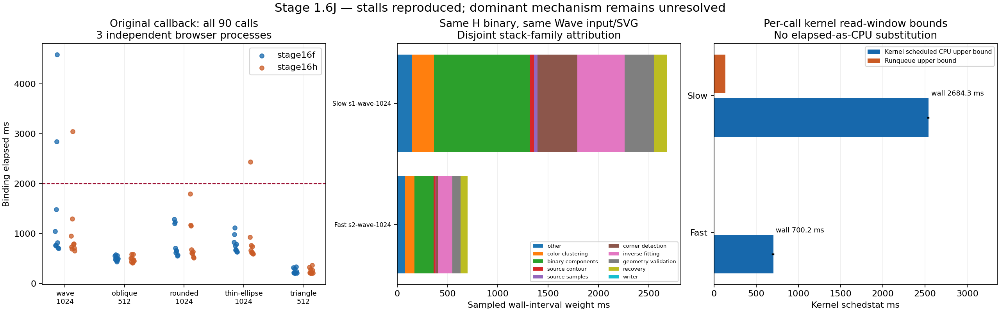
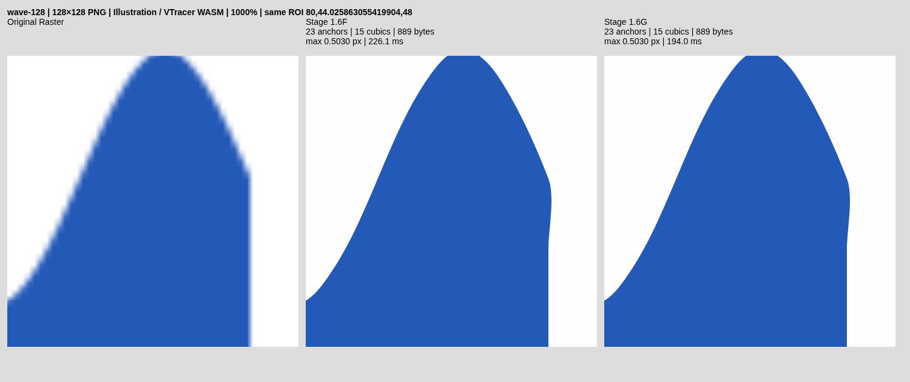

# Stage 1.6J — exact legacy export CPU forensics

**PARTIAL — research only. No production optimization, geometry change, merge or
promotion.** Multi-second stalls were reproduced in the exact legacy callback,
including without profiling. Sampling identifies expensive function families in
one CPU-heavy stall. The mechanism causing those functions to consume additional
CPU is still unresolved. This does **not** satisfy the root-cause acceptance
contract. The historical 10,666.7ms episode remains unexplained.

The new diagnostics and all current regression invocations passed. Historical
failed timing gates and the Stage I Download assertion remain historical FAILs;
they have not been retroactively changed to PASS.

## Revisions and immutable identities

- Verified base: `5fe0e2c54af0578649a7780f438da53ce85adb3c`.
- Initial diagnostic implementation: `eb756070c9285218b339247f4f841cad1da45c58`.
- Final diagnostic implementation: `314693a06c083808ccadfb235d6e9eb045b6a0e9`.
- Work branch: `feat/stage-1-6j-latency-root-cause`.
- H geometry/hot-path implementation: `7772a310e0e263caa0ead59eb14528b55aea439f`.
- F comparator source: `c7f47512598cec01ad0adc9516af94e3ff58c963`.
- `main` remains `69b06ef8383b729223040a1282cd10809eb172f1`.

The primary legacy experiment reuses the retained Stage I binaries, not newly
compiled approximations:

| Module | Source / Cargo features                 | WASM SHA256                                                        |
| ------ | --------------------------------------- | ------------------------------------------------------------------ |
| F      | `c7f4751`, `large_apex`                 | `0c6a61abcd91ffa4f6c350fcd438f6beb389b0681d43d893b23df9c8a1ed54a3` |
| H      | `7772a31`, `large_apex,inverse_hotpath` | `e4fe85619c991b62b1b7fd2b71e1b2312b7fb2ddb1d452105c82cdc067d1d13b` |

Each manifest also records the glue hash. Every observation includes source PNG,
actual decoded RGBA, options, dimensions and final SVG hashes. Source hash prefixes
below are for navigation; complete SHA256 values are in `legacy-primary/plan.json`:

| Fixture            | PNG SHA256 prefix  | RGBA SHA256 prefix |
| ------------------ | ------------------ | ------------------ |
| Wave 1024          | `11ee9f9573e79e2c` | `df44ea425f45c8a9` |
| Oblique blade 512  | `868c6c4e7c4e03c1` | `7529106c14ba0d91` |
| Rounded blade 1024 | `1a42aa1165d25edd` | `a1f5e17280e97ee2` |
| Thin ellipse 1024  | `08bbb9a69fcd05d0` | `3c28c5b24dbfe746` |
| Triangle 512       | `5a4ccd8bd6566ef0` | `d47a0a385af9b093` |

The separately requested cross-harness rebuilds have different binary hashes:
F `7f59bf48d0961819ccdd02e6aac845b5e9c547970e2d866c1a0d20b81ba888a9`,
H `70d989446d4e2f2bbc025c907cb4ed5128fb2ccf990f867e7cba5c51c5ec4eff`.
They are reused identically across their own pathways. Their observations are
**not** pooled with the pinned primary binaries as an identical-binary experiment.
Feature-counter builds are separately labelled diagnostics, never historical F/H.

## Audited execution and exact callback contract

`low-resolution-benchmark.mjs` is unchanged. It remains the historical control
and was also executed through the existing cross/export proofs. The new
`runtime-legacy-protocol.mjs` extracts its actual callback with the TypeScript
parser and fails if its expected structure changes. A regression test executes
both extracted variants against a binding double and checks all eight calls.

For every fixture, the callback performs:

1. RGBA base64 expansion, then F import/initialization and H import/initialization.
2. Round 0: F, H.
3. Round 1: H, F.
4. Round 2: F, H.
5. Auto F, Auto H, then returns to Node.

The six measured calls retain `illustration` and
`inverse-reduce-reconstruct`; the final Auto calls retain `reduce-reconstruct`.
No message yield, extra trace, alternate segmentation or optimizer option is
inserted between calls. Cold getter order and warm SVG equality assertions are
preserved. Downloads and independent reference/raster scoring stay outside the
binding timer.

The wrapper's control uses the extracted callback verbatim. The sampled twin
adds marks around individual binding windows and records metadata after the
existing getters. Detailed counters are read only in distinct diagnostic builds.
It does not claim that the surrounding host preparation is byte-identical to the
entire historical script: the wrapper preloads the five legal inputs and does
not perform reference-geometry preparation before each callback. The unchanged
45-case script separately covers the complete original export/scoring workflow.

| Measurement                | Included                                                                 | Excluded / limitation                                                                     |
| -------------------------- | ------------------------------------------------------------------------ | ----------------------------------------------------------------------------------------- |
| Binding elapsed            | wasm-bindgen RGBA copy, Rust pipeline, SVG return decoding               | Module import/init, base64 expansion, getters, messages, download and scoring             |
| Whole callback             | Initialization, six timed traces, getters, two Auto traces               | Download and reference/raster scoring                                                     |
| Per-call kernel CPU bounds | Scheduled execution-thread CPU between conservative kernel-read brackets | Not exclusive Rust CPU; marks include tiny bookkeeping outside the original binding timer |
| Per-call runqueue bounds   | The same TID's cumulative kernel runnable wait                           | Not an additional independent cgroup delay                                                |
| CDP sample weights         | Sampled wall intervals intersecting call marks                           | Not hardware instructions, cycles, or exclusive CPU time                                  |
| Cgroup/thread snapshots    | Shared-quota pressure and other browser activity                         | Envelopes overlap call CPU/wait; do not add them together                                 |

The old stage-6 interval is broad. The audit found upstream color clustering and
mask construction in segmentation; then compositor fitting invokes binary
connected-component extraction, component masks, round tests, VTracer
Pixel/Polygon/Spline fitting, `source_fit::raw_segment`, source color/sample
preparation, source model comparison, inverse candidate fitting/loss,
`inverse::repair` and `recovery::locate`. Quantization, node reduction,
output-consistent recovery, span fitting, coverage and final safety checks follow.
The writer is separate. Stage 1 overlaps stages 6/2/3/4; nested source/inverse/
coverage/correspondence scopes also overlap. No totals sum those inclusive timers.

## Bounded sampling and work instrumentation

The primary plan was written before execution: three independent browser
processes, five fixtures, one control and one sampled fresh page per fixture,
alternating condition/fixture order. This produced **30 callbacks, 180 timed
binding calls**, plus their 60 untimed Auto calls. The predeclared severe threshold
was 2,000ms. All observations, including outliers, were retained. There was no
retry-until-slow loop.

The sampled condition identifies the execution PID/TID from a browser UserTiming
mark. Its timestamp must lie in a host `CLOCK_MONOTONIC` bracket. A bounded
Python sampler requests 2ms `schedstat` reads for that exact task, records each
read's start/end times, and samples cgroup state at 20ms intervals. CPU/wait
analysis returns conservative lower/upper bounds; it never interpolates elapsed
time into CPU. CDP CPU profiling runs once around the callback, not a start/stop
RPC between every trace. Raw profiles and trace events are retained.

Observer cost is material: across 15 sampled callbacks, sampler scheduled CPU
had median **406.10ms**, range **134.51–2,487.88ms**. The slow Wave callback's
sampler consumed 2,487.88ms during a 10,752.63ms callback envelope. Profiler and
tracing threads also consume CPU. These controls do not justify a zero-overhead
claim. Four severe calls occurred without these instruments.

The opt-in `legacy_work` feature extends the existing profiler rather than
replacing it. It implies `runtime_uncached` and enables `vtracer/runtime_work`.
Normal builds compile out all new counters/getters. The original profiler ABI is
unchanged. Added counters cover region/mask scans, component construction,
round-test pixels, correspondence queries/edge tests, source model candidates,
location comparisons, span selection/solves, inverse axis proposals, color-cluster
builder ticks/output masks and upstream contour extraction calls/scan sizes.

The initial two-session, five-fixture diagnostic experiment retained 60 timed
calls. After sampling identified binary contour extraction, a bounded two-session
Wave/Rounded follow-up added the upstream fitter counters and retained another
24 timed calls. Each input/build had one deterministic work signature in its
respective experiment. Diagnostic binaries remain separately identified.

| H diagnostic work                   |        Wave 1024 | Rounded 1024 |
| ----------------------------------- | ---------------: | -----------: |
| Region masks / binary components    |            2 / 2 |        2 / 2 |
| Initial mask scan pixels            |        1,528,832 |    1,522,951 |
| Color-cluster builder ticks         |              140 |          141 |
| Upstream contour extraction calls   |                5 |            5 |
| Upstream binary scan pixels         |        2,969,600 |    2,946,076 |
| Upstream contour components         |                5 |            5 |
| Correspondence queries / edge tests | 40,711 / 131,870 |        0 / 0 |

Triangle 512 separately recorded three ordinary joint-handle fits, but zero
`large_recovery` calls and zero `large_joint_solves`. Ordinary Stage E joint fitting
was not attributed to the extended large-apex solver.

These are actual outer work counts, not estimated instruction counts. Private
Visioncortex cluster merges/insertions and allocator internals are not exhaustively
counted. Matching these signatures cannot rule out all additional internal work,
and the historical 10.67s production call did not have these new counters.

## Reproduction and CPU attribution

Five primary calls exceeded the predeclared 2s threshold:

| Condition / fixture        | Module / round | Binding ms | Per-call CPU evidence                      |
| -------------------------- | -------------- | ---------: | ------------------------------------------ |
| Control, Thin ellipse 1024 | H / warm 1     |   2,441.30 | No per-call sampler in the control         |
| Sampled, Wave 1024         | H / first      |   2,684.30 | CPU 2,536.01–2,541.93ms; runqueue 137.66ms |
| Control, Wave 1024         | F / warm 1     |   2,846.50 | No per-call sampler in the control         |
| Control, Wave 1024         | F / warm 2     |   4,584.60 | No per-call sampler in the control         |
| Control, Wave 1024         | H / warm 1     |   3,048.20 | No per-call sampler in the control         |

Thus stalls are reproduced with both F and H, including warm calls without a
profiler. The exact historical 10,666.70ms severity was **NOT REPRODUCED — ROOT
CAUSE UNRESOLVED** within the bounded primary experiment.

The uninstrumented F Wave session medians were 763.30, 2,846.50 and 817.80ms;
H's were 732.00, 1,294.70 and 793.40ms. These are three session medians, not nine
independent experiments. This A/A variability precludes attributing the bad
session to H from an unmatched aggregate median.

For the sampled 2,684.30ms Wave call, the broad fitting interval was 2,012.30ms,
refinement 466.80ms, segmentation 185.70ms and writer 3.80ms. Scheduled CPU is
about 95% of binding elapsed time. Runqueue delay alone cannot explain it.
The task's `schedstat` dispatch-period count changed by 103. Cgroup brackets
recorded four throttled periods and 342.82ms aggregate throttled time, overlapping
thread delay; those values are not added to the binding duration.

The sampled stack partition, assigning each sample once to its deepest matching
family, was approximately:

| Family                                | Sampled wall-interval weight ms |
| ------------------------------------- | ------------------------------: |
| Binary components / mask construction |                          948.02 |
| Inverse fitting                       |                          468.32 |
| Corner detection                      |                          394.68 |
| Geometry validation                   |                          294.53 |
| Color clustering                      |                          217.42 |
| Recovery                              |                          127.80 |

Other/source-preparation/writer frames account for the remainder. Inclusive
`source_fit::raw_segment` weight was 767.5ms and `RegionFitter::fit_region`
1,981.0ms; they overlap the table and must not be added. No top-level GC interval
was observed on this execution thread during that call. This locates expensive
execution; it does not establish why it became expensive.

The renewed existing cross-harness investigation provides an important contrasting
case: `cpu-sampling/s1-wave-1024-stage16h-direct-1-1` took **6,382.0ms**, using its
separately hashed H binary. Its execution-thread snapshot envelope was
**2,136.81ms CPU + 4,261.55ms runqueue wait**. The same binary/input/SVG completed
another call in 665.5ms. A CPU profile assigned about 4,048.88ms self sample weight
to `inverse::hotpath::signed_edge_areas`, but much of that wall interval could be
descheduled time. It would be incorrect to call it four seconds of integration
CPU. Perfetto/IO/profiler threads were concurrently active. Aggregate cgroup
throttled time was 20,853.44ms and is not an extra independent delay.

This new episode is predominantly a scheduling-delay case. It does not explain
the historical CPU-dominant 10.67s episode or establish that all stalls share one
cause. No scheduling policy or production Worker was changed.

## Controlled compiler intervention

After the primary samples, one bounded factor was tested: default compilation
versus `--no-liftoff`. Four independent browser processes used the predeclared
order default / no-liftoff / no-liftoff / default, Wave 1024 only, retaining the
same eight-call callback and both control/sampled conditions: 48 timed calls.
Both configurations logged native compilation times. No browser flag is promoted.

Unlike the inconclusive Stage I no-tier-up experiment, this intervention was
verified: each default process logged **1,584 Liftoff / 458 TurboFan** records;
each no-liftoff process logged **0 Liftoff / 1,470 TurboFan** records. These are
compiler log records across the process's two pages/modules, not unique CPU
instructions or an inference from absent CDP events.

| Process condition          | H control first ms | H control warm ms | H sampled first ms |
| -------------------------- | -----------------: | ----------------- | -----------------: |
| Default, first process     |            1,050.7 | 895.8; 765.2      |              891.3 |
| No Liftoff, first process  |            1,356.9 | 619.9; 854.4      |            1,558.3 |
| No Liftoff, second process |            1,292.9 | 612.1; 625.7      |            2,218.1 |
| Default, last process      |              825.2 | 716.1; 700.8      |              860.6 |

The flag changes observed cold/warm cost, but does not provide a demonstrated
stall remedy: first-call costs increased and a sampled 2.218s call remained.
Lazy optimizing compilation can still occur inside a first binding call; this is
not an experiment that moves every compilation cost into initialization. Native
logging and sampling perturb the experiment. A brief local plot-generation
process also overlapped the start of this diagnostic sequence; CPU access was
never exclusive. These data do not isolate the dominant historical CPU-inflation
mechanism. No favorable warm observation is claimed as a production speedup.

## Hypothesis decisions and hardware limits

| Explanation                                                            | Evidence / decision                                                                      |
| ---------------------------------------------------------------------- | ---------------------------------------------------------------------------------------- |
| H optimization is necessary for stalls                                 | Rejected: unchanged F control has 2.85s/4.58s warm calls                                 |
| Profiler is necessary for stalls                                       | Rejected: four severe primary control calls have neither profiler nor per-thread sampler |
| Additional counted algorithmic work                                    | Not observed in the counter builds; private internal work remains incompletely observed  |
| Binary component/contour extraction is expensive in one CPU-heavy call | Supported by execution stacks; the cause of the extra cost remains unknown               |
| Runqueue wait alone explains the CPU-heavy primary call                | Rejected for that call: scheduled CPU is 2.54s of 2.68s                                  |
| Scheduling contributes to other multi-second calls                     | Supported by the separate 6.38s/4.26s-wait envelope; not a universal cause               |
| Top-level JavaScript GC explains the sampled CPU-heavy call            | No such interval observed; Rust allocator activity is not thereby excluded               |
| Force TurboFan as the production fix                                   | Rejected as an established remedy; cold cost increased and a >2s call remained           |
| Frequency/cache/allocator/runtime efficiency                           | Still unresolved: no per-call instruction/cycle/cache evidence establishes causality     |
| Geometry differences explain latency                                   | Rejected for byte-identical measured exports                                             |

Environment: Chromium 154.0.8037.57, Node 24.19.0, Rust 1.99.1,
wasm-bindgen 0.2.126, Linux 6.18.55, Xeon Platinum 8573C; allowed CPUs `0-4`,
quota `400000/100000` (four CPU equivalents), shared/nonexclusive execution.
Frequency information is unavailable. Initial/final cgroup state and per-thread
CPU/runqueue observations are retained, without summing overlapping envelopes.

The sampler actually attempted `perf_event_open`. Cycles, instructions and cache
miss events failed with ENOENT. A software context-switch event opened but
reported zero under its user-only configuration; it is not treated as proof of
zero context switches. Kernel dispatch/runqueue evidence remains separate.
Hardware instructions, cache behavior, CPU frequency and native allocator
allocation counts are **unavailable**, not fabricated from elapsed time.

## Normal Download assertion investigation

No production lifecycle correction was justified. A separate diagnostic repeats
the exact prefix dense-circle-128 refinement off, 128 on, 512 off in three
independent browsers. It preserves the original 5,000ms assertion. A failure
would be saved before a separate bounded observation period, never relabelled a
successful retry. All nine assertions passed in this execution.

For the three 512 cases:

| Session | Worker post after request ms | Worker result ms | Result UI ms | Worker trace ms |
| ------- | ---------------------------: | ---------------: | -----------: | --------------: |
| 0       |                         53.1 |            203.8 |        206.8 |           150.0 |
| 1       |                         53.5 |            189.1 |        194.4 |           133.4 |
| 2       |                         47.9 |            211.5 |        214.3 |           162.6 |

The same Worker was reused, startup was zero, result ID 3 matched the request,
source refinement was disabled, and decode cost was about 21–24ms. UI heartbeat
maximum gaps across each session were 112.6–140.6ms. There was no observed obsolete
result suppression or error, and actual SVG downloads succeeded.

The Stage I failure's last retained DOM was still processing the 512 case; it
contains no corresponding Worker timeline. These new successful timelines cannot
recover its missing state. Verdict: **NOT REPRODUCED — CAUSE UNRESOLVED**.
`tests/e2e/source-refinement.spec.ts` and its five-second assertion are unchanged.

## Geometry, alpha, topology and editability

The new code adds diagnostic counters, not geometric decisions. No tolerance,
node reducer, shared-edge compositor, coordinate precision, source-model choice,
acceptance/rollback rule or SVG writer was changed. Four independently retained
45-case comparisons pass exact research SVG and Auto byte identity: pinned
cross-harness exports, current H/F export proof, initial counter build, and final
contour-counter build. Source/reference metrics use the existing endpoint-inclusive
sampling policy and independent Chromium/libvips rasterization.

| Protected output |  Mean px |   p95 px | Maximum px | Anchors | SVG bytes |
| ---------------- | -------: | -------: | ---------: | ------: | --------: |
| Triangle 128     | 0.150871 | 0.381214 |   0.409670 |      14 |       605 |
| Triangle 512     | 0.064629 | 0.191055 |   0.985251 |      53 |     2,040 |
| Triangle 1024    | 0.054593 | 0.149175 |   1.292558 |      79 |     3,202 |
| Wave 128         | 0.028710 | 0.085308 |   0.502973 |      23 |       889 |
| Wave 512         | 0.074254 | 0.237143 |   0.578088 |      27 |     1,103 |
| Wave 1024        | 0.059089 | 0.241311 |   0.660000 |      57 |     2,309 |
| Cubic 128        | 0.063891 | 0.270706 |   0.823200 |      18 |       708 |
| Cubic 512        | 0.055474 | 0.258020 |   0.823200 |      38 |     1,430 |
| Cubic 1024       | 0.047432 | 0.200903 |   0.766976 |      72 |     2,735 |

These nine outputs retain corner precision/recall 1/1, zero unexpected corners in
the existing metric, and zero proper crossings. Existing held-out geometric defects
are retained, not claimed repaired. Byte identity preserves source reconstruction,
node/curve counts and source colors for these operations. Shared-edge, true-hole,
partial-alpha, thin-feature and source-loss browser gates pass. Inkscape actually
imported three low-resolution exports. Physical Illustrator testing is unverified.

Representative actual exports: [Wave 128](evidence/stage16j/wave-128.svg) and
[Triangle 128](evidence/stage16j/triangle-128.svg). The original-raster/F/H comparison
below is an output-preservation check, not a claim of new geometric improvement.

All 45 original exports, independent scores and 100/400/1000% screenshots are
retained in the export-proof artifacts.

## Memory, cleanup and Android

WASM linear-memory high-water values are invariant across the primary calls for
each input: Wave 40,828,928 bytes; Rounded 40,501,248; Thin ellipse 30,998,528;
Oblique 11,272,192; Triangle 8,781,824. These are allocated linear-memory sizes,
not live Rust heap, browser RSS, or proof of Android memory safety under every
input. No new cache or retained cross-image geometry was introduced. Sampler
budgets, stop-on-completion, file-descriptor cleanup and browser-finally cleanup
bound diagnostic lifetime. Cancellation/reset/obsolete-result and Worker reuse
browser tests pass; production lifecycle code is unchanged.

Normal WASM/dist were restored. The normal WASM SHA256 is
`1f0fefc5b944d31d7a70b1d4ef970903451ab3e48a68cfa50a9647dde463f314`;
its exports contain no runtime, legacy-work, large-apex or recovery diagnostic
getters. This is not claimed to be the same binary as the retained F/H modules.

**Physical Android performance: UNVERIFIED.** No physical Android browser or
exclusive host CPU was available. Desktop mobile emulation is not device proof.

## Verification outcomes and preserved failures

Required regression-command statuses are retained in
`verification-eb75607/exit-status.tsv`, `cross-eb75607/exit-status.tsv` and
`focused-314693a/exit-status.tsv`. No failing invocation was rerun until favorable.
The additional focused tests follow new counter code and a predeclared compiler
experiment, not a retry of a failed quality gate.

| Check                                                 | Local result                                                          |
| ----------------------------------------------------- | --------------------------------------------------------------------- |
| Production WASM build and final normal restore        | PASS                                                                  |
| Default / source_geometry Rust                        | 69 / 69 PASS                                                          |
| large_apex / large_apex,inverse_hotpath Rust          | 72 / 76 PASS                                                          |
| legacy_work,inverse_hotpath Rust                      | 79 PASS, including reset/ABI test                                     |
| Upstream VTracer                                      | 31 PASS                                                               |
| TypeScript unit tests                                 | 42 tests / 8 files PASS                                               |
| Extracted callback / conservative CPU bounds          | 2 PASS                                                                |
| Lint / typecheck / Vite                               | PASS                                                                  |
| Normal browser E2E                                    | 27 PASS                                                               |
| Experimental H browser E2E                            | 27 PASS                                                               |
| Existing complete cross-harness runner                | Exit 0; comparability invariants PASS, research verdict still PARTIAL |
| H/F exact 45-case identity and +500ms / 250ms budgets | PASS in both current export runs                                      |
| Final counter-build 45-case identity                  | PASS                                                                  |
| SVG download / Inkscape imports                       | PASS                                                                  |
| New bounded primary/counter/tier diagnostics          | Exit 0; no root-cause success inferred                                |

Development checks also exposed a test-double name-shadowing error in the first
protocol-test prototype and a Markdown formatting failure. The double was fixed
and the document formatted; these are not claimed as engine or latency repairs.
The historical runtime failures remain separate.

The cross runner retained 900 matched observations, 480 diagnostic observations,
576 dispatch calls, 576 trace-control observations and 72 separately sampled calls.
It did not alter old thresholds. The unchanged old percentage/geometry/source
pipeline also ran in GitHub's validation job; its successful current result does
not erase an earlier failure.

Immutable Stage H failure JSON checksums were verified against Stage I's retained
checksum file. Its six H/E timing failures, ordinary-source clipped-case failure,
Stage I's +808.3ms Oblique 512 gate failure and original Download assertion remain
available in their original namespaces. Current PASS results mean only that the
same failure did not block these particular fresh invocations. They are not fixes.

## CI evidence, files and artifact map

- [Initial implementation CI — SUCCESS](https://github.com/akidwush/vector-magic-bydika/actions/runs/40435656022)
  (`eb75607`, 34m28s).
- [Final implementation CI — SUCCESS](https://github.com/akidwush/vector-magic-bydika/actions/runs/40436388529)
  (`314693a`, 34m47s), all four jobs completed without failed steps.
- The raw `legacy-cpu-raw-<commit>` artifact contains native compiler logs,
  exact callback source/manifests, every timing, per-call OS samples, hardware
  capability failures, CPU profiles, traces, browser diagnostics and actual SVGs.
- Existing `cross-harness-raw-<commit>`, `runtime-raw-<commit>` and
  `stage-01-evidence` artifacts retain the independent harness/export/regression
  runs. CI success is not a declaration that this milestone is COMPLETE.

CI artifacts contain the CI runner's independently generated observations, not
a claimed upload of the local observation files quoted above. The local raw
archive is `/tmp/nexora-stage16j-evidence.zip`; compiled binaries are excluded
while their manifests/hashes are retained.

Local immutable namespaces are under `benchmark-results/stage16j/`:
`legacy-primary`, `legacy-diagnostic`, `legacy-contour-counts`, `tier-isolation`,
`download`, `cross-eb75607`, `export-proof-eb75607`, `diagnostic-export`,
`diagnostic-final-export`, `verification-eb75607`, `focused-314693a`.
Generated scores, private/compiled binaries and raw CPU profiles are not committed.
The report/evidence commit is separate from the implementation commits above.

Changed source groups:

- `engine/Cargo.toml`, `engine/src/{lib,legacy_work,inverse,source_fit,recovery}.rs`:
  opt-in counter wiring only; no fitting/acceptance changes.
- `vendor/vtracer/Cargo.toml`, `vendor/vtracer/src/{lib,runtime_work,fitter}.rs`,
  `vendor/vtracer/src/frontend/color_cluster.rs`: opt-in upstream wrapper counters.
- `scripts/runtime-legacy-{protocol,cpu-forensics,analysis}.mjs`,
  `scripts/runtime-thread-sampler.py`, diagnostic build/tier shell scripts,
  plot source and `scripts/tests/runtime-legacy.test.mjs`.
- `scripts/runtime-download-diagnosis.mjs`: separate, bounded UI/Worker diagnosis.
- `.github/workflows/stage0-check.yml`: research branch checks and raw uploads.
- This report and the legal SVG/PNG evidence.

The original legacy benchmark, production app/Worker files and old quality gates
are unchanged.

## Promotion decision and next investigation

**Do not promote.** The root-cause contract is not met: there is no repeatable,
controlled correction of the historical CPU-heavy stall, and no demonstrated
production whole-trace speedup from Stage J. No speculative cache, compiler flag,
geometry change, timeout increase or scheduling change is shipped.

The next useful step requires a less-contended profiling environment with actual
instruction/cycle/cache counters, or a narrowly instrumented Visioncortex build
that counts internal cluster merges and allocator operations during a captured
CPU-dominant episode. Preserve the exact callback/input/binary identities and
independent uninstrumented controls. Distinguish scheduling-heavy stalls from
CPU-heavy stalls before selecting an intervention. If those facilities remain
unavailable, retain PARTIAL rather than inventing a mechanism or optimization.
