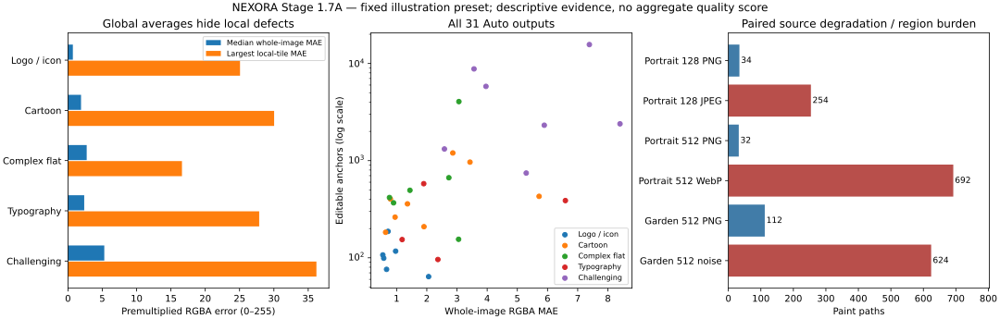
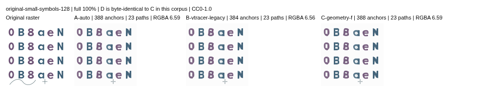
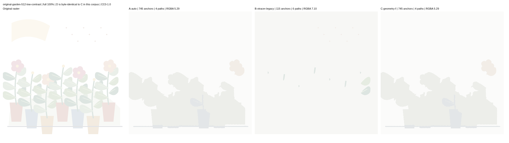

# Stage 1.7A — real artwork quality and generalization audit

**PARTIAL overall; quality evaluation delivered, production promotion blocked.**
31 legally documented images were converted through five configurations of the
actual browser application: **335 SVG downloads, 155 image/configuration
comparisons**, independently rasterized in Chromium and libvips. Every conversion
completed, and repeated first/warm/reset exports were byte-identical. This does
not mean their visual quality passed. Small typography, low-contrast artwork,
lossy portraits and narrow details expose substantial defects.

The independent H/F proof preserves all 45 historical exports and the nine
protected geometric results. The complete local historical runner still **FAILS**
its unchanged +500ms timing gate on a rounded 1024px blade. A separate CI run
passes; it does not reverse that recorded local failure. No engine, adapter,
source-fitting, topology, feature activation or old quality-gate threshold changed.
No merge to `main`.



## 1. Revisions, scope and binaries

- Exact base: `ce63c7202f2f0836b2123036b8e24db939ffa420`.
- Initial corpus/conversion tooling: `f04fb5b70f2c8762cb837f7bb3bd70106d963fd2`.
- Calibrated mask/viewport geometry evaluator and offline prerequisite fix:
  `af552b1f597b9990f0b16a427d6e52b322e3502d`.
- Final implementation, split audit and exact-regeneration check:
  `8662fc28545a8de56bfba15a0de84d9a8ce63135`.
- Work branch: `feat/stage-1-7a-real-artwork-quality`.
- `main` retained at `69b06ef8383b729223040a1282cd10809eb172f1`.
- `git diff ce63c72 -- engine vendor src` is empty. Original VTracer
  `1.0.0-alpha.4` / upstream `e71343fbcbf469b8a72a255030408a39939162eb`,
  visioncortex `0.9.3` and flo_curves `0.8.0` integration is retained.

These are isolated **current-J-source builds under the F/H feature contracts**,
not the historical F/H binary files. Each build records its source commit, engine
tree, feature list, glue hash and WASM hash. All three local builds used engine
tree `d437623211c669208d48c2de4fbc1b0abc5628ca`:

| Module     | Cargo features                           | Local WASM SHA256                                                  |
| ---------- | ---------------------------------------- | ------------------------------------------------------------------ |
| production | none                                     | `1f0fefc5b944d31d7a70b1d4ef970903451ab3e48a68cfa50a9647dde463f314` |
| geometry-f | `large_apex` (implies `source_geometry`) | `ff87a3b4f05c8cf6323dcd0753cc4be77ae908fab38173ea4754f66fa39c10ae` |
| hotpath-h  | `large_apex,inverse_hotpath`             | `9127f6e59c375aa7eaa1ac81e0dde8029713b05cd79584442aa086b7aa1a16e8` |

Production builds contain neither research recovery nor runtime instrumentation.
`runtime_cache`, `runtime_profile` and `legacy_work` were not enabled for the artwork
comparisons. The existing runtime investigations remain in the F–J reports.

## 2. Corpus, legal provenance and holdout audit

[Manifest](../tests/fixtures/real-artwork/manifest.json) and
[corpus attribution](../tests/fixtures/real-artwork/README.md) contain exact source
URLs, source/reference/raster SHA256, dimensions, format, degradation, license,
rendering transform, foreground/background policy and named detail ROIs.

| Asset group                                                                                | Families | Rights and pinned source                                                                                                               |
| ------------------------------------------------------------------------------------------ | -------: | -------------------------------------------------------------------------------------------------------------------------------------- |
| Twemoji: cat, fox, woman, unicorn, camping, rose, teddy, rocket, bicycle, palette          |       10 | Graphics CC-BY 4.0; Copyright 2019 Twitter, Inc and other contributors; v14.0.2, commit `7a3dad4a4da30497093dab22eafba135f02308e1`     |
| Original ribbon, compass, two portrait variations, garden, outlined signage, small symbols |        7 | Authored for this evaluation; artwork dedicated to CC0-1.0. Bespoke outlined glyphs, no embedded font or proprietary character artwork |
| Kenney city-builder documentation screenshot                                               |        1 | Repository MIT notice, Copyright 2025 Kenney; commit `4535092b740b378b700efd9df9e27a631815b84a`; original PNG retained                 |

Twemoji graphics are **not** labelled MIT. Full graphics-license text and upstream
README attribution are retained. Kenney's README additionally calls sprites/models
CC0; the documentation screenshot conservatively retains the repository MIT
notice. No competitor conversion, user upload or unclear-license asset is included.
Noto was excluded after the inspected image-license statement and linked font
license did not provide sufficiently clear provenance for this corpus.

There are 31 images, 18 asset families and **17 independent design groups**.
The initial pre-conversion split had 12 holdout images. Review discovered that
`original-anime-side` shares the primary portrait's generating template. Schema 2
moves that sibling to the same development group: **11 strict holdout images**.
The initial [manifest.v1.json](../tests/fixtures/real-artwork/manifest.v1.json) and
all original conversion records remain unchanged. Reports keep `recordedSplit`
and effective `split`/`splitGroup`. This corrects leakage rather than claiming the
two related portraits are independent evidence.

- Initial manifest SHA256:
  `edfa9efa7dfb940fe1171177980e8e7974b2b091561925a0b396fbb47dc320b5`.
- Canonical schema-2 SHA256:
  `c9bfdb34e75a16907b1af11c63d1e1e632843e0a746c7df1d77d0d149aa327df`.
- All image and reference bytes are identical across the metadata correction.
  Isolated regeneration after formatting and again after the correction reproduced
  every committed asset byte for byte. The report rejects undeclared manifest
  lineage or changed source-image hashes.

Categories: six logos/icons, eight cartoons, six complex flat illustrations,
four typography/symbols and seven challenging variants. Eight inputs are 128px
wide, 21 are 512px, two are 1024px. The city screenshot is 512×287; others square.
Each SVG-backed resolution is independently rendered at 4× and Lanczos3-downsampled.
The lower resolutions are not resized from the 1024px images. JPEG quality 38
(4:2:0), WebP quality 45, deterministic ±4 RGB noise, an 82%-white low-contrast
palette and intrinsic group opacity 0.68 are explicitly declared derivatives.

29 rows have legal vector references. The noisy garden reference is deliberately
withheld after degradation; this is different from the city, whose original
vector geometry is genuinely unavailable. Neither receives invented exact
boundary/corner scores. This small corpus represents flat artwork and emoji,
not the distribution of professional anime, photographs or all design workflows.
The portraits are original character-like illustrations, not a commercial anime
benchmark. Holdout results were inspected for this audit and evaluator validation;
no engine parameters or anomaly thresholds were tuned on them. Future algorithm
work needs additional unseen design families.

## 3. Configurations and actual browser conversion

All rows use the same **illustration preset**, fixed before conversion. There is
no per-image search for the most favorable preset. UI controls and adapter
eligibility are unchanged; images classified as noisy or unsupported are allowed
to follow their normal fallback route.

Illustration requests 24 colors, speckle 2 and spline mode through the existing
adapter. Actual route telemetry is 17 `reconstruct`, eight `coverage-adaptive`,
five `legacy` and one `reconstruct-blend` for A/C/D/E; B is `legacy` for all 31.
These are VTracer-WASM routes, not ImageTracerJS fallback. The five Auto legacy
routes are the two JPEGs, portrait WebP, noisy garden and city screenshot.
Changing the source-refinement checkbox does not force those unsupported images
into an inverse solver. This audit characterizes the default balanced preset;
it does not establish best achievable quality across every supported preset.

| ID  | WASM       | Quality / node optimization / source refinement | Interpretation                                                                   |
| --- | ---------- | ----------------------------------------------- | -------------------------------------------------------------------------------- |
| A   | production | Auto / on / off                                 | Ordinary production NEXORA Auto                                                  |
| B   | production | legacy / off / off                              | Closest supported VTracer-derived Stage 1.1 route; not pristine upstream VTracer |
| C   | geometry-f | Auto / on / on                                  | Experimental source fitting and F geometry recovery when eligible                |
| D   | hotpath-h  | Auto / on / on                                  | Same geometry contract as C, exact H computation optimization                    |
| E   | production | Auto / on / on                                  | Extra full-corpus control: Stage 1.5 source fitting without F recovery           |

B retains current preset color/palette constraints and the legacy alpha limitation;
it is not advertised as equivalent preprocessing with only one mathematical
operation disabled. E is necessary to avoid attributing all C/A differences to F.
ImageTracerJS was not required and is not mixed into these scores. No Vector Magic
or Vectorizer.AI outputs were obtained, so no parity claim is made.

The isolated Vite builds alias only the selected WASM import. Each trial uses the
real file picker, controls, unchanged conversion Worker and **Download SVG** link.
The conversion HTTP server exposes app assets only, not vector references.
References are opened later by the offline evaluator. Source PNG/file hashes,
actual transferred RGBA hashes, options, engine provenance, Worker events and
SVG hashes are retained. All five configurations received identical decoded RGBA
for each image.

124 A–D comparisons were followed by 31 E comparisons. Every comparison has a
first/fresh-Worker and warm/reused-Worker download. Five selected images per
configuration also have a reset/new-Worker download: **335 total actual downloads**.
Every recorded file hash matches its download, with identical first/warm/reset
SVG bytes for all 155 comparisons. All 335 observations name `vtracer-wasm`;
there are no captured console/page errors. Observed first/warm/reset telemetry
matches the intended Worker state in every invocation. No failed conversion was
retried. A 45s research
watchdog records an incomplete conversion as a failure; it does not change the
normal application's existing five-second Download assertion.

## 4. Metric definitions and measurement limits

- Premultiplied RGBA MAE: mean absolute difference over four channels on the
  0–255 scale. RGB channels are multiplied by their own alpha; hidden RGB cannot
  inflate error. The comparison is in encoded image RGB, **not** a linear-light,
  Delta-E or perceptual score. Alpha MAE is also recorded separately.
- Interior RGB error: opaque source/output pixels whose source four-neighbor
  channel differences are ≤4. This samples stable color regions; it does not
  measure all colors or isolate segmentation causality.
- Foreground IoU: declared-background separation (>8 encoded-channel difference)
  with alpha ≥128. No known segmentation/background means N/A, as for the city.
  It is a threshold-dependent reconstruction measure, not true-vector accuracy.
- Local worst regions: integral-image search with tile side
  `max(8, round(min(width,height)/16))`, half-tile stride, retaining three separated
  high-error crops plus named semantic ROIs. Difference images are amplified ×12
  and labelled. A high-error crop does not identify its algorithmic cause.
- Reference geometry: transformed SVG command endpoints plus ≤0.5px arc-length
  samples, restricted to visible foreground boundaries using a 2× raster mask.
  Used `userSpaceOnUse` alpha-mask boundaries and viewport clipping edges are
  included. Symmetric nearest-neighbor mean/p95/max are reported in native pixels.
  These are sampled visible-silhouette distances, **not certified Hausdorff bounds,
  all internal color-edge distances, or hidden-layer correspondence**. Subthreshold
  acute tips may be excluded by visibility; independently annotated compass
  endpoints and the unchanged historical endpoint-inclusive gates remain separate.
- Corner precision/recall is measured only for the compass's 16 annotated outer
  vertices, using the existing final-output G0 detector and 2px one-to-one matching.
  No invented true-corner labels are assigned to emoji, portraits or raster-only art.
- Complexity: all editable path commands, including opacity-mask geometry,
  anchors, cubic/straight segments, closure, compound subpaths, distinct SVG fill
  values, tiny bounding boxes, node density and bytes. Mask/paint counts and
  per-path node distributions are separate in the raw observations. Source
  design-element count is descriptive, not an optimal-output node target.
- Topology screens: 4-connected foreground/8-connected background components
  ≥4px and proper crossings **within each path**. Tiny paths, high density and
  control-box overlap/containment are suspects. Intended stacked underpainting,
  compound paths and normal adjacent-face contacts are not declared invalid.
  Pairwise control-box checks stop at 200,000 and report budget status; this is
  not a complete proof of hole containment or unnecessary overlap.

Both Chromium 154.0.8037.57 and Sharp 0.35.5 / libvips 8.18.7 / librsvg 2.63.2
rasterize each untouched download at identical dimensions. Known reference strokes
and primitive objects are normalized **offline** through Inkscape; actual source
versus normalized native-pixel MAE is zero on all available references. These
normalized files never become tracing inputs.

### Evaluator defects found and rejected

Initial geometry analysis reported approximately 94px errors for unicorn and
partial-alpha artwork. Those were **measurement defects**, not repaired engine
geometry. The old extractor omitted a mask-defined silhouette and dropped the
reference's boundary just beyond its viewport. An unchanged candidate then appeared
far from a missing reference edge.

The initial scores, logs and downloads remain in `evaluation-v1`. A new analytic
calibration fails against the old extractor (exit 1) and passes against the corrected
one (exit 0), covering root viewBox, transformed endpoints, mask-defined boundaries,
viewport clips and exact self-comparison. Fresh `review-v2/geometry` remeasured the
same exports; `review-v3/report` applies the metadata-only split correction.
Unicorn's revised sampled max is **10.293px**, and partial portrait's is **1.739px**.
Neither numerical correction is credited as a tracing improvement. Pixel metrics
and actual SVG bytes are unaffected. Same-image/same-SVG consistency checks have
zero failures across the five configurations.

## 5. Category reconstruction and experimental generalization

Values below are category **upper medians** for an even count, matching the frozen
summary implementation. Worst local values are maxima, not medians. Categories
are not combined into one quality score.

| Category (images) | A MAE | B MAE | E MAE | C/D MAE | A worst tile | A median paths | A median anchors |
| ----------------- | ----: | ----: | ----: | ------: | -----------: | -------------: | ---------------: |
| logo-icon (6)     | 0.716 | 1.292 | 0.716 |   0.716 |       25.066 |              4 |              107 |
| cartoon (8)       | 1.906 | 2.281 | 1.906 |   1.906 |       30.035 |             15 |              403 |
| complex-flat (6)  | 2.731 | 2.936 | 2.731 |   2.731 |       16.609 |             17 |              495 |
| typography (4)    | 2.368 | 5.228 | 2.326 |   2.287 |       27.859 |             20 |              388 |
| challenging (7)   | 5.294 | 7.103 | 5.294 |   5.294 |       36.198 |            254 |             2392 |

The clean ribbon and palette are relatively manageable: Auto's 512px ribbon has
four paths, 107 anchors, MAE 0.543 and IoU 0.998; palette has six paths, 99 anchors,
MAE 0.573. The high category-local errors come from specific details, not uniform
failure of every logo. Cartoons retain recognizable eyes and pupils, but small
hair highlights, lash/outline shape and neck/clothing separations degrade. Complex
flat art retains the main composition while small leaves/gaps are lost. Typography
at 128px is markedly weaker than its independently rasterized 512px equivalent.

**C and D match byte-for-byte on all 31 images.** A/C match on 25/31; E/C match on
26/31. Eighteen C conversions pass ordinary source-refinement eligibility, but
only five accept F recovery. Most difficult lossy/noisy cases receive no benefit.
These are measured limits of generalization, not evidence to enable F globally.

| Image                | A MAE | E MAE | C/D MAE | A → C worst local | F recovery accepted?    |
| -------------------- | ----: | ----: | ------: | ----------------- | ----------------------- |
| original-compass-512 | 0.967 | 0.953 |   0.927 | 4.079 → 3.293     | yes                     |
| twemoji-cat-512      | 0.793 | 0.767 |   0.767 | 4.431 → 4.099     | no: source-fitting only |
| twemoji-woman-512    | 0.635 | 0.631 |   0.628 | 10.379 → 10.379   | yes                     |
| twemoji-rocket-1024  | 0.763 | 0.751 |   0.741 | 6.350 → 6.350     | yes                     |
| original-signage-128 | 2.368 | 2.326 |   2.287 | 20.863 → 20.863   | yes                     |
| original-signage-512 | 1.182 | 1.138 |   1.126 | 6.871 → 6.871     | yes                     |

Compass 512's sampled maximum improves from 2.460 to 1.266px already in E; C
further improves mean/p95 from 0.224/0.461 to 0.205/0.413px. Its G0 precision/recall
improves from 0.750/0.938 in A/B to 1/1 **already in E**; C retains that classification.
Its worst annotated endpoint-to-anchor error improves from 3.162 to 1.800px in E/C,
which is different from the visibility-filtered sampled maximum. Compass 128 and
1024 remain at 0.750/0.938 and 3.162px endpoint-anchor error in all configurations.
This inconsistent cross-resolution outcome prevents a universal corner claim.
Woman 512's worst local crop remains 10.379 despite C's lower global MAE; signage
128 retains its missing/shrunken counter despite a small C MAE improvement.

There are costs and mixed metrics. Cat 512 increases from 403 to 421 anchors,
rocket 1024 from 417 to 448, and signage 512 from 154 to 159 in E/C. Their small
pixel improvements do not establish better manual editability. Signage 128's
sampled p95 is **0.586px in E versus 0.596px in C**, while mean and RGBA MAE improve;
this remains an observed geometric tradeoff, not a claim that all metrics improve.
C/D introduce no additional within-path crossing candidates versus A on this
corpus. These observations support retaining experimental isolation.

## 6. Per-image production reconstruction

All metrics in the next tables describe **A**, not experimental production claims.
IDs resolve to source files, licenses and variant definitions in the manifest.
`d(mean/p95/max)` is the sampled visible-boundary metric defined above. N/A is
intentional for the two raster-only evaluation rows.

| Image                            | Dimensions / format | RGBA MAE | Worst tile | Foreground IoU | d(mean / p95 / max), px   |
| -------------------------------- | ------------------- | -------: | ---------: | -------------: | ------------------------- |
| original-ribbon-128              | 128×128 / png       |    0.667 |      8.086 |          0.995 | 0.151 / 0.382 / 1.827     |
| original-ribbon-512              | 512×512 / png       |    0.543 |      8.062 |          0.998 | 0.137 / 0.299 / 2.445     |
| original-compass-128             | 128×128 / png       |    2.060 |     25.066 |          0.931 | 0.377 / 0.766 / 2.386     |
| original-compass-512             | 512×512 / png       |    0.967 |      4.079 |          0.989 | 0.249 / 0.710 / 2.460     |
| original-compass-1024            | 1024×1024 / png     |    0.716 |      1.911 |          0.996 | 0.210 / 0.616 / 2.451     |
| twemoji-palette-512              | 512×512 / png       |    0.573 |      3.057 |          0.997 | 0.306 / 0.777 / 1.313     |
| twemoji-cat-128                  | 128×128 / png       |    1.906 |     10.793 |          0.986 | 0.369 / 0.950 / 1.853     |
| twemoji-cat-512                  | 512×512 / png       |    0.793 |      4.431 |          0.997 | 0.384 / 1.215 / 2.097     |
| twemoji-fox-512                  | 512×512 / png       |    1.359 |     15.999 |          0.989 | 0.722 / 3.185 / 4.839     |
| twemoji-woman-512                | 512×512 / png       |    0.635 |     10.379 |          0.995 | 0.584 / 1.886 / 6.490     |
| twemoji-unicorn-512              | 512×512 / png       |    0.949 |      6.186 |          0.996 | 0.260 / 0.847 / 10.293    |
| original-anime-128               | 128×128 / png       |    5.721 |     30.035 |          0.973 | 1.390 / 7.980 / 11.362    |
| original-anime-512               | 512×512 / png       |    3.431 |     12.115 |          0.979 | 4.795 / 33.084 / 44.427   |
| original-anime-side-512          | 512×512 / png       |    2.862 |     12.413 |          0.979 | 4.336 / 32.744 / 84.505   |
| twemoji-camping-512              | 512×512 / png       |    2.731 |     14.750 |          0.893 | 11.384 / 92.428 / 191.561 |
| twemoji-rose-512                 | 512×512 / png       |    3.053 |     15.270 |          0.992 | 0.441 / 1.783 / 4.037     |
| twemoji-teddy-512                | 512×512 / png       |    0.899 |      3.703 |          0.996 | 0.311 / 0.832 / 2.170     |
| twemoji-bicycle-512              | 512×512 / png       |    1.441 |      8.451 |          0.985 | 0.315 / 0.829 / 3.137     |
| twemoji-rocket-1024              | 1024×1024 / png     |    0.763 |      6.350 |          0.998 | 0.288 / 0.888 / 1.602     |
| original-garden-512              | 512×512 / png       |    3.063 |     16.609 |          0.983 | 0.468 / 1.034 / 7.217     |
| original-signage-128             | 128×128 / png       |    2.368 |     20.863 |          0.949 | 0.350 / 0.658 / 8.053     |
| original-signage-512             | 512×512 / png       |    1.182 |      6.871 |          0.984 | 0.260 / 0.637 / 2.897     |
| original-small-symbols-128       | 128×128 / png       |    6.592 |     27.859 |          0.783 | 1.030 / 4.009 / 14.308    |
| original-small-symbols-512       | 512×512 / png       |    1.898 |      9.109 |          0.943 | 0.485 / 0.852 / 13.006    |
| original-anime-128-jpeg          | 128×128 / jpeg      |    8.402 |     33.945 |          0.949 | 1.969 / 5.995 / 27.432    |
| original-anime-512-webp          | 512×512 / webp      |    3.960 |     12.333 |          0.991 | 1.255 / 2.708 / 55.555    |
| original-anime-512-partial       | 512×512 / png       |    2.584 |      8.012 |          0.997 | 0.283 / 0.851 / 1.739     |
| original-garden-512-low-contrast | 512×512 / png       |    5.294 |     17.031 |          0.627 | 16.310 / 96.608 / 239.104 |
| twemoji-fox-128-jpeg             | 128×128 / jpeg      |    5.892 |     20.219 |          0.894 | 2.962 / 9.803 / 14.682    |
| original-garden-512-noise        | 512×512 / png       |    3.564 |     13.510 |          0.974 | N/A                       |
| kenney-city-512                  | 512×287 / png       |    7.387 |     36.198 |            N/A | N/A                       |

## 7. SVG complexity, structure and actual editability

Every A output has closed subpaths and no embedded raster. No open subpath was
reported. All **31 A downloads** imported into Inkscape 1.4 CLI and exported as
plain SVG with **zero native premultiplied RGBA roundtrip MAE**. This proves CLI
import/export and paint preservation on this corpus, not comfortable GUI editing.
Manual anchor manipulation, Illustrator and paid-editor compatibility remain
**UNVERIFIED**.

`Input/Fill` below means frontend dominant-color diagnostic / distinct SVG fill
values, not exact source color cardinality. `P/K/C/L` means paths / anchors / cubic
segments / straight segments. Masks count toward editable geometry. `Tiny` is
small control-box candidates; `X` is proper within-path crossing candidates,
not confirmed invalid topology. Bytes refer to original downloads.

| Image                            | Input/Fill | P / K / C / L              | Compound / Tiny / X | SVG bytes |
| -------------------------------- | ---------: | -------------------------- | ------------------- | --------: |
| original-ribbon-128              |        3/4 | 4 / 76 / 46 / 30           | 0 / 0 / 0           |      1602 |
| original-ribbon-512              |        3/3 | 4 / 107 / 69 / 38          | 0 / 0 / 0           |      2406 |
| original-compass-128             |        2/3 | 4 / 64 / 56 / 8            | 0 / 0 / 0           |      1788 |
| original-compass-512             |        2/4 | 4 / 117 / 109 / 8          | 0 / 0 / 0           |      4024 |
| original-compass-1024            |        2/3 | 4 / 187 / 179 / 8          | 0 / 0 / 0           |      6441 |
| twemoji-palette-512              |        5/6 | 6 / 99 / 85 / 14           | 1 / 0 / 0           |      2990 |
| twemoji-cat-128                  |      11/15 | 15 / 209 / 165 / 44        | 2 / 0 / 0           |      5370 |
| twemoji-cat-512                  |        5/9 | 9 / 403 / 376 / 27         | 6 / 0 / 0           |     11516 |
| twemoji-fox-512                  |        5/8 | 9 / 359 / 346 / 13         | 5 / 0 / 0           |     10784 |
| twemoji-woman-512                |        3/6 | 6 / 183 / 173 / 10         | 2 / 0 / 0           |      5565 |
| twemoji-unicorn-512              |       3/12 | 13 / 262 / 249 / 13        | 0 / 0 / 0           |      8039 |
| original-anime-128               |      38/23 | 34 / 429 / 240 / 189       | 6 / 0 / 0           |      8437 |
| original-anime-512               |       9/18 | 32 / 965 / 827 / 138       | 14 / 0 / 0          |     25617 |
| original-anime-side-512          |      12/21 | 41 / 1199 / 1069 / 130     | 13 / 0 / 0          |     32538 |
| twemoji-camping-512              |       9/18 | 21 / 667 / 622 / 45        | 1 / 0 / 0           |     19230 |
| twemoji-rose-512                 |        4/3 | 3 / 155 / 137 / 18         | 1 / 0 / 0           |      4314 |
| twemoji-teddy-512                |       5/14 | 14 / 368 / 345 / 23        | 5 / 0 / 0           |     11101 |
| twemoji-bicycle-512              |       4/11 | 17 / 495 / 465 / 30        | 3 / 0 / 0           |     14383 |
| twemoji-rocket-1024              |        4/7 | 7 / 417 / 392 / 25         | 1 / 0 / 0           |     12457 |
| original-garden-512              |      12/23 | 112 / 4052 / 3229 / 823    | 46 / 0 / 2          |     97935 |
| original-signage-128             |        3/7 | 10 / 96 / 73 / 23          | 3 / 0 / 0           |      2648 |
| original-signage-512             |        2/7 | 12 / 154 / 130 / 24        | 2 / 0 / 0           |      4666 |
| original-small-symbols-128       |      15/15 | 23 / 388 / 164 / 224       | 13 / 0 / 0          |      6188 |
| original-small-symbols-512       |       3/16 | 20 / 579 / 483 / 96        | 11 / 0 / 0          |     15632 |
| original-anime-128-jpeg          |     192/24 | 254 / 2392 / 932 / 1460    | 15 / 0 / 0          |     38532 |
| original-anime-512-webp          |      46/23 | 692 / 5810 / 3052 / 2758   | 76 / 0 / 0          |    117615 |
| original-anime-512-partial       |      10/22 | 46 / 1318 / 718 / 600      | 12 / 0 / 0          |     25529 |
| original-garden-512-low-contrast |        5/4 | 4 / 745 / 714 / 31         | 1 / 0 / 0           |     20033 |
| twemoji-fox-128-jpeg             |     110/24 | 220 / 2314 / 1056 / 1258   | 15 / 0 / 0          |     39785 |
| original-garden-512-noise        |      31/24 | 624 / 8791 / 5033 / 3758   | 112 / 0 / 0         |    173195 |
| kenney-city-512                  |     117/24 | 1365 / 15643 / 7903 / 7740 | 107 / 0 / 8         |    288236 |

Garden has two within-path crossing candidates; city has eight. They require
local geometric review and are not certified new invalid crossings or broken
containment. No general all-region topology proof is claimed. All A proper-crossing
scans finished their own budget. Control-box overlap screening is separately bounded
and reaches its cap on the WebP portrait and city. Exact shared-edge identity is tested
by the unchanged dedicated graph regression; ordinary Auto's stacked paths must
not be assumed to form a planar subdivision. Renderer antialias seams are not
classified as geometric cracks without checking edge coordinates.

The clean garden's source contains 136 geometry elements, so its 112 output paths
are not automatically redundant. Its 4,052 editable anchors still impose a real
editing burden. The WebP portrait has 692 paths for the same 55-element design
whose clean 512px conversion has 32. Here the paired degradation is strong evidence
of fragmentation, not simply one dense contour needing fewer Bézier knots.

## 8. Visually confirmed failures and uncertainty

The [human review ledger](evidence/stage17a/REVIEW.md) links each confirmed or
suspected finding to source/export crops, configuration, category and uncertainty.

### Typography and thin structures

[Full native comparison](evidence/stage17a/original-small-symbols-128-full-100.png),
[100% detail](evidence/stage17a/original-small-symbols-128-detail-100.png),
[400%](evidence/stage17a/original-small-symbols-128-detail-400.png),
[1000%](evidence/stage17a/original-small-symbols-128-detail-1000.png),
[difference ×12](evidence/stage17a/small-symbols-local-difference-1000.png),
[actual A SVG](evidence/stage17a/original-small-symbols-128--A-auto.svg).



The thin wave at the bottom disappears in A/B/C. Glyph counters become narrow or
occluded, and the tiny letter row changes thickness. The ≥4px negative-space
screen drops **28 → 0**; this does not mean all 28 mathematical holes are entirely
filled. At 512px it is 28 → 24. Local MAE 27.859 accompanies global MAE 6.592 at
128px. Signage loses one of seven negative-space components at 128px and preserves
all seven at 512px. All source corners/holes are legal outlined vector artwork;
no font engine is involved. Root cause is consistent with detail loss before
final recovery; exact clustering/speckle/fitting guard needs label-stage diagnosis.

### Portrait details and lossy fragmentation

[Portrait native](evidence/stage17a/original-anime-128-full-100.png),
[100%](evidence/stage17a/original-anime-128-detail-100.png),
[400%](evidence/stage17a/original-anime-128-detail-400.png),
[1000%](evidence/stage17a/original-anime-128-detail-1000.png),
[WebP eye at 1000%](evidence/stage17a/original-anime-512-webp-detail-1000.png).

Eyes and pupils remain recognizable; they are **not** labelled wholly missing.
At 128px hair highlights vanish, lashes/outline and neck/jaw/clothing boundaries
change. Eye ROI MAE is 8.916 versus global 5.721; hair-tip ROI is 8.211.
The independently rendered 512px clean version still has eye/hair ROI errors
4.121/5.741. Its same-resolution WebP derivative reaches 692 paths, 5,810 anchors
and 117,615 bytes versus clean 32 paths, 965 anchors and 25,617 bytes. The 128px
JPEG variant increases paths 34 → 254 and nodes 429 → 2,392. This paired evidence
supports a segmentation/codec-fragmentation priority; it does not prove every
intermediate tone is a false antialias ring.

### Low contrast and complex flat artwork

[Native](evidence/stage17a/original-garden-512-low-contrast-full-100.png),
[100%](evidence/stage17a/original-garden-512-low-contrast-detail-100.png),
[400%](evidence/stage17a/original-garden-512-low-contrast-detail-400.png),
[1000%](evidence/stage17a/original-garden-512-low-contrast-detail-1000.png),
[actual A](evidence/stage17a/original-garden-512-low-contrast--A-auto.svg),
[actual B](evidence/stage17a/original-garden-512-low-contrast--B-vtracer-legacy.svg).



Flowers, pot/leaf separation and small banner decorations collapse into a small
number of pale regions. Foreground IoU is 0.627, foreground components 12 → 2 and
negative-space components 12 → 0, despite a modest full-image MAE of 5.294.
A/C/E are identical; B is nearly blank. The four-path A output is compact but
visually unusable for preserving this composition. This is not a node-efficiency
success. Clean garden remains recognizable with smaller gaps lost; its noise
variant increases paths 112 → 624 and anchors 4,052 → 8,791. The exact stage causing
low-contrast merging is **not isolated**; coarse color precision, region clustering
and contour filtering remain hypotheses, not confirmed root causes.

### Transparency, sharp negative space and raster-only city

[Partial-alpha native comparison](evidence/stage17a/original-anime-512-partial-full-100.png)
shows the intrinsic opacity retained by A/C/E and lost by the known-unsupported
legacy B route. A alpha MAE is 1.801, foreground IoU 0.9966 and RGBA MAE 2.584;
B alpha MAE is 56.145 and RGBA MAE 33.257. This single group-opacity variant does
not prove arbitrary layered transparency is correct.

[Unicorn native](evidence/stage17a/twemoji-unicorn-512-full-100.png) and
[negative-space tip at 1000%](evidence/stage17a/twemoji-unicorn-512-geometry-1000.png)
show a retracted narrow notch in the mane. Revised sampled max is 10.293px despite
IoU 0.9963 and MAE 0.949. This is an actual local detail failure; the former 94px
viewport-extraction result is rejected. Twemoji attribution/license applies to
these derivatives as recorded in the evidence README.

The raster-only city produces 1,365 paths, 15,643 anchors and 288,236 bytes,
MAE 7.387 and worst tile 36.198. It has a high editing burden, but no exact original
vector boundary, corner recall or known optimal node count. It is not called
incorrect merely because legitimate complex scene detail creates many paths.

## 9. Failure taxonomy and priority for Stage 1.7B

[Taxonomy definitions and automatic rules](REAL_ARTWORK_FAILURE_TAXONOMY.md)
separate MEASURED, SUSPECTED, VISUALLY CONFIRMED and ROOT-CAUSE CONFIRMED findings.
An anomaly does not automatically become a causal engine diagnosis. Production
screens flag local discrepancies in **9/17 independent groups**, high node density
in 6/17, negative-space differences in 5/17, unsupported narrow mask structure
in 4/17, crossing candidates in 2/17 and interior-color discrepancy in 1/17.
These frequencies are not defect prevalence estimates for real users. Variants
and the related portraits are not counted as independent artwork.
Unsupported narrow pixels in JPEG/WebP can include codec speckles; that screen
is not a semantic feature detector. Only crop-confirmed lines, counters and
region losses motivate repair, rather than indiscriminately retaining every speckle.

| Rank | Next target                                                                         | Evidence / severity                                                                                                                        | Editability, feasibility, regression and cost                                                                                                                                                                                                                         |
| ---- | ----------------------------------------------------------------------------------- | ------------------------------------------------------------------------------------------------------------------------------------------ | --------------------------------------------------------------------------------------------------------------------------------------------------------------------------------------------------------------------------------------------------------------------- |
| 1    | Source-supported thin-detail and negative-space preservation in region construction | Four narrow-support and five negative-space groups; missing thin wave, shrunken glyph counters, portrait strokes, lost garden gaps/regions | High visual importance; recovery cannot recreate absent topology. Audit existing visioncortex/VTracer labels, color precision and thread/speckle decisions first. Local evidence is plausible without a new engine; moderate topology/CPU risk requires explicit caps |
| 2    | Noise/codec-resistant region fragmentation                                          | Same-design WebP 32 → 692 paths, JPEG 34 → 254, garden noise 112 → 624                                                                     | Large editing/file impact. Evaluate local two-region ownership and intentional-color evidence, not global palette merging or blur. High risk to genuine tiny details; avoid trading rank-1 detail away                                                                |
| 3    | Source-verified local contour/tip recovery on wider art classes                     | Unicorn notch 10.293px, woman 6.490px; compass improvement does not generalize across resolutions                                          | Useful after ownership/feature survival is known. Existing source geometry is a foundation; broader eligibility without confidence would carry regression and CPU risk                                                                                                |
| 4    | Opacity and complex compositing coverage                                            | Production handles the tested group-opacity example; B has a known alpha limitation                                                        | Keep current alpha gates; expand intrinsic-opacity/layered fixtures before a new representation. One failure in unsupported B is insufficient to prioritize an Auto rewrite                                                                                           |
| 5    | Runtime/whole-scene complexity                                                      | City 15,643 nodes; previous H–J failures and a new retained local timing failure                                                           | Important blocker, but no new open-ended runtime project in this stage. Preserve attribution data and existing blocking gates                                                                                                                                         |

**Proposed Stage 1.7B objective:** instrument and preserve source-supported thin
features and enclosed negative spaces **before final curve fitting**, beginning
with the missing symbol wave, 128px glyph counters and low-contrast garden.
Compare pre/post region labels and surviving contours to separate quantization,
segmentation, thread/speckle rejection and geometric fitting. Use unseen licensed
families for validation. Keep intentional small colors and compression noise
separate; do not fix one by merging everything or disabling all speckle filtering.

This outranks another general Bézier solver: the legacy route already loses the
same thin features; F/E leave those cases unchanged, and topology-preserving
handle motion cannot resurrect an absent region or hole. It is a testable next
investigation, not a claim that one specific guard has already been proven guilty.

## 10. Runtime, memory and mobile observations

Environment: Intel Xeon Platinum 8573C, five visible CPUs, cgroup quota
`400000/100000` (four CPU equivalents), Linux kernel 6.18.55, Node 24.19.0,
Rust 1.99.1, wasm-bindgen 0.2.126, Chromium 154.0.8037.57. No exclusive CPU or
physical Android device was available.

First/warm/reset are **one observed sequence per image/configuration**, not
independent statistical performance sessions. They are descriptive, not evidence
that H is faster/slower overall. `traceMs` is the app's Worker trace interval,
not hardware CPU time; decode/startup/Worker-total/click-to-result are separately
retained. Existing Rust subintervals overlap and must not be added together.
No new runtime profiler, cache or threshold experiment was introduced.

| Auto input                       | First trace ms |  Warm ms | Reset ms | WASM linear MiB |
| -------------------------------- | -------------: | -------: | -------: | --------------: |
| original-compass-512             |        364.300 |  278.600 |  388.100 |           9.812 |
| original-anime-128               |        373.800 |  299.000 |      N/A |           2.125 |
| original-anime-512               |       1432.200 | 1351.700 | 1462.400 |          11.125 |
| original-anime-512-webp          |        300.400 |  246.900 |      N/A |          16.062 |
| original-anime-512-partial       |       1699.200 | 1644.600 |      N/A |          10.312 |
| original-garden-512-low-contrast |        211.900 |  128.700 |      N/A |          25.875 |
| kenney-city-512                  |        428.800 |  312.900 |  414.400 |          14.688 |

The largest observed A trace was 1,791.3ms; this does not negate historical
multi-second stalls. A source-quality workload may be slower than a fragmented
fallback because it executes different fitting work. Do not interpret the WebP
portrait's lower trace time as higher quality.

A linear-memory readings span 1.625–50.438MiB (all configurations peak at
50.438MiB). This is WASM memory capacity/high-water allocation, **not live heap,
RSS, leak proof or Android memory use**. Fresh and reset Workers produce identical
bytes; the existing browser suite verifies reuse, cancellation, obsolete-result
suppression and object-URL cleanup. There was no new long-duration memory-soak
experiment. The 335 conversions do not substitute for one.

**PHYSICAL ANDROID — UNVERIFIED.** Desktop viewport tests are not device evidence.
No backend, GPU service, image upload, account or paid dependency was added.

## 11. Regression outcomes and immutable failures

The complete local invocation is preserved at
`verification-f04fb5b/exit-status.tsv`. Every command's exit status was retained.
The required build/test sequence ran with no automatic retries:

| Check                                                                              | Actual local result                                                                                                 |
| ---------------------------------------------------------------------------------- | ------------------------------------------------------------------------------------------------------------------- |
| Normal WASM rebuild                                                                | PASS, exit 0                                                                                                        |
| Rust default / source_geometry / large_apex / large_apex,inverse_hotpath           | PASS: 69 / 69 / 72 / 76 tests                                                                                       |
| Upstream VTracer library                                                           | PASS: 31 tests                                                                                                      |
| New benchmark metric regressions                                                   | PASS: 5 tests                                                                                                       |
| Browser contour calibration                                                        | PASS; old extractor intentionally fails control                                                                     |
| TypeScript unit tests                                                              | PASS: 42 tests, 8 files                                                                                             |
| Lint / typecheck / Vite build                                                      | PASS, exit 0 each                                                                                                   |
| Normal browser E2E                                                                 | PASS: 27 tests, including existing Download, cancellation/replacement, reuse/reset and shared/alpha suites          |
| Initial offline source-quality preparation                                         | **FAIL**, exit 1: missing prior corner-benchmark geometry artifact                                                  |
| Isolated prerequisite correction plus corner/source-quality/curve-quality evidence | PASS, exit 0 for all three; initial failure preserved                                                               |
| Complete historical source-target runner                                           | **FAIL**, exit 1 at unchanged false-corner runtime gate; later sub-gates not all reached                            |
| Independent H/F protected proof                                                    | PASS: 27 experimental browser tests; 45/45 exact SVG and Auto identity; unchanged H/F +500ms and 250ms apex budgets |
| Final default WASM and Vite restoration                                            | PASS, exit 0                                                                                                        |
| Legal/hash verifier and isolated byte-regeneration after split correction          | PASS, 31 assets, zero changed bytes                                                                                 |

The retained historical failure is `rounded-blade-native-srgb-1024`, ordinary
recovery comparator versus candidate, **not proof that large-apex code ran**.
Observed three-call values were comparator 1720.2/1020.3/654.8ms and candidate
2113.3/2647.5/774.4ms: medians 1020.3 → 2113.3ms, **+1093.0ms > +500ms**.
Both outputs have the same SVG and 2.496980px sampled boundary maximum.
Shared-host contention and some concurrent offline metric work were present;
this is not a demonstrated cause or waiver. The gate was not rerun until favorable.
Historical F–J performance failures remain unresolved; a passing independent
proof or CI does not erase them.

| Protected reference | Endpoint-inclusive maximum, px | Current H/F exports |
| ------------------- | -----------------------------: | ------------------- |
| Triangle 128        |                       0.409670 | byte-identical      |
| Triangle 512        |                       0.985251 | byte-identical      |
| Triangle 1024       |                       1.292558 | byte-identical      |
| Wave 128            |                       0.502973 | byte-identical      |
| Wave 512            |                       0.578088 | byte-identical      |
| Wave 1024           |                       0.660000 | byte-identical      |
| Cubic 128           |                       0.823200 | byte-identical      |
| Cubic 512           |                       0.823200 | byte-identical      |
| Cubic 1024          |                       0.766976 | byte-identical      |

These remain the unchanged historical endpoint-inclusive metric, not the new
artwork visibility-filtered distance. Existing corner, transparency, shared-edge,
source-paint, topology and editability checks were not relaxed. Independent
H/F byte identity does not imply every unchanged held-out shape is correct.

## 12. CI, artifacts and reproduction

- [Initial tooling run — FAIL](https://github.com/akidwush/vector-magic-bydika/actions/runs/40467420313)
  is retained. The initial local offline prerequisite failure is documented above;
  do not infer that every failed historical CI step had that single cause.
- [Calibrated implementation af552b1 — SUCCESS](https://github.com/akidwush/vector-magic-bydika/actions/runs/40470794414).
  This independent full runner completed all recorded commands. Its success does
  not replace the local historical FAIL.
- [Final split/regeneration implementation 8662fc2](https://github.com/akidwush/vector-magic-bydika/actions/runs/40476319767):
  status pending at report preparation; see final update below.

The dedicated workflow always uploads `real-artwork-raw-<commit>` with source and
configuration manifests, binary hashes, all actual SVG downloads, complete raw
metrics, Chromium renders, difference crops, Inkscape roundtrips, gallery, logs,
per-command statuses and historical/protected proof artifacts. Old gate failures
retain nonzero exit codes. Reports/screenshots-only commits do not retrigger this
long workflow; implementation and corpus changes do.

The separate local evidence archive is
`benchmark-results/stage17a/stage17a-local-evidence.tar.gz` (39,856,762 bytes), SHA256
`31a938712364319045d8624f1293c0887af6fa8806d5b5c07504f066ea9685ff`.
It contains the complete local artwork observations, corpus/rights, reviewed
metrics and selected historical/protected evidence; compiled WASM is excluded.
The CI artifact contains that runner's own observations, not a relabelled copy of
the local timing measurements.

Local artifact namespaces (ignored by git, never overwritten):

| Namespace under `benchmark-results/stage17a/`                  | Contents                                                                                                   |
| -------------------------------------------------------------- | ---------------------------------------------------------------------------------------------------------- |
| `modules/`                                                     | Three compiled module/app identities; no global activation                                                 |
| `evaluation-v1/`                                               | Original 124 A–D conversions, 268 downloads and initial analysis, including rejected geometry measurements |
| `source-only-v1/`                                              | 31 E conversions, 67 downloads and independent analysis                                                    |
| `calibration-control/`                                         | Old extractor FAIL / corrected extractor PASS                                                              |
| `review-v2/geometry/`                                          | Corrected geometry on the same 155 exports, no retracing                                                   |
| `review-v2/gallery/`                                           | 100/400/1000% details and geometric-worst crops, anchor overlays                                           |
| `review-v3/report/`                                            | Final 155-row summaries with corrected independent groups and declared manifest lineage                    |
| `review-v3/evidence-integrity.json`                            | 335 actual download hashes, source-RGBA identity and first/warm/reset consistency                          |
| `regeneration-v1/`, `regeneration-v2/`, `split-correction-v2/` | Byte reproduction and metadata-only correction evidence                                                    |
| `verification-f04fb5b/`                                        | Required local checks, historical FAIL and separate protected PASS                                         |
| `review-v2/offline/`                                           | Fresh isolated prerequisite/corner/source/curve evidence; original failure untouched                       |

The first two metric-diagnosis prototypes reused two temporary sampled-point debug
filenames; original tables, diagnostic logs and all source/exports were retained.
Final reviewed metrics use fresh versioned directories. No failed gate result was
replaced with a passing rerun.

From a clean checkout with Rust/WASM, wasm-bindgen, Node/npm, Chromium and Inkscape:

```sh
npm ci
npx playwright install chromium
bash scripts/real-artwork-research.sh
```

Use `NEXORA_CHROMIUM_PATH` for an installed Chromium and `NEXORA_TEST_PORT` if the
normal 4173 test port is occupied. `NEXORA_ART_STUDY` must name a fresh directory.
The runner performs required Rust, JS, browser and offline checks, builds isolated
modules, performs the five-config artwork study, then runs historical/protected
proofs and restores normal WASM/dist. The isolated modules never replace normal
application imports. Existing historical runners retain their cleanup traps.
All data-dependent comparisons include hashes; no hidden reference enters the
converter. Raw scores/binaries are not committed. Curated licensed screenshots,
unaltered downloaded SVG examples and this measured report are committed.

## 13. Files and promotion decision

Added benchmark-side fixture generation/verifier/regeneration, isolated builds,
actual-app conversion, independent analysis, calibrated contour extraction,
editability screens, metric unit tests, failure taxonomy, report/gallery generation,
research orchestration and a dedicated artifact-upload workflow. The corpus, source
licenses and prior manifest are under `tests/fixtures/real-artwork`; curated evidence
is under `docs/evidence/stage17a`. Production source, vendor algorithms, thresholds
and existing quality scripts remain unchanged.

The real-artwork dataset, five-way exports, source metrics, editability inspection,
worst-region evidence and priority diagnosis are delivered. The strict whole-stage
criterion “all required checks pass” remains unmet locally, so **Stage 1.7A is
PARTIAL overall**. The next development target is detail-/negative-space-aware
region construction, not another general runtime or Bézier-optimization project.
Experimental F/H recovery stays isolated. No claim of universal subpixel accuracy,
99.9% fidelity, professional editability or Vector Magic equivalence is supported.
