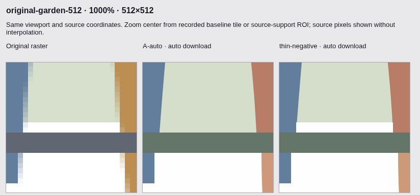
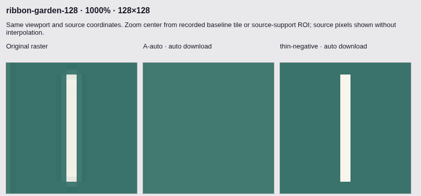
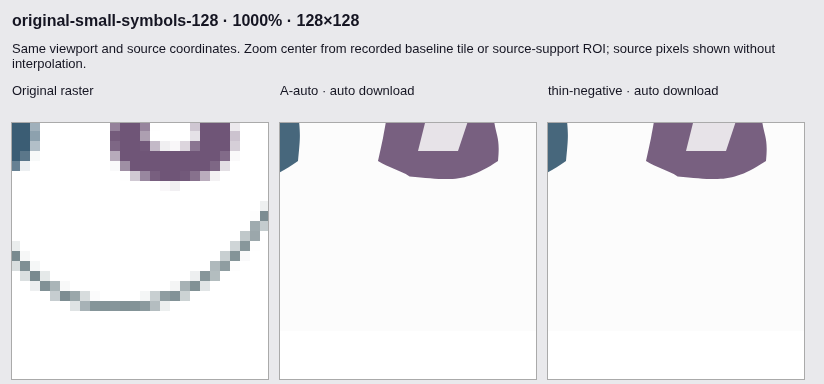
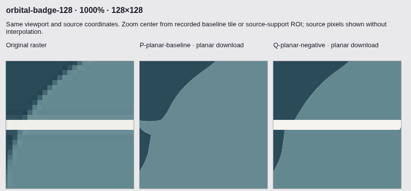

# Stage 1.7B — source-guided thin-region survival

**PARTIAL overall. Validated recovery of elongated enclosed negative spaces;
broad thin-line, typography and low-contrast recovery remains unfinished.**
Experimental only; no production promotion or merge. This stage adds bounded,
source-supported overrides to the existing region-survival predicate, plus an
input-to-export diagnostic. It does not replace VTracer, add post-trace shapes,
change Bézier fitting, or activate research in normal Auto. Results and complete
local/CI verdicts are recorded below; retained defects are not counted as repairs.

## 1. Revisions and reproducibility

- Exact verified base: `ca3871e14ca633aad09503e78681631348d71b75`.
- Frozen engine/predicate implementation: `7596e629e40281683f0ff338cb51afb98c06a630`.
- Lifecycle/regression tooling: `22c49c600e14fa0b8a68edfcaab96a31f769f674`.
- Aligned-view evidence tooling: `28df284`.
- Selected negative-only predicate and ambiguity guard: `8834add6bc660482b9efd0ea4c65de067e327fbf`.
- Read-only bounded-log correction: `4693eef` (classifier/paint rules unchanged).
- Complete diagnostic/reproduction tooling: `3f76e4e`.
- Work branch: `feat/stage-1-7b-thin-feature-preservation`.
- Normal application controls, preset palette budgets, source-fitting mathematics,
  shared-edge graph, reducer tolerances and historical gates are unchanged.

The first full model and [contract](STAGE_01_7B_THIN_FEATURE_CONTRACT.md) were committed
before inspecting its validation outcomes. The selected subset was frozen before
the additional orbital-badge outcomes; prior validation reuse is disclosed below. The baseline
is an isolated build of the exact A commit. Research builds explicitly configure
mode 0/1/2/3 through isolated bindings. Compiling the Cargo feature alone does not
enable protection. Source snapshots, Cargo locks, glue and WASM SHA256, decoded RGBA
hashes, actual downloaded SVG hashes, browser versions and every timing observation
are retained in each artifact namespace. Different worktree paths can change WASM
panic-location bytes; SVG identity is checked directly rather than inferred from
source names or binary labels.

| Frozen local binary           | Features / mode                       | WASM SHA256                                                        |
| ----------------------------- | ------------------------------------- | ------------------------------------------------------------------ |
| A Auto                        | none                                  | `13136c3770d8cd9a8b144c9da4a2d7206d4be42a905311d8284816eb9184cbb9` |
| Rejected full model           | `thin_feature_research`; mode 0/1/2/3 | `39d00b8b51e8fc13d72e292cc13b40c4ec84ddb4ac3da78a83d62949fbfeeffd` |
| Selected subset               | `thin_feature_research`; mode 4       | `e24610409015233f8bd301e3613a3d2b1f7ac173a889a7e3dead47888227d65e` |
| Read-only priority-log replay | same feature; explicit capture        | `5f180b03e22230d00e99cc474c81240f7a35edd644165692a372fdc27e2e9a0c` |

## 2. Actual segmentation architecture

Pinned VTracer is `1.0.0-alpha.4` (upstream
`e71343fbcbf469b8a72a255030408a39939162eb`), visioncortex is `0.9.3`,
and flo_curves is `0.8.0`. Upstream licenses/attribution are retained. No dependency
was added. The standalone vendor lock uses the same dependency versions as the
engine lock and makes the feature-specific upstream test command reproducible.

The path is source decoding → optional existing source preparation → selected
frontend → layer masks/residue colors → area-weighted median-cut/OKLab palette
snapping → consecutive equal-paint mask union → stacked or shared-boundary
composition/fitting → existing source/reducer/recovery passes → SVG/alpha writing.
Auto does not always select ColorCluster: the low-contrast garden selects
`reconstruct-blend`, preparation returns no trusted source model, and the engine
uses Watershed at detail 96 in cutout/mosaic mode.

In visioncortex `Runner::builder`, `same`, `deepen` and `hollow` are existing
extension points. Color precision compares shifted channels, each allowing a
one-step difference; it is not merely final palette quantization. Stage 1 creates
connected components, then stage 2 processes area-sorted patches and nearest-color
neighbors. The exact private `patch_good` predicate requires:

```text
min_area < area < max_area
and (min_area == 0 or boundary_pixel_count < area)
and nearest_neighbor_color_difference > deepen_diff
```

The perimeter is a boundary-pixel count, not Euclidean perimeter. A long one-pixel
strip may have `perimeter == area` and be rejected despite substantial length.
With the inspected illustration settings, speckle side 2 gives strict minimum
area 4. Rejected patches merge residue and membership into a nearest-color parent;
deepened patches retain a layer under the original hollowing/hierarchy rules.
The B closure reproduces the legacy predicate exactly and only overrides a failed
decision with additional source evidence. Nearest targets and merge operations
remain upstream. Minimum area is never globally set to zero.

`AutoQuantize` can change paint identity even when masks survive. `MergeAdjacent`
only unions consecutive equal-paint layers; this union preserves their existing
visible appearance. Mosaic has another adjacency/color merge using running means.
These are different opportunities for loss and must not be conflated.

## 3. First-loss diagnosis

Observer-only diagnostic replay matches the actual A browser-download SVG hashes
on all five primary audited inputs, with identical browser-decoded RGBA hashes.
The final captures omit zero events on these cases, including 6,589 hierarchy
predicate calls for small-symbols 512. Capture overhead is excluded from claims
about ordinary runtime.

| Input             | Source → initial ownership → clustered → exported visible negative spaces | First observed loss                                                                   |
| ----------------- | ------------------------------------------------------------------------- | ------------------------------------------------------------------------------------- |
| Small symbols 128 | 28 → 28 → 0 → 0                                                           | Hierarchical survival/residue paint, not initial precision alone                      |
| Small symbols 512 | 28 → 28 → 24 → 24                                                         | Hierarchical survival                                                                 |
| Signage 128       | 7 → 7 → 6 → 6                                                             | Hierarchical survival; source preparation retains all 7                               |
| Anime 128         | 0 → 0 → 0 → 4                                                             | Multiple changes: clustering color loss, palette-created spaces, then contour fitting |
| Pale garden 512   | 12 → 0 at Watershed cut → 0 → 0                                           | Watershed partition, then further mosaic merging                                      |

Counts use the unchanged A metric: 4-connected foreground, 8-connected background,
components at least four pixels, background distance at most eight channel levels.
A count change is not proof of an SVG compound-path hole or semantic detail loss.

Per-source-component records contain support pixels, bounding box, approximate
width/length, label ownership and neighboring-owner fractions, local RGB error,
per-stage enclosed support, hierarchy cluster/parent IDs, areas, colors, perimeter,
minimum/difference thresholds, keep/absorb result and merge target. Classification
is diagnostic: `LOST_DURING_CLUSTERING`, `MERGED_BY_COLOR_PRECISION`,
`MERGED_DURING_PALETTE_FITTING`, `PRESERVED_BUT_COLOR_DISTORTED`, `PRESERVED`,
or `UNDETERMINED`. Later geometry-only changes are separately observable in the
composed/pre-export SVG snapshots. This does not certify semantic identity.

For small-symbols 128, the ownership/paint diagnostic separates 12 components with
retained but color-distorted ownership from 16 likely absorbed components. Thus
“28 → 0” does **not** mean all 28 masks were destroyed. Some became gray enough to
fail the background metric. The bottom wave includes boundary-only patch fragments
absorbed toward the background. B does not safely recover that whole wave.

The pale garden has exactly 14 regions at the Watershed cut; snapping and minimum-
area absorption retain 14. It already has only 3 visible foreground components and
zero measured negative spaces. Mosaic flattens 13 visible owned regions and merges
them to four paints/regions at `merge_diff=19`, leaving 2 foreground components.
The source has 12 foreground components; the final foreground IoU remains about
0.627, with only 2 foreground components. The loss therefore precedes curve fitting,
with another destructive color merge at composition. B does not change this route or claim its recovery.

## 4. Source-evidence protection

[The frozen contract](STAGE_01_7B_THIN_FEATURE_CONTRACT.md) records every bound and
threshold. Protection uses only the current raster, cluster ownership and immediate
neighbors. Reference SVGs, fixture identifiers and other resolutions never enter
the predicate.

A coherent ridge requires stable source color, adequate extent, and opposed
neighbors with compatible colors and meaningful contrast at two of three local
radii. This rejects a one-sided antialias band. Confidence is deliberately
conservative; weakly sampled or clipped details retain the ordinary decision.

A negative-space candidate requires a consistent observed opaque corner
background, an incompatible parent color, and locally closed background support
under both tight and loose color tolerances. Eight-connectivity is used throughout.
Exactly one meaningful tight core must be supported by the candidate's own pixels;
multiple meaningful cores, window escape and insufficient evidence reject it.
Small AA threshold fragments may surround that one core. Its source background
paint must improve pixel L1 error by at least 25% versus absorption into the parent.
Only a newly preserved negative layer receives that existing background color,
before palette fitting. Successful legacy regions are not repainted.

This preserves a source-supported region inside the existing hierarchy. There is
no injected SVG path, extra stroke, universal white paint or background flattening.
Intrinsic partial transparency and legacy routes are excluded rather than confused
with geometric coverage. Shared-boundary composition and all source-geometry
contracts remain independent.

## 5. Corpus, legal rights and blindness

The first epoch joins the unchanged A corpus with six CC0 original rasters:
circuit-ribbon, stencil-kite and ribbon-garden at 128/512. The selected-model epoch
adds orbital-badge at 128/512, giving eight added CC0 rasters in total. Every size is independently rendered
from its legal outlined SVG at 4× then Lanczos3 downsampled. All eight rasters and
references regenerate byte-for-byte. Rights and per-file hashes are in
[the added manifest](../tests/fixtures/thin-feature/manifest.json) and
[README](../tests/fixtures/thin-feature/README.md). The original A manifest and
historical artifacts are unchanged; Twemoji retains CC-BY-4.0 and Kenney retains
its documented MIT provenance, not a new blanket CC0 claim.

The first epoch has 37 images / 20 independent design groups; the final corpus
has **39 images / 21 independent design groups**. Existing A symbols/garden
remain validation-only despite being named development targets in the task;
threshold development uses signage/portraits and circuit-ribbon. Stencil-kite and
ribbon-garden are new unseen validation families. Their candidate results were
not inspected before the implementation was committed. Baseline failure diagnosis
is distinguished from tuning on candidate/reference outcomes.

## 6. Rejected development methods

- Precision 8 alone: no recovery of the circuit's missing counter; anime 128
  MAE worsens from 5.721 to 6.104, paths 34 → 49 and anchors 429 → 782. Palette
  budget was unchanged. Not promoted.
- Removing just thread rejection: signage's seventh measured space returns,
  but circuit paths 7 → 46 and anime 128 paths 34 → 86. This overpreserves
  intermediate regions. Minimum area/deepen difference remained enabled.
- Early structural prototype: circuit MAE 5.547 → 3.350 but spaces stay 2;
  source diagnostics show a retained mean-gray counter can still fail visibility.
- Final negative model: uses local source closure and observed background paint;
  the circuit gains one measured space without retaining every threshold fragment.
- Existing successful gray regions are deliberately not universally repainted.
  This leaves some counter defects, preserving uncertainty rather than fabricating
  a perfect glyph.

Prototype namespaces, the initial serializer-only diagnostic mismatch, failed
exploratory Cargo invocations and an accidental duplicate circuit-only development
run are retained. The duplicate is not pooled for speedup claims or substituted
for a failed gate. Final full-corpus results use the frozen implementation.

## 7. Model selection and actual Auto exports

The full mode-3 model is **rejected**, despite lower whole-image MAE. Four of seven
clean-garden ridge patches get worse after fitting/palette: for example local RGBA
MAE 13.388 → 14.502. The enabled 45-case gate also rejects unreviewed contour/closure
changes on narrow-box4 sRGB/linear blades at 512px. These are not relabelled as
repairs. The protected nine outputs themselves remain identical in that experiment.

Mode 4 retains only the original enclosed-background certificate, plus extent
≥8px. It does not promote colored ridges. A compact 2×2 white patch could represent
either a real counter or a speckle; mode 4 keeps the baseline on that ambiguity.
The extended-gap and compact-ambiguity tests exercise this distinction. No old
area, palette, fitting, source-drift or topology tolerance was loosened.

The selected comparison has **117 image/configuration pairs and 249 actual browser
SVG downloads**: A Auto, unconfigured research mode 0, and explicit negative-only
mode 4. All first/warm/reset downloads are identical within each configuration.
Mode 0 matches A on all 39 images. Mode 4 matches A on 36; three change. Independent
Chromium and libvips RGBA MAE do not regress on any of the 39.

| Actual input               | libvips MAE A → mode 4  | Visible negative spaces A → mode 4 | Paths     | Anchors     | SVG bytes       |
| -------------------------- | ----------------------- | ---------------------------------- | --------- | ----------- | --------------- |
| Original garden 512, clean | 3.063187 → **3.054215** | 12 → **14** (source 17)            | 112 → 114 | 4052 → 4060 | 97,935 → 98,045 |
| Circuit-ribbon 128         | 5.547073 → **5.085495** | 2 → **3** (source 4)               | 7 → 8     | 69 → 73     | 1,623 → 1,678   |
| Ribbon-garden 128          | 2.192123 → **1.756607** | 2 → **3** (source 3)               | 12 → 12   | 80 → 84     | 1,800 → 1,825   |
| Small-symbols 128          | 6.592331 → 6.592331     | 0 → 0 (source 28)                  | 23 → 23   | 388 → 388   | 6,188 → 6,188   |
| Small-symbols 512          | 1.898056 → 1.898056     | 24 → 24 (source 28)                | 20 → 20   | 579 → 579   | 15,632 → 15,632 |
| Signage 128                | 2.367859 → 2.367859     | 6 → 6 (source 7)                   | 10 → 10   | 96 → 96     | 2,648 → 2,648   |
| Signage 512                | 1.182253 → 1.182253     | 7 → 7                              | 12 → 12   | 154 → 154   | 4,666 → 4,666   |
| Pale garden 512            | 5.293861 → 5.293861     | 0 → 0 (source 12)                  | 4 → 4     | 745 → 745   | 20,033 → 20,033 |

Every repaired gap adds four **line** anchors; cubic counts stay unchanged
(garden 3229, circuit 42, ribbon 38). These are necessary new source-supported
contours, not redundant curve knots. The garden remains a complex 4,060-anchor
SVG; this stage does not solve its overall editability burden.

| Artwork category              | Images | Changed Auto outputs | Interpretation                                             |
| ----------------------------- | -----: | -------------------: | ---------------------------------------------------------- |
| Logo/icon                     |      6 |                    0 | Retained, not newly repaired                               |
| Cartoon                       |      8 |                    0 | Eye/hair defects remain; no damage or noise multiplication |
| Complex flat                  |      6 |                    1 | Two genuine garden gaps recovered                          |
| Typography                    |      4 |                    0 | Small counters/wave still unresolved                       |
| Challenging raster conditions |      7 |                    0 | Existing codec/alpha limitations retained                  |
| Added thin-feature families   |      8 |                    2 | Two elongated counters recovered; other cases unchanged    |

## 8. First-loss and final-paint proof on the repaired artwork

On clean garden, source and initial precision components retain 17 spaces.
Clustering retains 12. The decisive two patches have area 38, boundary-pixel count
38, nearest-parent difference 125 and minimum area 4. The original predicate
rejects them **because of thread rejection**, not because 38 is below four.
For example cluster `12788` merges toward `11768` at box `[141,476,19,2]`.
The mirrored second gap is `[333,476,19,2]`.

The original raster supports 37 tightly background-colored pixels in each patch.
Mode 4 changes only the survival decision, retaining source background paint inside
the same hierarchy. Its serialized geometry is two 19×2 rectangles. Source bounds,
final SVG fill ownership and independent rasterizations agree. The SVG contains
ordinary editable paths; visible white space is represented by existing stacked
overpainting semantics, not certified transparency or necessarily a compound hole.

| Final downloaded patch  | libvips RGBA MAE before → after | Padded context before → after |
| ----------------------- | ------------------------------- | ----------------------------- |
| Garden `[141,476,19,2]` | 31.815789 → **1.197368**        | 12.010870 → **3.579710**      |
| Garden `[333,476,19,2]` | 31.835526 → **1.197368**        | 11.990942 → **3.554348**      |
| Circuit `[101,21,2,18]` | 129.861111 → **6.138889**       | 38.340909 → **4.431818**      |
| Ribbon `[98,29,2,21]`   | 102.571429 → **4.678571**       | 31.623333 → **3.680000**      |

Chromium independently confirms improvement on every patch/context. Final fill
ownership is measured at pixel centers and full area/AA appearance is rasterized
separately. Both renderers pass the strict local nonregression checks. A global
mean is not used to conceal a damaged repaired region.



The legal-reference visible-boundary metric also improves:

| Case               | Mean px                 | p95 px                    | Sampled maximum px       |
| ------------------ | ----------------------- | ------------------------- | ------------------------ |
| Garden 512         | 0.468291 → **0.432663** | 1.034430 → **1.001710**   | 7.216972 → 7.216972      |
| Ribbon-garden 128  | 0.484168 → **0.169868** | 1.092908 → **0.833241**   | 14.000000 → **1.716470** |
| Circuit-ribbon 128 | 4.614139 → **4.356892** | 33.475922 → **32.256761** | 42.523261 → 42.523261    |

This is the unchanged A endpoint-inclusive visible point-cloud metric, ≤0.5px
arc-length sampling and 2× visibility masks. It is not a certified Hausdorff
bound, internal color-boundary error or universal corner recall. The circuit's
unrecovered wires still dominate its maximum. No reference SVG enters conversion.



## 9. Negative controls and remaining real-world defects

All four Auto noise/codec controls are **byte-identical**, including path/anchor
counts and source reconstruction:

| Control          | Paths A / mode 4 | Anchors A / mode 4 |
| ---------------- | ---------------: | -----------------: |
| Anime 512 WebP   |        692 / 692 |        5810 / 5810 |
| Anime 128 JPEG   |        254 / 254 |        2392 / 2392 |
| Fox 128 JPEG     |        220 / 220 |        2314 / 2314 |
| Garden 512 noise |        624 / 624 |        8791 / 8791 |

This prevents **additional** fragmentation on these cases; it does not repair
existing fragmentation. The unchanged legacy route executes zero source-protection
predicates in normal capture-free conversion. Eligibility still has a bounded
opaque-alpha scan, so zero predicate count is not a claim of zero CPU overhead.
Clean anime remains 32 paths / 965 anchors at 512 and 34 / 429 at 128. Hair highlights,
the small-symbol wave, the missing signage counter and pale garden remain defects.
Unicorn's displaced notch is also outside the delivered recovery scope.



## 10. Additional family and frontend generalization

The untouched post-selection orbital-badge family selects **Watershed** in Auto.
Mode 4 executes zero ColorCluster decisions and its Auto SVGs are unchanged at
128/512. This is **not** an Auto generalization success.

A bounded post-hoc experiment then uses the existing planar UI profile for both
binaries on eight added images plus four noise controls: 24 actual image/config
comparisons, independently rasterized. No classifier threshold, source image or
Auto routing changes. This isolates the compatible frontend; it is not an unbiased
new Auto benchmark or a reason to force images into shared-edge mode.

| Orbital 128, explicit planar           |                         Baseline |                              Mode 4 |
| -------------------------------------- | -------------------------------: | ----------------------------------: |
| libvips MAE                            |                         3.298014 |                        **3.011859** |
| Chromium MAE                           |                         3.303126 |                        **3.018719** |
| Visible negative spaces                |                                0 |                    **1** (source 2) |
| Reference boundary mean / p95 / max px | 3.373754 / 23.563730 / 32.293556 | **1.777000 / 0.750393 / 25.978219** |
| Anchors / bytes                        |                     432 / 13,294 |                    **396 / 13,257** |

The supported horizontal source gap `[30,47,27,2]` improves local RGBA MAE from
84.901688 to 6.190959; the rotated gap remains unrecovered. Region construction
reduces the damaged interface's knot burden while adding the missing region.
There are no measured within-path crossings in any of the 24 planar outputs.
The existing shared-edge compositor still fits an edge once and reuses its reverse.

**Auto itself has lower full-image MAE, 2.660146, than the planar candidate's
3.011859. Do not switch Auto globally on the strength of the P/Q improvement.**
The result demonstrates a mechanism on another family in a compatible frontend;
strict blind Auto generalization remains unproved.



Three compressed planar controls remain byte-identical. Noisy garden adds two
paths (457 → 459) and two supported spaces (11 → 13), with MAE 2.868569 → 2.848244.
The original diagnostic log could not attribute those late decisions: it filled
before the two certificates. Its strict completeness verdict is retained as
**FAIL / INCOMPLETE_DIAGNOSTICS**, not a quality pass.

The corrected logger reserves 128 slots for up to 64 certificates and matching
keep/parent records inside the unchanged 16,384-event total. A dedicated exhaustion
test passes. A fresh replay matches the actual SVG download hashes and attributes
both noisy-garden changes to the same two source-supported extended gaps, with
37/36 tight source pixels and observed background `[252,255,254]`. Both final local
RGB/context checks improve. Ordinary omitted events remain explicitly reported
(128,124); the complete hierarchy is not claimed to be logged. The correction
changes observation only. Capture-enabled and capture-free replays match all 39
previously downloaded selected SVGs.

## 11. Resource cost, Worker lifecycle and editability

Ordinary protection shares the original `ColorImage` with `Arc`. At scope exit it
releases that source reference and clears all paint lookup entries, including on
Rust errors. Diagnostic snapshots deliberately retain bounded **copies** until
reset/next trace; `sourceRetained=false` describes the original Arc, not deletion
of an opt-in snapshot. Normal production contains no thin-research exports.

Bounds remain 64 additional survival decisions, one million charged candidate
pixels, one million charged local-probe cells and 56×56 maximum flood windows.
These bound decisions/work, not a universal promise of 64 resulting SVG paths.
The largest observed Auto workload uses 2 protections, 19,685 charged patch pixels,
1,080 charged probe cells and 148 actual flood visits. The explicit noisy-planar
probe uses 476,160 charged patch pixels, still inside the existing research cap.
The source classifier uses iterative flood traversal, not unbounded recursion.

| Representative Auto trace, ms | A first / warm | Mode 4 first / warm |
| ----------------------------- | -------------- | ------------------- |
| Garden clean 512              | 426.3 / 312.6  | 508.3 / 459.8       |
| Circuit 128                   | 194.3 / 74.7   | 160.9 / 60.7        |
| Ribbon-garden 128             | 169.5 / 59.2   | 182.5 / 230.6       |
| Small symbols 512             | 570.6 / 459.9  | 587.5 / 468.3       |

These are retained single first/warm observations, **not repeatable speedup claims**
or exclusive classifier CPU measurements. Segmentation and downstream costs can
both change. Timing variability from Stages F–J is unresolved. The P/Q exploration
originally overlapped offline scoring and is excluded from latency claims. All
outliers remain in raw observations; no failed gate is replaced by a favorable run.

Maximum observed WASM linear-memory allocation is **52,887,552 bytes in both A and
mode 4**. The three repaired cases use the same allocated pages before/after
(garden 10,616,832; circuit/ribbon 1,835,008 bytes). This is linear-memory capacity /
worker high-water allocation, not live Rust heap, total browser RSS or physical
Android memory. First/warm/reset observations are retained separately.

The actual opt-in app lifecycle proof passes first/warm equality, real unscaled
30-second idle cleanup (observed wait ≈29.9s), cancellation after Worker dispatch,
replacement conversion, same downloaded SVG after cancellation and URL revocation.
It records 3 Workers created, 3 terminated and 6 revoked URLs; source references
and paint caches are clear after completed results. Default and combined-feature
browser tests also exercise cancellation, replacement, reset and alpha behavior.

All **39 selected SVGs import/export with Inkscape 1.4 CLI**; measured native-size
roundtrip RGBA MAE is zero. Paths remain closed and contain no embedded raster.
This verifies CLI compatibility and editable path structure, not manual GUI anchor
editing. **Manual Inkscape editing and Illustrator compatibility — UNVERIFIED.**

**PHYSICAL ANDROID — UNVERIFIED.** No device/ADB was available. Desktop Chromium
mobile emulation is not device evidence. The reproducible device check is to open
a normal/isolated opt-in build locally, convert the same licensed inputs twice,
reset, cancel a large trace, and record device/browser, cold/warm time, UI response
and memory/termination behavior. No Android performance claim follows from CI.

## 12. Protected geometry and regression outcomes

The feature-disabled current F/H proof retains **45/45 byte-identical SVGs and Auto
outputs** versus the pinned Stage F build. The selected feature-enabled combined
build also retains **45/45 exact SVGs**, including all nine protected cases:

| Endpoint-inclusive protected case | Maximum px, retained |
| --------------------------------- | -------------------: |
| Triangle 128                      |             0.409670 |
| Triangle 512                      |             0.985251 |
| Triangle 1024                     |             1.292558 |
| Wave 128                          |             0.502973 |
| Wave 512                          |             0.578088 |
| Wave 1024                         |             0.660000 |
| Cubic 128                         |             0.823200 |
| Cubic 512                         |             0.823200 |
| Cubic 1024                        |             0.766976 |

Byte identity preserves their corners, false-corner results, closed paths, winding,
source paint, node counts and existing topology. The 45-case set also contains
known poor retained baselines (nearly parallel/clipped cases); unchanged is **not**
a declaration that every held-out geometry is correct. The selected real-artwork
comparison detects no new within-path crossing suspects; pre-existing crossing
suspects remain and are not certified away. Renderer AA seams are not called
geometric cracks without coordinate/ownership evidence.

| Local verification                                           | Actual outcome                                                             |
| ------------------------------------------------------------ | -------------------------------------------------------------------------- |
| Default Rust                                                 | 69 passed                                                                  |
| `source_geometry`                                            | 69 passed                                                                  |
| `large_apex`                                                 | 72 passed                                                                  |
| `large_apex,inverse_hotpath`                                 | 76 passed                                                                  |
| Thin-only / combined thin + F/H                              | 69 / 76 passed                                                             |
| Vendor + thin research                                       | **42 passed**, including bounded-log exhaustion                            |
| TypeScript                                                   | 42 tests in 8 files passed                                                 |
| Lint / typecheck / production WASM / Vite                    | Passed                                                                     |
| Normal browser E2E                                           | 27 passed                                                                  |
| Actual selected combined-feature browser E2E                 | 27 passed                                                                  |
| Existing corner / source-alpha / curve offline evidence      | All three scripts exit 0 on normal and selected browser exports            |
| Source comparison                                            | 39 images / 117 pairs / 249 actual downloads; both renderers nonregressing |
| Latest read-only diagnostic replay                           | 39/39 selected download hashes match, with capture on and off              |
| F/H disabled 45 identity and unchanged +500/+250ms gates     | PASS                                                                       |
| Selected enabled 45 identity and unchanged +500/+250ms gates | PASS                                                                       |

The exact shell commands are implemented by
[`thin-feature-research.sh`](../scripts/thin-feature-research.sh), including every
requested Rust feature, JS, build, browser and historical command. Feature-specific
upstream tests use the vendor manifest/lock; a dependency cannot be selected with
the engine's feature name via `cargo -p vtracer`. Exploratory invalid invocations
were retained, not counted as passing tests.

### Blocking historical failure

The complete local `source-target-research.sh` invocation exits **1** at the
unchanged low-resolution historical runtime gate. Triangle 1024's baseline runs
are `[1049.1,466.9,461.7]` ms and candidate runs
`[1485.4,1486.4,746.0]` ms: difference of medians **+1018.5ms**, above +500ms.
The diagnostic median of individual paired differences is a different statistic;
it does not override the gate's verdict. Thin research is not compiled into that
historical comparison. This is retained as an unresolved historical runtime
failure, not called harmless noise or fixed by B.

The runner stops there, so later historical gates are not falsely marked executed
by that invocation. Separate F/H and selected-enabled proofs execute their own
45-case geometry/runtime contracts and pass. Prior Stage H–J and Stage A failures
remain immutable; a green CI run does not erase any local failure.

## 13. Artifacts, CI and reproducibility

Curated [SVG downloads and screenshots](evidence/stage17b/README.md) include:

- Source / A / selected candidate at 100%, 400%, 1000% on the same coordinates.
- Actual before/after garden, symbols, signage, pale-garden, circuit and ribbon SVGs.
- Unchanged failures as well as successful gaps.
- Separately labelled planar orbital comparison and rejected full-model leaf crop.
- Per-file SHA256 and CC0 artwork provenance; SVG geometry is not manually edited.

The raw namespaces under `benchmark-results/stage17b` are separate and immutable:

| Namespace                                                 | Meaning                                                                               |
| --------------------------------------------------------- | ------------------------------------------------------------------------------------- |
| `diagnosis-v1`, `diagnosis-v2`                            | Initial serializer diagnosis; corrected observer identity                             |
| `modules-dev-*`, `development-*`                          | Development prototypes, failures and accidental duplicate retained                    |
| `modules-frozen-v1`, `frozen-evaluation-v1`               | Rejected full model; 37 images / 111 comparisons                                      |
| `diagnosis-frozen-*`, `garden-clean-diagnosis-*`          | First-loss, ownership and source-support evidence                                     |
| `modules-negative-v1`, `negative-evaluation-v1`           | Frozen selected predicate; 39 images / 117 comparisons                                |
| `negative-diagnosis-*`, `worker-negative-v1`              | Source certificates, final local RGB and actual Worker lifecycle                      |
| `frontend-isolation-v1`                                   | Fixed P/Q experiment, original incomplete attribution and fresh corrected replay      |
| `priority-diagnostic-module-v1`, `priority-all-replay-v1` | Same geometry with bounded-priority logging; 39 actual hashes verified                |
| `verification-v1`                                         | Required tests, historical FAIL, rejected-mode enabled FAIL, disabled F/H PASS        |
| `verification-negative-v1`, `verification-priority-v1`    | Selected and final diagnostic-correction tests / 45-case / browser / offline evidence |

The first frontend local-attribution measurement lacked an omission check. The
new integrity check exposes that incompleteness in a **fresh** directory with
nonzero exit code. The logger correction uses a different source/binary and fresh
replay; this is not retrying the same failed gate until it passes. Original records
and failed verdicts remain available.

GitHub Actions uploads complete raw data, logs, SVGs, source/configuration/binary
manifests and browser diagnostics with `if: always()`:

- [Initial full-model run 40509841677](https://github.com/akidwush/vector-magic-bydika/actions/runs/40509841677): research step failed; retained.
- [Selected implementation run 40514440999](https://github.com/akidwush/vector-magic-bydika/actions/runs/40514440999): SUCCESS.
- [Final predicate run 40516443065](https://github.com/akidwush/vector-magic-bydika/actions/runs/40516443065): **SUCCESS**, commit `2bceddb43773c4de6e5841c1e21ddaae5720bac6`, classifier `8834add`. Its uploaded artifact is `thin-feature-raw-2bceddb43773c4de6e5841c1e21ddaae5720bac6`.

- [Expanded priority-log / frontend-isolation run 40546814580](https://github.com/akidwush/vector-magic-bydika/actions/runs/40546814580): **IN PROGRESS when recorded**, commit `3f76e4e`; it is not relabelled as the older successful job. Local results above cover
  the final diagnostic correction. CI status is observational, not proof of Android
  performance or universal SVG quality.

From a clean checkout with the pinned tools, Chromium and Inkscape:

```sh
npm ci
npx playwright install chromium
bash scripts/thin-feature-research.sh
```

Use a fresh `NEXORA_THIN_STUDY` output, `NEXORA_CHROMIUM_PATH` for a system browser
and `NEXORA_TEST_PORT` when 4173 is occupied. The runner preserves each original
exit status, invokes old gates unchanged, and restores normal WASM/dist through
cleanup traps and final default builds. No threshold is lowered, no failure is
masked and no production feature is activated. Baseline builds use detached
worktrees; historical artifact checksums remain intact.

## 14. Files, limitations and promotion decision

Implementation changes are limited to feature forwarding, an opt-in survival
closure around the pinned Runner, source-scope/paint metadata, and readonly
pipeline/Watershed/mosaic snapshots. `engine/src/lib.rs` contains gated exports and
hooks; `vendor/vtracer/src/thin.rs` contains the bounded classifier/diagnostics/tests.
Vendor masks, parent merge operations, VTracer/visioncortex/flo_curves fitting and
existing source/reducer/planar mathematics remain in place. Benchmark helpers,
licensed fixtures, research orchestration/workflow and curated evidence complete
the change. No dependency, UI mode, hosting system or remote processor is added.

**Promotion decision: retain mode 4 as research-only; do not globally enable or
merge into main. Reject full mode 3 for promotion. Stage 1.7B remains PARTIAL.**

Delivered: a proven first destructive clustering decision, source-supported thin
negative-space recovery in actual artwork, lower independent local/global RGB
error, legal-reference geometric improvement, editable exports, bounded execution,
noise nonregression and preserved F/H geometry. Not delivered: the small-symbol
wave, all glyph counters, open narrow gaps, hair lines, pale-garden reconstruction,
or broadly verified Auto generalization.

Known limits include opaque uniform-corner-background assumptions, minimum 8px
extent, local window sides ≤48px, contrast ≥48, clipped-support rejection and no
compact-counter intent inference. Near-background intentional third colors remain
ambiguous under RGB tolerances. Existing successful regions are preserved; that
also leaves some mean-gray counter defects. Source similarity alone cannot certify
unknown original-vector geometry. There is no universal final-paint rollback for
every future input; the rejected ridge experiment demonstrates why the corpus
validation and experimental isolation remain necessary.

Recommended **Stage 1.7C priority**:

1. Source/topology-aware Watershed cut and adjacent-region merge decisions using
   relative local color evidence, with final-painted local acceptance/rollback.
   Pale garden and the independent orbital family establish this missing route;
   fixing ColorCluster alone cannot solve it.
2. Safe final-paint validation for colored thin-region survival before revisiting
   the rejected ridge model, small-symbol wave and hair details.
3. Codec-resistant palette/region construction for the still-fragmented JPEG/WebP
   cases; never preserve every noisy patch or blur the image globally.

The first target has a demonstrated destructive stage and can reuse the existing
hierarchy/ownership model. It outranks another Bézier or runtime rewrite. None of
these remaining failures is concealed by aggregate MAE or a passing synthetic suite.
